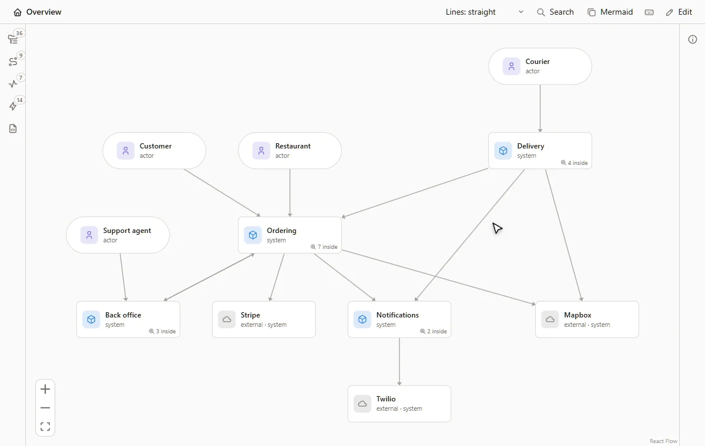
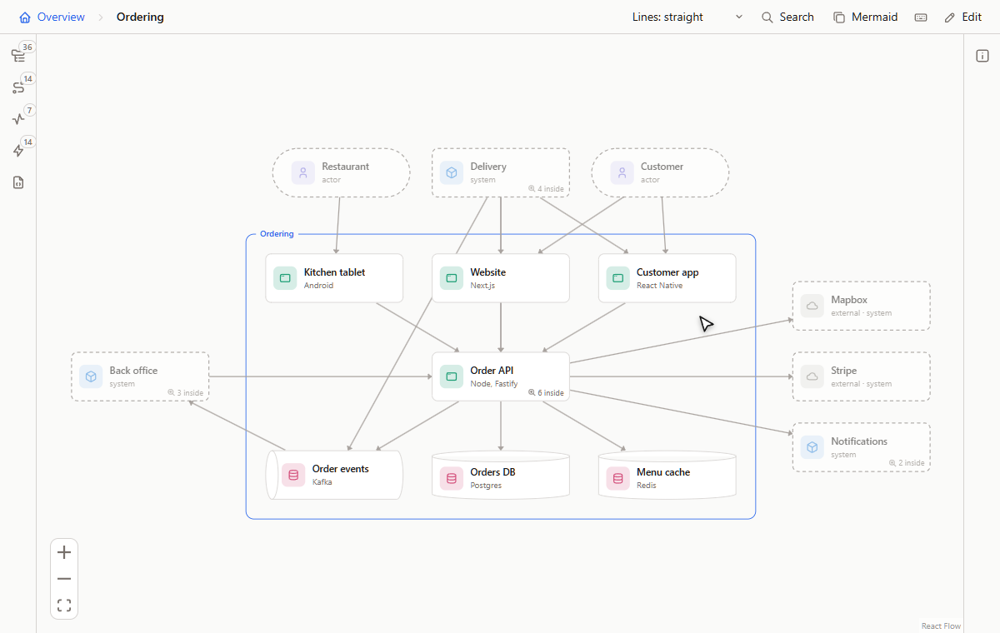
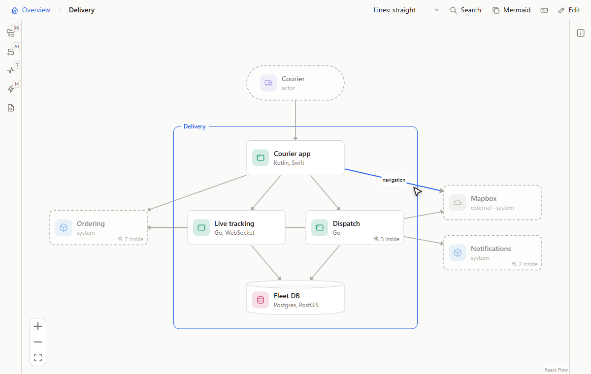
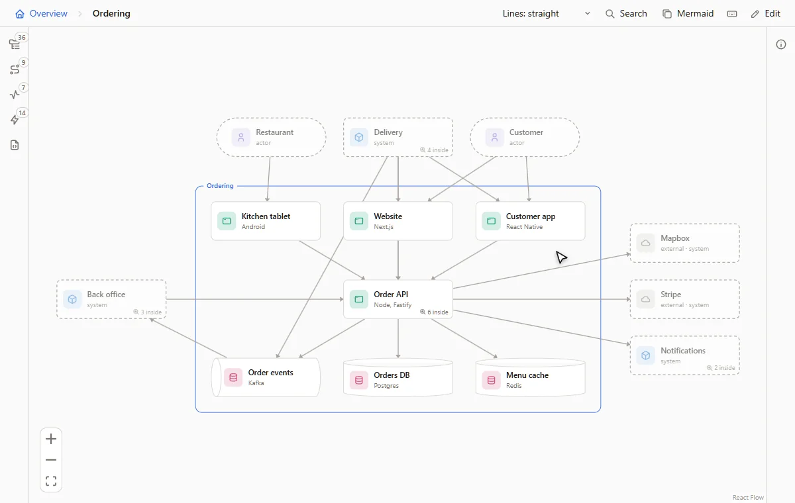
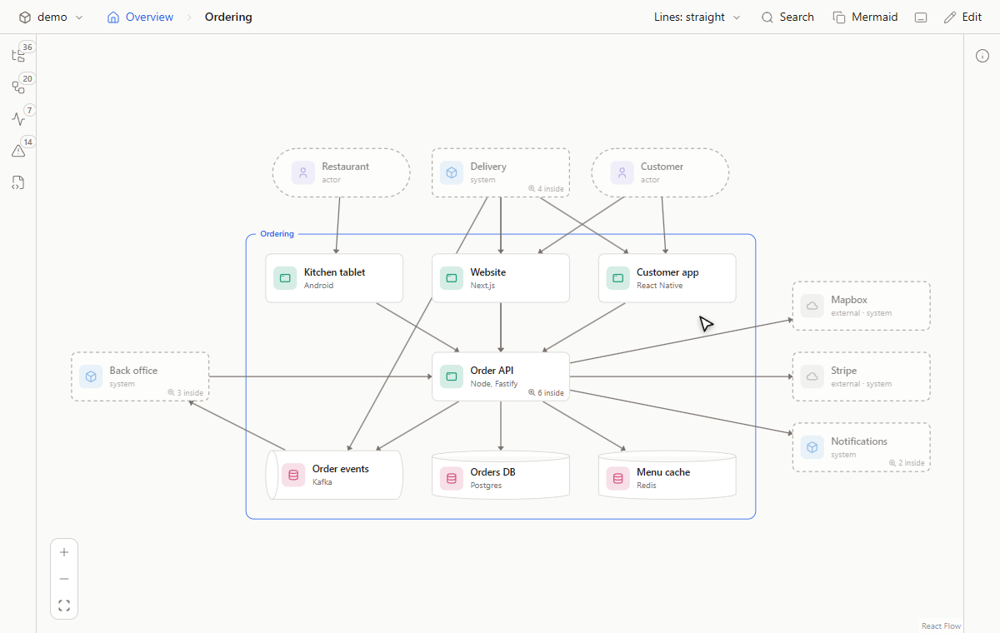
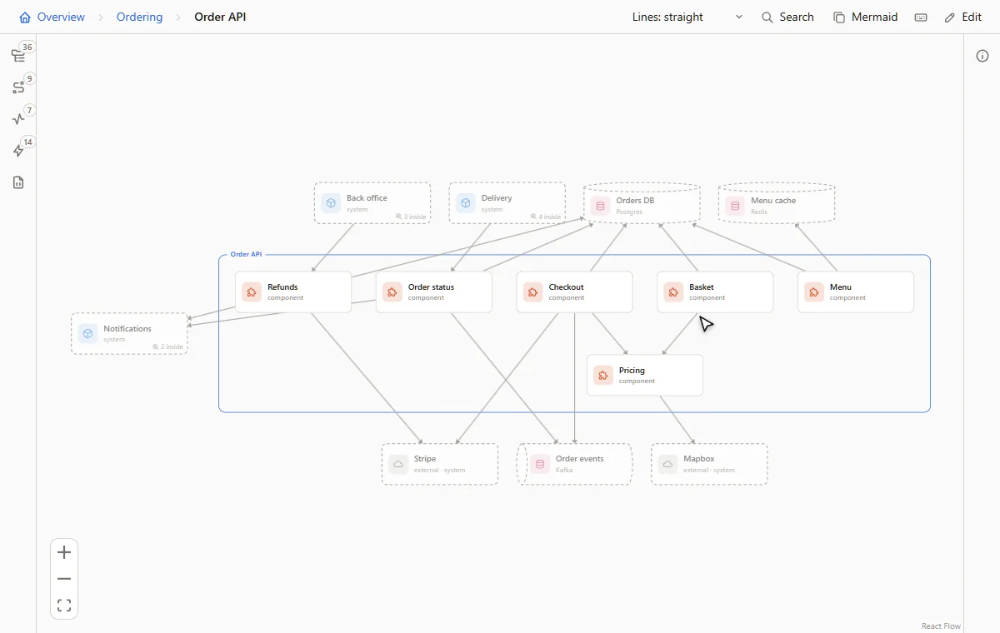

<h1 align="center">Flowy Docs</h1>

<p align="center">Architecture docs you zoom into, kept in your repo.</p>

<p align="center">
  <a href="LICENSE"></a>
  <a href="https://github.com/feluminais/flowy-docs/actions/workflows/ci.yml"></a>
</p>

<p align="center">
  <a href="docs/install.md"><strong>Install</strong></a>
  &nbsp; · &nbsp;
  <a href="docs/guide.md">Guide</a>
  &nbsp; · &nbsp;
  <a href="docs/format.md">File format</a>
  &nbsp; · &nbsp;
  <a href="https://github.com/feluminais/flowy-docs/issues">Issues</a>
</p>

<p align="center">
  <picture>
    <source media="(prefers-color-scheme: dark)" srcset="docs/images/anim/zoom-dark.webp">
    
  </picture>
</p>

Flowy Docs draws a system as shapes you zoom into: people, systems, apps, stores and components, the connections between
them, and step-by-step flows. Double-click a shape to open what is inside it. Esc or the breadcrumb takes you back up, and a
faded shape beside you slides across instead. The model is plain YAML in a `flowy/` folder, so it goes through git and review
like the code it describes. You read it in the desktop app, a browser or VS Code, and you or an AI agent write it.

The animations are the browser version on Plum, a made-up delivery service whose model is in [docs/demo/flowy](docs/demo/flowy).

## Flows

<p align="center">
  <picture>
    <source media="(prefers-color-scheme: dark)" srcset="docs/images/anim/flows-dark.webp">
    
  </picture>
</p>

Play a request one step at a time. A step can call, send or fail, and a group of steps can repeat, branch or run in parallel.
[More](docs/guide/flows.md)

## Performance

<p align="center">
  <picture>
    <source media="(prefers-color-scheme: dark)" srcset="docs/images/anim/performance-dark.webp">
    
  </picture>
</p>

Put a load test's results in `flowy/perf/` and replay them on the diagram. Dots run along the lines, outlines go from green to
red as a shape fills up, and the panel says where the system first struggles. [More](docs/guide/performance.md)

## Failure modes

<p align="center">
  <picture>
    <source media="(prefers-color-scheme: dark)" srcset="docs/images/anim/failures-dark.webp">
    
  </picture>
</p>

Rate how each part can fail on severity, likelihood and how hard it is to spot. The canvas badges the worst parts, outlines
what a mode touches and plays the flow that tells it. [More](docs/guide/failures.md)

## Data

<p align="center">
  <picture>
    <source media="(prefers-color-scheme: dark)" srcset="docs/images/anim/data-dark.webp">
    
  </picture>
</p>

A store shows what it holds: tables as tables, with sample rows, a short note where a choice needs explaining, and how long
the data is kept. The rows are made up, and Flowy never connects to a database. [More](docs/guide/data.md)

## Edit

<p align="center">
  <picture>
    <source media="(prefers-color-scheme: dark)" srcset="docs/images/anim/edit-dark.webp">
    
  </picture>
</p>

Press **E** to draw lines, add shapes and restyle them from drawn pickers. Every save is checked, written as plain YAML and can
be undone, so git sees the same change whether you made it by hand or in the app. [More](docs/guide/canvas.md#edit-it)

## AI agents

<p align="center">
  <picture>
    <source media="(prefers-color-scheme: dark)" srcset="docs/images/anim/agents-dark.webp">
    
  </picture>
</p>

An MCP server lets Claude or any other MCP client read the model and write it: shapes, lines, flows and failure analyses. Each
call is checked, so a change that would break the model is refused, and an open canvas redraws as the files change. From the
root of the repo you want to document:

```bash
claude mcp add flowy -- node /path/to/flowy-docs/dist/cli.js mcp
```

Another MCP client runs `node /path/to/flowy-docs/dist/cli.js mcp` over stdio. Then ask the agent to "map this repo into Flowy". [More](docs/guide/ai.md)

## Also

- **Source links.** A shape lists the files it lives in, and a path that no longer exists is reported. [More](docs/guide/canvas.md#read-it)
- **Share.** Export a read-only site, or copy a view as a Mermaid diagram for a README or a pull request. [More](docs/guide/share.md)
- **Search and history.** Ctrl+K finds a shape anywhere, and the YAML tab keeps every change to the files. [More](docs/guide/canvas.md#yaml-and-history)

## Install

The desktop app is the way to read a model. Download the installer from [Releases](https://github.com/feluminais/flowy-docs/releases),
start it, and open a repo with **File › Open Folder**. **Help › Open the Demo** shows Plum.

The browser version needs Node 22.18 or later and runs from a clone:

```bash
git clone https://github.com/feluminais/flowy-docs
cd flowy-docs
npm install
npm run build
```

Then, from the root of the repo you want to read:

```bash
node /path/to/flowy-docs/dist/cli.js
```

To look at Plum first, run `node dist/cli.js --dir docs/demo/flowy` in the clone. The VS Code extension, the other commands
(`check`, `export`, `mermaid`, `failures`) and updating are in [Install](docs/install.md).

> [!NOTE]
> Windows is where the desktop app has been built and tried. The macOS and Linux packages haven't been run, and none of them is signed yet.

## What a model looks like

This is Checkout from the demo, a component of Order API with a line to Stripe. You can write the files by hand too.

```yaml
objects:
  checkout:
    type: component
    in: order-api
    name: Checkout
    code: [services/order-api/src/checkout.ts]
    description: Prices the basket, authorises the card and places the order.
connections:
  - { from: checkout, to: stripe, label: holds the card }
```

## Documentation

| Page | Covers |
| --- | --- |
| [Guide](docs/guide.md) | Everything the canvas does, and how editing, agents and sharing work |
| [Writing good Flowy docs](docs/writing.md) | What to put in a model, shape by shape |
| [File format](docs/format.md) | Every key of the YAML files |
| [Install](docs/install.md) | The desktop app, the browser version, the VS Code extension |
| [Shortcuts](docs/shortcuts.md) | Every key |
| [Security](SECURITY.md) | What Flowy touches, and how to report a problem |

## Contributing

[CONTRIBUTING.md](CONTRIBUTING.md) has the build, the conventions and the checklist for changing the canvas or the app. This repo
documents itself: open its own `flowy/` folder in the app, or run `node src/cli.ts`. Bug reports and feature requests go to
[Issues](https://github.com/feluminais/flowy-docs/issues).

## License

[MIT](LICENSE). The shape icons are from [Tabler Icons](https://tabler.io/icons), also MIT; their notice ships with the
canvas and the app.

Plum is made up. Stripe, Twilio and Mapbox appear in it as examples of outside services, and have no tie to Flowy Docs.
