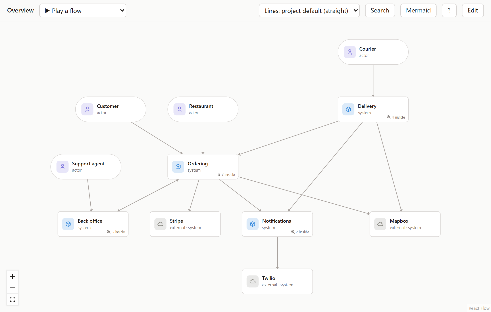
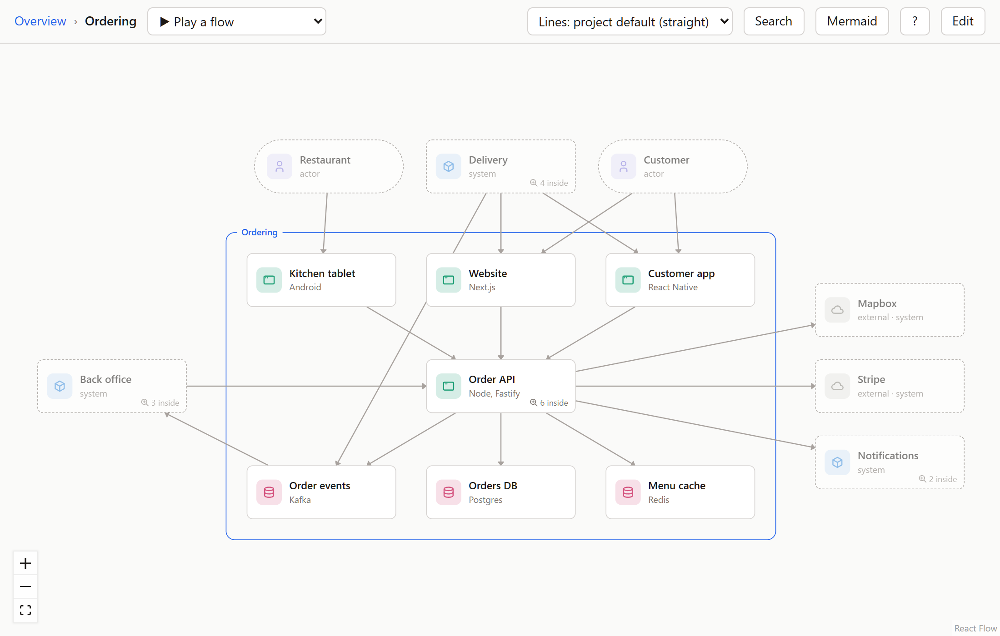
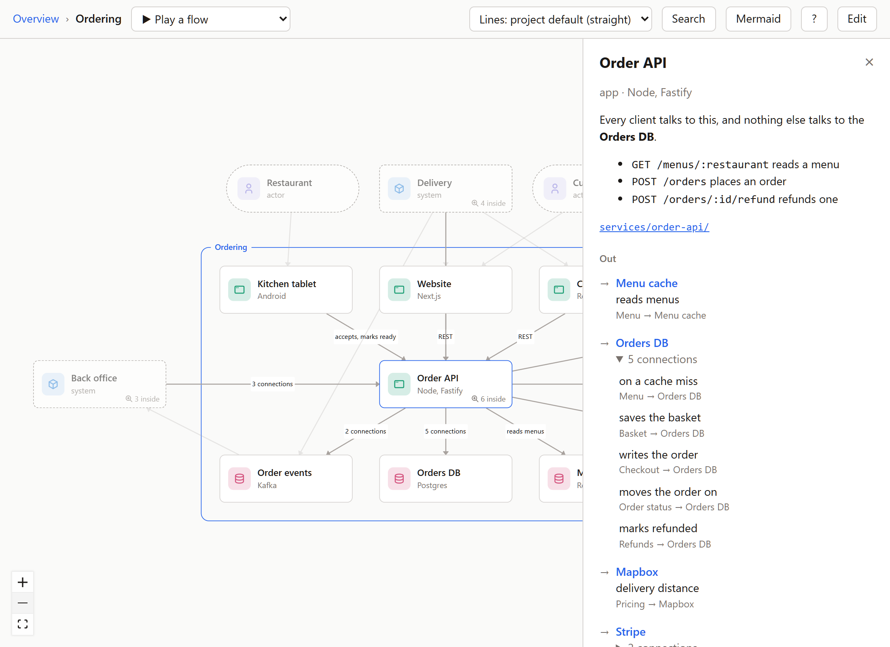
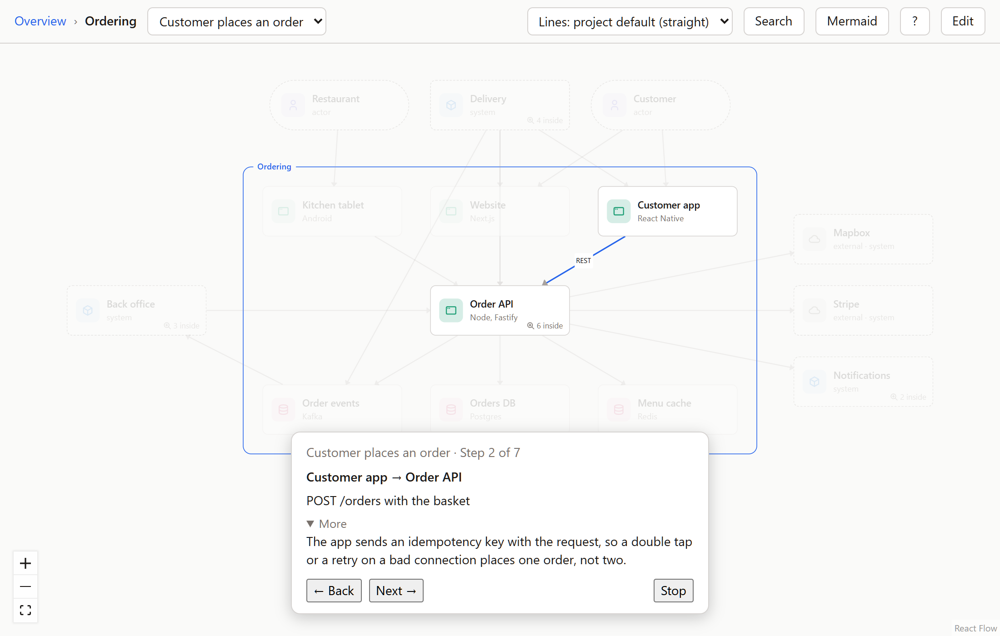
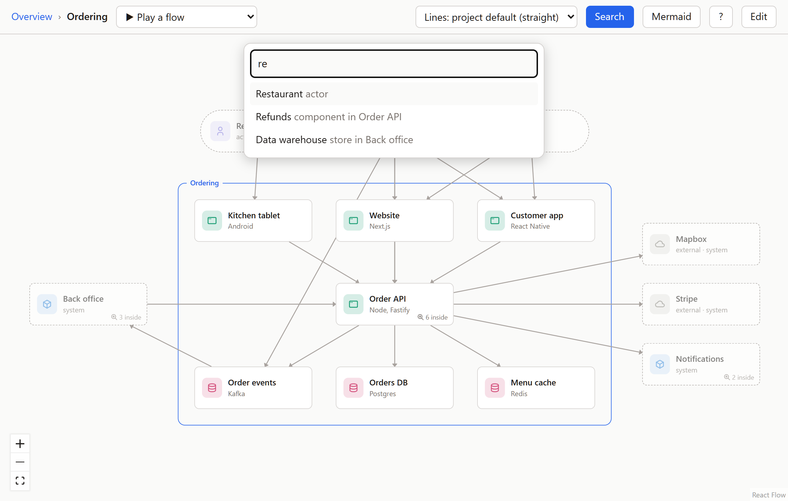
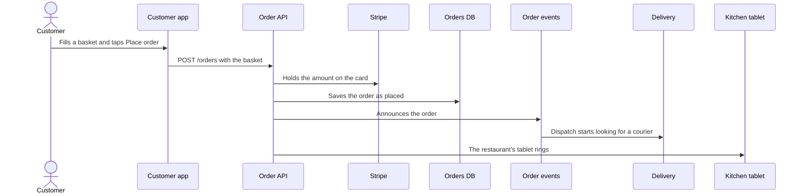

<h1 align="center">Flowy Docs</h1>

<p align="center">Architecture docs you zoom through instead of scrolling through.</p>
<p align="center">Node 22.18+ &nbsp; · &nbsp; Windows, macOS, Linux &nbsp; · &nbsp; MIT</p>
<p align="center">Your architecture lives as YAML in your repo. Draw it on the canvas, let Claude write it, or both.</p>

<p align="center">
  <a href="#install"><strong>Install</strong></a>
  &nbsp; · &nbsp;
  <a href="docs/guide.md">Guide</a>
  &nbsp; · &nbsp;
  <a href="https://github.com/feluminais/flowy-docs/issues">Report an issue</a>
  &nbsp; · &nbsp;
  <a href="CONTRIBUTING.md">Build &amp; contribute</a>
</p>



Readers start at the big picture and open only the box they care about. The model is plain YAML in a `flowy/` folder:
people, systems, apps, stores and components, the connections between them, and step-by-step flows. It sits in git next
to the code it describes.

The screenshots show Plum, a made-up delivery service. Its model is in [docs/demo/flowy](docs/demo/flowy).

## Zoom in



Boxes show their type as a coloured icon, and a box that holds others says how many ("7 inside"). Double-click it, or
select it and press Enter, to zoom in. A frame named after the box wraps what's inside, and the faded dashed boxes
around it are what something inside connects to. Esc, Backspace or the breadcrumb zoom back out.

| Type | What it is | Lives |
| --- | --- | --- |
| Actor | A person or role | At the top |
| System | Something you build or use | At the top, and holds apps and stores |
| App | A service, a mobile app, a website | Inside a system, and holds components |
| Store | A database, a cache, a queue | Inside a system, and holds components |
| Component | A part of an app or store | Inside an app or a store |

Outside services you don't own (a payment provider, an SMS gateway) are marked `external: true` and show grey with a cloud.

## Details on demand



Hover a box for its short description. Click it for the full text, the files it lives in, and every connection out and
in. A line that stands for several connections opens to list them, and pointing at a row lights its line on the canvas.
Lines show their labels when you point at one, or when you select a box.

A box can list the files and folders it lives in. When the repo's `origin` is on GitHub or GitLab they link there, and a
path that doesn't exist shows up as a problem, so the model can't quietly point at code that's gone.

## Flows



Pick a flow in the top bar to play it step by step. A step is one box handing something to another, or one box doing
something on its own, and a step with more to say has a **More**. The address follows what's on screen, so
`#ordering/place-order` plays Customer places an order; send it to someone and they land on the same step.

## Find anything



**Ctrl+K** or **/** finds a box anywhere in the model by name. Pick one and the canvas opens the level it's on, with its
panel open.

## Edit it


Press **E**, or the Edit button.

- Drag boxes to arrange a view. Positions go to `flowy/layout.yaml`.
- Drag from the dot under a box onto another box to connect them, then type a label.
- **Add** offers only the types that fit where you are: actors and systems at the top, apps and stores inside a system, components
  inside an app or store.
- Click a box to change its name, type, tech, description and code. A field saves when you leave it.
- **Tidy** forgets where boxes were dragged and lays the view out again with as few crossing lines as it finds.
- **New flow** records a walkthrough: click the box where a step starts and the box it goes to, type what happens, press
  Enter, repeat.

Every save goes through the same checks as Claude's edits: a change that would add a problem is refused, and nothing is
written. **Ctrl+Z** takes back your last change, **Ctrl+Y** puts it back. Git keeps the history.
[The guide](docs/guide.md#edit-it) has the rest.

## Let Claude build it

From the root of the repo you want to document:

```bash
claude mcp add flowy -- npx flowy-docs mcp
```

Then ask Claude something like "map this repo into Flowy". It writes `flowy/model.yaml` and `flowy/flows/*.yaml`, points
each box at the code it lives in, marks outside services, and refuses any change that would break the model. The page
updates by itself as the files change.

You can write the files by hand too. This is Checkout from the demo:

```yaml
objects:
  checkout:
    type: component
    in: order-api
    name: Checkout
    code: [services/order-api/src/checkout.ts]
    description: Prices the basket, authorises the card and places the order.
connections:
  - { from: checkout, to: stripe, label: holds the card }
```

Saving rewrites a file, so YAML comments aren't kept. Put notes in a box's `description` instead.

## Share it

People without the repo can read the model too:

```bash
npx flowy-docs export
```

It writes a read-only copy of the canvas to `./flowy-site`. Put the folder on any static host, such as GitHub Pages, and
send the link. Embed the link to show it in Notion or Confluence.

For a README or a pull request, the **Mermaid** button copies the view on screen, or the flow playing, as a Mermaid
diagram that GitHub and GitLab draw. This is Customer places an order, from `npx flowy-docs mermaid --flow place-order`:



## Shortcuts

| Shortcut | Action |
| --- | --- |
| Ctrl+K or / | Find a box |
| Enter | Open the selected box |
| Esc | Close what's open, then go up a level |
| Backspace | Go up a level |
| F | Fit the view |
| ← → | Previous and next step of the flow playing |
| Home, End | First and last step |
| E | Edit mode on and off |
| N | Add a box |
| Ctrl+Z, Ctrl+Y | Undo and redo |
| ? | List every shortcut |

## Install

From the root of the repo you want to document:

```bash
npx flowy-docs
```

It prints a local address (port 4321, or the next free one) and opens it in your browser. The model lives in `./flowy`,
which Flowy creates if it's missing. `--dir <folder>` uses another folder, `--port <number>` picks the port, and
`--no-open` skips the browser. Needs Node 22.18 or later.

<details>
<summary>Not on npm? Run it from a clone</summary>

`flowy.sh` (macOS, Linux, Git Bash) or `flowy.cmd` (Windows) does the same with the same flags. Run it from the repo
you want to document. The first run installs and builds, which takes a moment. After a `git pull`, delete `dist/` to
rebuild.

```bash
/path/to/flowy-docs/flowy.sh
```

</details>

<details>
<summary>Is it safe to run?</summary>

Flowy runs on your machine and touches only its model folder.

- It listens on 127.0.0.1, so other computers can't reach it. It refuses a request whose Host isn't `127.0.0.1` or
  `localhost` on its own port, and it saves only when a request carries a header that a web page open in another tab
  can't send. A website can't change your files through it.
- Saving, from the canvas or from Claude, writes `model.yaml`, `layout.yaml` and `flows/*.yaml` in the model folder and
  nothing else. `export` writes only to its output folder.
- It never opens your code. For `code:` paths it checks that they exist, and it runs `git` with fixed arguments to read
  the `origin` URL and the branch for the links.
- It makes no network requests of its own: no telemetry, no CDN, no fonts. The page talks only to its local server.
- Through `npx flowy-docs mcp`, Claude gets nine tools: three read the model and six change its objects, connections and
  flows. None runs a command or reads a file outside the model folder.

Treat a `flowy/` folder you didn't write like any other text from that repo. Descriptions are Markdown and can embed
images, which your browser then fetches from wherever they point, and Claude reads the descriptions back through MCP.

</details>

## Contributing

See [CONTRIBUTING.md](CONTRIBUTING.md) for the build, the conventions and the checklist to run through before changing
the canvas. This repo documents itself: `node src/cli.ts` opens its own `flowy/` folder. Bug reports and feature
requests go to [Issues](https://github.com/feluminais/flowy-docs/issues).

## License

[MIT](LICENSE). The box icons are from [Tabler Icons](https://tabler.io/icons), also MIT; their notice ships with the
canvas.

Plum is made up. Stripe, Twilio and Mapbox appear in it as examples of outside services, and have no tie to Flowy Docs.
