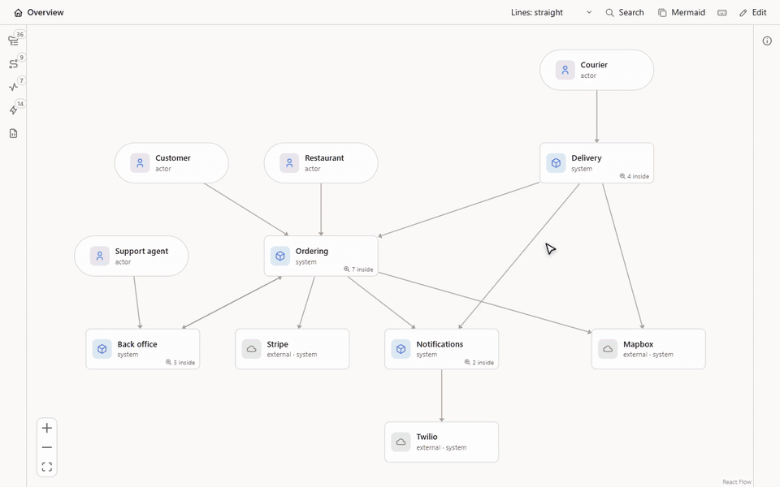

<h1 align="center">Flowy Docs</h1>

<p align="center">Architecture docs you zoom into, kept in your repo.</p>

<p align="center">
  <a href="LICENSE"></a>
  <a href="https://github.com/feluminais/flowy-docs/actions/workflows/ci.yml"></a>
</p>

<p align="center">
  <a href="docs/install.md"><strong>Install</strong></a>
  &nbsp; · &nbsp;
  <a href="docs/guide.md">Guide</a>
  &nbsp; · &nbsp;
  <a href="docs/format.md">File format</a>
  &nbsp; · &nbsp;
  <a href="https://github.com/feluminais/flowy-docs/issues">Issues</a>
</p>

<p align="center">
  <picture>
    <source media="(prefers-color-scheme: dark)" srcset="docs/images/zoom-dark.gif">
    
  </picture>
</p>

Flowy Docs draws a system as shapes you zoom into: people, systems, apps, stores and components, the connections between
them, and step-by-step flows. The model is plain YAML in a `flowy/` folder, so it goes through git and review like the code it
describes. You read it in the desktop app, a browser or VS Code. Claude can write it, or you can draw it on the canvas.

The animation is the browser version and the screenshots are the desktop app. Both show Plum, a made-up delivery service whose
model is in [docs/demo/flowy](docs/demo/flowy).

## Features

| | |
| --- | --- |
| [Zoom](docs/guide/canvas.md#read-it) | Double-click a shape to open what is inside it. Esc or the breadcrumb takes you back up |
| [Flows](docs/guide/canvas.md#read-it) | Play a request step by step, including failures, repeats, branches and parallel lanes |
| [Performance](docs/guide/performance.md#performance) | Replay a load test on the diagram and see where the system first struggles |
| [Failure modes](docs/guide/failures.md#failure-modes) | Rate how each part fails and read the ranked list on the canvas |
| [Data](docs/guide/data.md#data) | Show what a store holds: tables with sample rows, topics, key sets |
| [Source links](docs/guide/canvas.md#read-it) | A shape lists the files it lives in, and a path that no longer exists is reported |
| [Claude](docs/guide/claude.md#let-claude-build-it) | An MCP server lets Claude map a repo into the model, and it refuses a change that would break the model |
| [Edit](docs/guide/canvas.md#edit-it) | Drag, connect and record flows on the canvas. Every save goes through the same checks |
| [Share](docs/guide/share.md#share-it) | Export a read-only site, or copy a view as a Mermaid diagram for a README or a pull request |


## Install

The desktop app is the way to read a model. Download the installer from [Releases](https://github.com/feluminais/flowy-docs/releases),
start it, and open a repo with **File › Open Folder**. **Help › Open the Demo** shows Plum.

The browser version needs Node 22.18 or later and runs from a clone:

```bash
git clone https://github.com/feluminais/flowy-docs
cd flowy-docs
npm install
npm run build
```

Then, from the root of the repo you want to read:

```bash
node /path/to/flowy-docs/dist/cli.js
```

To look at Plum first, run `node dist/cli.js --dir docs/demo/flowy` in the clone. The VS Code extension, the other commands
(`check`, `export`, `mermaid`, `failures`) and updating are in [Install](docs/install.md).

> [!NOTE]
> Windows is where the desktop app has been built and tried. The macOS and Linux packages haven't been run, and none of them is signed yet.

## What a model looks like

This is Checkout from the demo, a component of Order API with a line to Stripe:

```yaml
objects:
  checkout:
    type: component
    in: order-api
    name: Checkout
    code: [services/order-api/src/checkout.ts]
    description: Prices the basket, authorises the card and places the order.
connections:
  - { from: checkout, to: stripe, label: holds the card }
```

Ask Claude to write the rest. From the root of the repo you want to document:

```bash
claude mcp add flowy -- node /path/to/flowy-docs/dist/cli.js mcp
```

Then say "map this repo into Flowy". [The guide](docs/guide/claude.md#let-claude-build-it) lists what it can change.

## Documentation

| Page | Covers |
| --- | --- |
| [Guide](docs/guide.md) | Everything the canvas does, and how editing, Claude and sharing work |
| [Writing good Flowy docs](docs/writing.md) | What to put in a model, shape by shape |
| [File format](docs/format.md) | Every key of the YAML files |
| [Install](docs/install.md) | The desktop app, the browser version, the VS Code extension |
| [Shortcuts](docs/shortcuts.md) | Every key |
| [Security](SECURITY.md) | What Flowy touches, and how to report a problem |

## Contributing

[CONTRIBUTING.md](CONTRIBUTING.md) has the build, the conventions and the checklist for changing the canvas or the app. This repo
documents itself: open its own `flowy/` folder in the app, or run `node src/cli.ts`. Bug reports and feature requests go to
[Issues](https://github.com/feluminais/flowy-docs/issues).

## License

[MIT](LICENSE). The shape icons are from [Tabler Icons](https://tabler.io/icons), also MIT; their notice ships with the
canvas and the app.

Plum is made up. Stripe, Twilio and Mapbox appear in it as examples of outside services, and have no tie to Flowy Docs.
