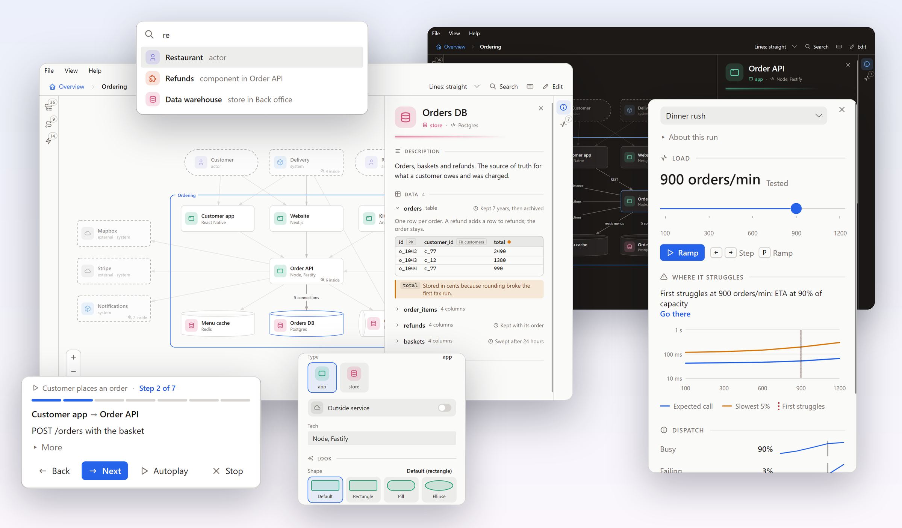
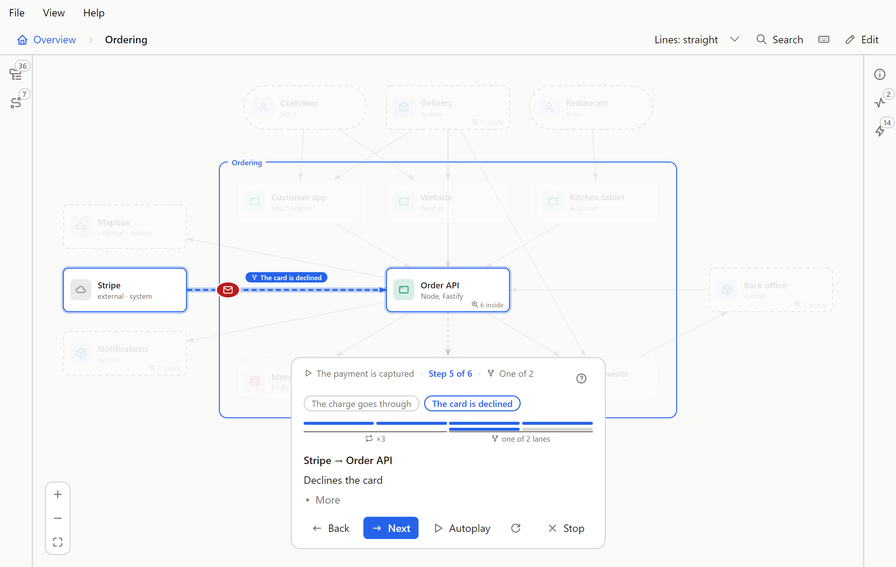
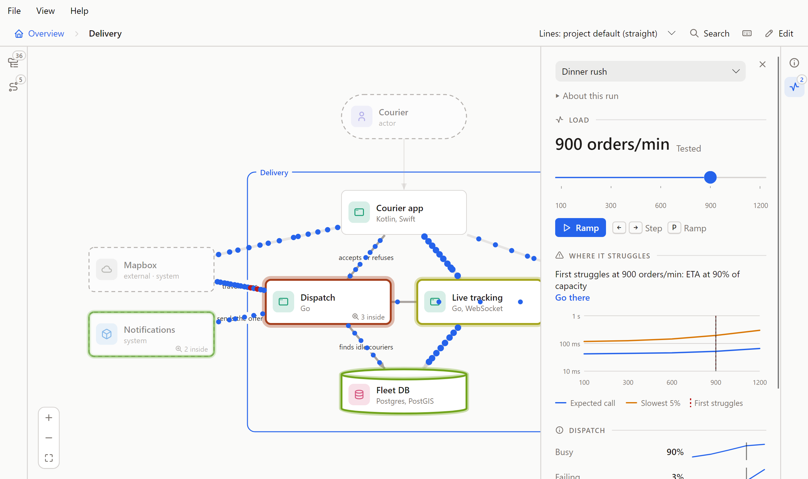
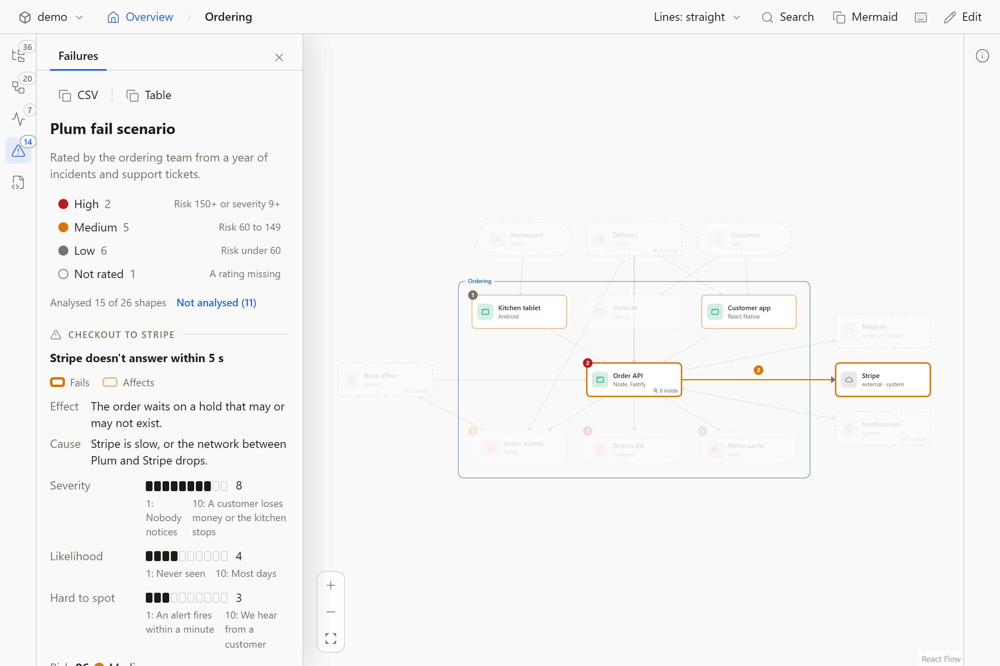
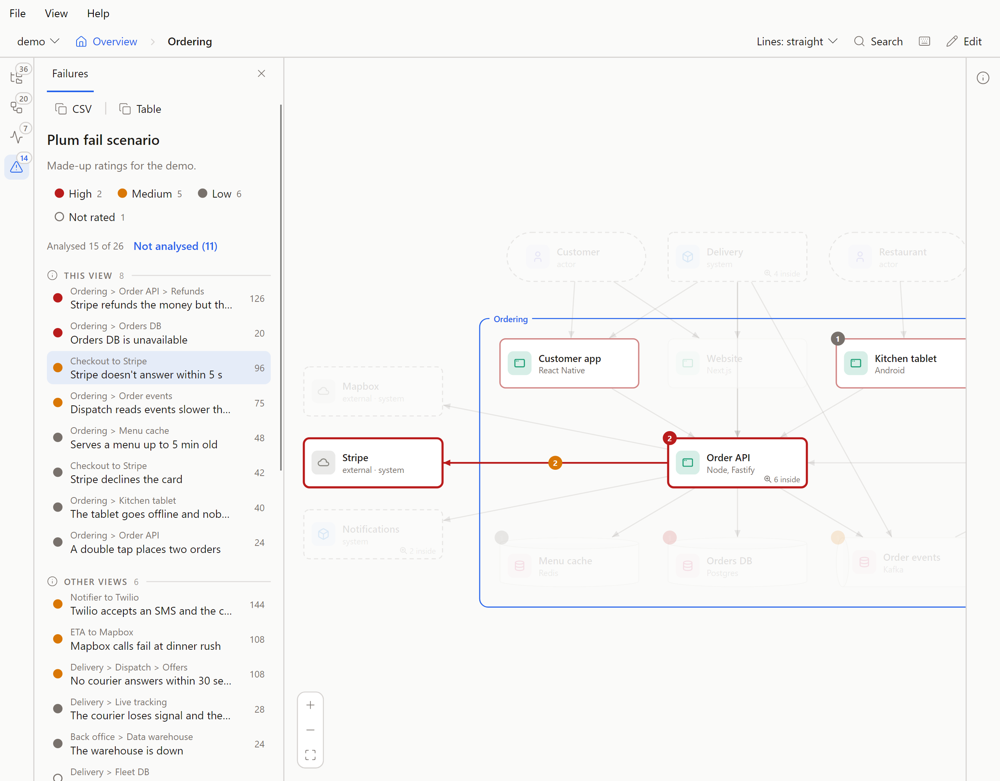
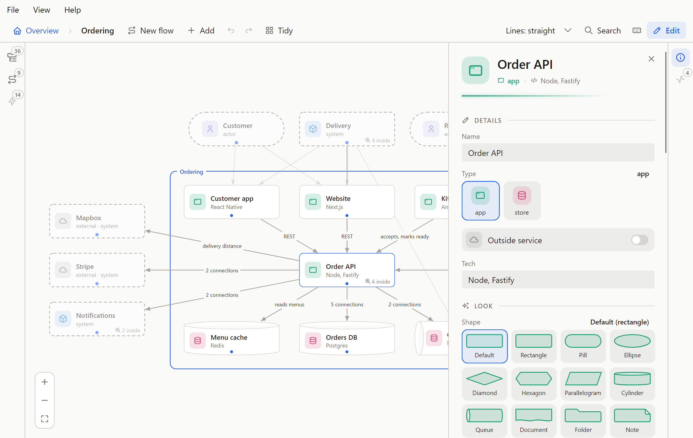
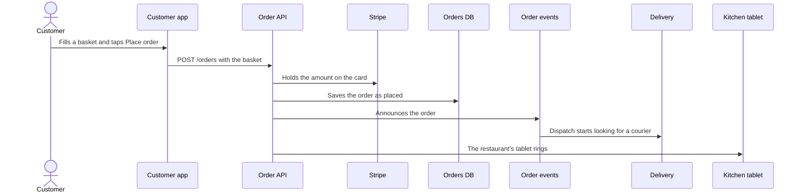
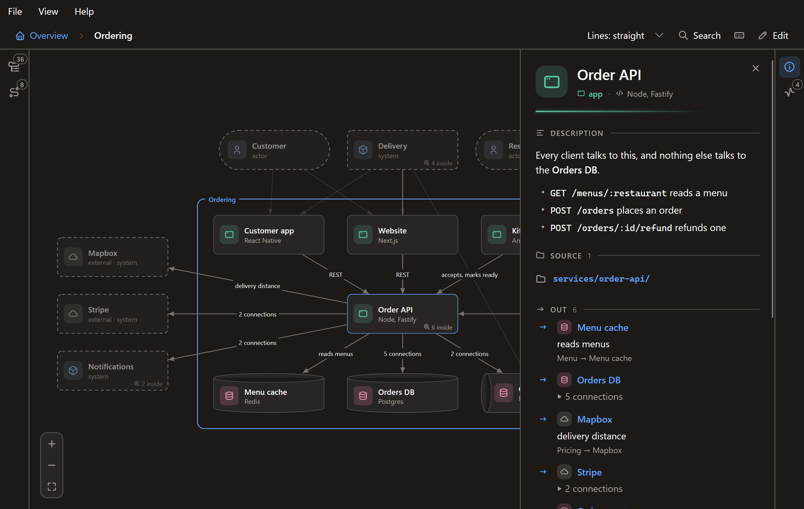

<h1 align="center">Flowy Docs</h1>

<p align="center">Architecture docs you zoom through instead of scrolling through.</p>
<p align="center">Desktop app for Windows &nbsp; · &nbsp; Browser version for Windows, macOS and Linux (Node 22.18+) &nbsp; · &nbsp; MIT</p>
<p align="center">Your architecture lives as YAML in your repo. Open it in the app, let Claude write it, or draw it on the canvas.</p>

<p align="center">
  <a href="#get-it"><strong>Get it</strong></a>
  &nbsp; · &nbsp;
  <a href="docs/guide.md">Guide</a>
  &nbsp; · &nbsp;
  <a href="https://github.com/feluminais/flowy-docs/issues">Report an issue</a>
  &nbsp; · &nbsp;
  <a href="CONTRIBUTING.md">Build &amp; contribute</a>
</p>



Readers start at the big picture and open only the shape they care about. The model is plain YAML in a `flowy/` folder:
people, systems, apps, stores and components, the connections between them, and step-by-step flows. It sits in git next
to the code it describes.

The screenshots show Plum, a made-up delivery service, in the desktop app. Its model is in [docs/demo/flowy](docs/demo/flowy).

What to write in it, shape by shape, is in [Writing good Flowy docs](docs/writing.md), and every key of the files is in [the file format](docs/format.md).

## Get it

**The desktop app** is the way to read a model. Download the installer for your system from
[Releases](https://github.com/feluminais/flowy-docs/releases), start it, and open a repo with **File › Open Folder**
(Ctrl+O). It finds the repo's `flowy/` folder, draws it, and redraws it whenever a file changes. No repo handy? **Help ›
Open the Demo** shows Plum.

**The browser version** does the same on any system that has Node, and it is where `export`, Claude's MCP server, the YAML tab and failure modes live.
It runs from a [clone of this repo](#the-browser-version), since there is no npm package yet. From the root of the repo you
want to read:

```bash
node /path/to/flowy-docs/dist/cli.js
```

**The VS Code extension** shows the same canvas in an editor tab, and reads and edits there too. It isn't on the Marketplace yet,
so you install it from a file you build yourself. From a [clone of this repo](#the-browser-version) (Node 22.18 or later):

```bash
npm install
npm install --prefix vscode
npm run package:vscode
```

That writes `vscode/flowy-docs-<version>.vsix`. In VS Code, open the Extensions view, choose **… › Install from VSIX…** and pick the
file, or run:

```bash
code --install-extension vscode/flowy-docs-<version>.vsix
```

Then open a repo that has a `flowy/` folder and run **Flowy: Open Docs** from the command palette (Ctrl+Shift+P). It needs VS Code
1.95 or later and a folder on disk that you trust. To update, pull, build the file again and install it again (add `--force` to the
command above if the version didn't change). More in [vscode/README.md](vscode/README.md), and how it is packaged in
[CONTRIBUTING.md](CONTRIBUTING.md).

Both read, and both edit. Press **E** to change a model by hand ([below](#edit-it)), or ask Claude
([below](#let-claude-build-it)). Whichever one has the folder open shows every save as it happens, so the app and a browser can
be open on the same model at once.

## Zoom in


Shapes show an icon in a colour, and a shape that holds others says how many ("7 inside"). Double-click it, or
select it and press Enter, to zoom in. A frame named after the shape wraps what's inside, and the faded dashed shapes
around it are what something inside connects to. Esc, Backspace, **Z** or the breadcrumb zoom back out. A faded shape that
opens sits beside you rather than inside, so opening it slides across instead.

| Type | What it is | Lives |
| --- | --- | --- |
| Actor | A person or role | At the top |
| System | Something you build or use | At the top, and holds apps and stores |
| App | A service, a mobile app, a website | Inside a system, and holds components |
| Store | A database, a cache, a queue | Inside a system, and holds components |
| Component | A part of an app or store | Inside an app or a store |

The type sets what a shape may sit inside. How it looks is separate: each type has a shape, a colour and an icon, and any shape can
choose its own from 13 shapes (a diamond for a decision, a queue, a document, a cloud), any colour with an opacity for its
background, and about 150 icons or ones you define. [The guide](docs/guide.md#shapes-colour-and-icons) says which shape fits what.

Outside services you don't own (a payment provider, an SMS gateway) are marked `external: true` and show grey with a cloud.

## Details on demand


Hover a shape for its short description. Click it for the full text, the files it lives in, and every connection out and
in. Inside a shape, click the blue frame round what is in it to see that shape the same way. A line that stands for several connections opens to list them, and pointing at a row lights its line on the canvas.
Lines show their labels when you point at one, or when you select a shape.

A shape can hold a few lines of code, such as a formula or a query, and its panel draws them in colour. Flowy works out the
language, and you can pick another. A shape can also list the files and folders it lives in. When the repo's `origin` is on GitHub or
GitLab they link there, and a path that doesn't exist shows up as a problem, so the model can't quietly point at code that's gone.

A shape can also link to its long documents, such as a runbook or a decision record, so Flowy stays the map and the
documents stay documents.


A store can show what it holds. Its panel draws a table as a table, with column headings, a few sample rows and a short note
where a choice needs explaining ("Cents, not decimals"), and a line for how long the data is kept. The first table is open and the
others are one line each. A key set, a topic and a document use the same frame. You write it under `data:` on the store, or in the
**Data** box of its form in edit mode, in the app and in the browser alike, and Claude can write it from a migration or a schema file.
The sample rows are made up: Flowy never connects to a database. [The guide](docs/guide.md#data) has the format.

## Flows


The icons on the left edge open the Explorer (**O**), the whole documentation as a tree, and the Flows tab (**L**), which lists
every flow so you can pick one and play it step by step. A step is one shape handing something to another, or one shape doing
something on its own, and a step with more to say has a **More**. In the browser the address follows what's on screen, so
`#ordering/place-order` plays Customer places an order; send it to someone and they land on the same step.

A step can also say how it travels. Give it `animation: call` and something runs
along its line and back while the sender waits; `send` and `event` go one way, and `callback` shows what set it off. A step that really ends another way says so with an `outcome`: `fail` runs red and flashes the receiver, `timeout` leaves the sender waiting with no reply and dims the line, and `lost`, `rejected`, `intercepted`, `duplicated` and `delayed` show a request that vanishes partway, is turned away at the door, is taken by a third party, arrives twice or waits on the way. `reason` says why in a few words, and `share: 30` limits the outcome to 30 percent of a burst of requests (the lost ones are named and coloured so you can follow them). [The guide](docs/guide.md#how-a-request-ends) has the rest. In the browser the
step plays again two and a half seconds after it ends until you move on (the Repeat button on the card turns that off), **R** plays it again from the start, and **Autoplay** (**P**) steps through the flow
on its own. Nothing moves when the system asks for less motion, and the step's text still says the same thing. The app plays each step once. When Claude writes your flows it asks how much to animate: None, Key steps or Every step.

Neighbouring steps can also belong together. A flow file can mark them as a `repeat` that runs up to a stated number of times,
a `branch` of lanes of which one happens, or `parallel` lanes that all happen at once, and a step can say that another flow
tells the rest of its story (`flow:`).



The player steps through what is on screen at once, so the lanes of a parallel group are one stop, lit and moving together.
A chip names the group, a branch shows its lanes as tabs while the other lanes are dashed on the canvas, the progress bar has a
bracket under each group, a label on the line says how often it repeats or which lane it is, and **Open flow** plays the other
flow with a bar to come back. A **?** on the card says what each of these means. Flowy checks all of it, and the Mermaid copy draws
it as `loop`, `alt` and `par` blocks. The format is in [the guide](docs/guide.md#repeats-branches-and-parallel-steps), and Plum has three:
[capture-payment](docs/demo/flowy/flows/capture-payment.yaml) retries a charge and branches on the outcome,
[announce-order](docs/demo/flowy/flows/announce-order.yaml) tells two readers at once and opens Delivery's flow, and
[no-courier-answers](docs/demo/flowy/flows/no-courier-answers.yaml) offers a job to one courier after another and branches when the list runs out.

A shape can also be Starting, Stopping, Stopped, Restarting or Degraded. A step's `states` change it, the change holds until a later step changes it again, and Flowy animates the move. Plum's [stripe-outage](docs/demo/flowy/flows/stripe-outage.yaml) uses all six, and [the guide](docs/guide.md#shape-states) has the format.

## Performance



Flowy can also play back how a system behaved under load. Put a load test's results in `flowy/perf/<name>.yaml` and open the Performance
tab among the icons on the left edge (or press **T**; the desktop app keeps it on the right). Without a run, the tab offers to **Create** a starter to fill in. The diagram then shows the load: dots run along the lines as often, and as
slowly, as the calls were, a line gets thicker with traffic, a shape's outline goes from green to red as it fills up, and a number
on it says how many are waiting. A run can also set the colour of its dots and a small formula for how many there are, so that ten times the calls
is ten times the dots ("1 dot = 50 calls/s" in the key) until the screen limit says it is scaled down. A system with several sources of requests, such as customers and couriers, gets a slider, a colour and a scale for each source, from runs added together or from one run tested with both at once, and the tab says which. Move the slider (← →) to another tested load, or press **Ramp** (**P**) to sweep up through them.
A run can also be measured over time (`axis: time`), with events on its timeline such as "Payments killed" at 40 s: the slider is in time, the events are marked on it, **Play** sweeps the run, and the
shapes stop, restart and recover as the events say.
The tab says where things first struggle ("First struggles at 200 req/s: Fulfilment worker at 100% of capacity"), plots latency
against load, and reads out the numbers of the shape or line you click.

It plays back what was measured and nothing more: between two tested loads it blends the two, past the highest there is nothing
to show, and a shape nobody measured stays plain. The file format is in [the guide](docs/guide.md#performance). To see it work, open the demo (Help › Open the Demo) and press **T**:
Plum has seven made-up runs: a dinner rush where Delivery gives way, the same test after a fix, customer orders alone, courier pings with a dot scale, the two added together, the two tested together, and Stripe going down and coming back over time. `perf-lab/` is a
small shop that really runs, with a load generator that writes these files (`npm run lab:run`, then
`node src/cli.ts --dir perf-lab/flowy` to look at it). The browser and the desktop app both show runs.

## Failure modes



Flowy can hold how a system breaks, too. A failure analysis lives in `flowy/failures/<name>.yaml`. For a shape, or a line between two,
it says how the part fails, what that causes, what exists to deal with it and what to do next, and rates it from 1 to 10 on
Severity, Likelihood and Hard to spot (10 means nobody would notice). The Failures tab is among the icons on the left edge, or press **M**. With no analysis yet, its **Create** button turns edit mode on, where the first one is made.

- The list runs from High to Low, then Not rated for a mode with no ratings. A severity of 9 or 10 is High whatever else is missing.
- **Analysed 15 of 26** counts the shapes that have a mode, and **Not analysed** lists the rest.
- A shape or a line with modes carries a badge in the colour of its worst one, and a shape that holds others adds up what is inside it.
- Pick a mode to outline its part in red and what it affects in a lighter outline. The rest fades.
- **Show it** plays the flow that tells the failure. **Seen in a run** opens the Performance tab at the load where that part first fails.
- **Copy as table** and **Copy as CSV** copy the ranked list. In edit mode the tab adds **New analysis** and **Add failure mode**.

A mode looks like this:

```yaml
name: Plum fail scenario
modes:
  stripe-timeout:
    from: checkout
    to: stripe
    mode: Stripe doesn't answer within five seconds
    effect: The order waits on a hold that may or may not exist.
    severity: 8
    occurrence: 4
    detection: 3
    controls: Three tries with backoff. The idempotency key stops a double hold.
    action: Page when more than 1% of holds time out for five minutes.
    status: planned
    affects: [customer-app, kitchen-tablet]
    flow: capture-payment
```

What a mode affects is written by hand. Flowy doesn't work it out from the lines, because a line's direction means different things.
Plum has an analysis with made-up ratings, [Plum fail scenario](docs/demo/flowy/failures/ordering.yaml). From a clone, run
`node dist/cli.js --dir docs/demo/flowy` and press **M**. Claude reads and writes analyses through the MCP server (`get_failures`,
`put_failure`), and `node /path/to/flowy-docs/dist/cli.js failures` prints the ranked table, or a CSV with `--format csv`. It exits with
an error when a file has a problem, so a CI job can use it. The format, the ranking and the names are in
[the guide](docs/guide.md#failure-modes).

A second analysis reads parts of the workflow engine [Conductor OSS](https://github.com/conductor-oss/conductor) from its code: seventeen modes, each with the files it came from. It is kept in the maintainer's clone of Conductor and is not published. [CONTRIBUTING](CONTRIBUTING.md#the-conductor-analysis) says how to build a clone like it. Flowy's own folder has an analysis too, [Flowy fail scenario](flowy/failures/flowy.yaml).



Failure modes show in the browser version, in the desktop app and in an exported page. The desktop app only reads them: writing an analysis is the browser's.

## Find anything


**Ctrl+K** or **/** finds a shape anywhere in the model by name. Pick one and the canvas opens the level it's on, with its
panel open.

## Let Claude build it

From the root of the repo you want to document, once the clone is [built](#the-browser-version):

```bash
claude mcp add flowy -- node /path/to/flowy-docs/dist/cli.js mcp
```

Any other MCP client takes that command (`node /path/to/flowy-docs/dist/cli.js mcp`) over stdio. Then ask Claude something like "map this repo into Flowy". It writes `flowy/model.yaml` and `flowy/flows/*.yaml`, points
each shape at the code it lives in, marks outside services, and refuses any change that would break the model. It can show what a store holds (its tables, key sets or topics, from a migration or a schema file) with invented sample rows. Ask how the system fails and it can write a failure analysis in `flowy/failures/` too. Keep the
model open in the app, and it updates by itself as Claude saves. Besides its tools the server offers prompts for the usual jobs (map a repo, update the
model after a change, write a flow, write a failure analysis, review the model) and the guides as resources; [the guide](docs/guide.md#let-claude-build-it) lists the tools.

You can write the files by hand too. This is Checkout from the demo:

```yaml
objects:
  checkout:
    type: component
    in: order-api
    name: Checkout
    code: [services/order-api/src/checkout.ts]
    description: Prices the basket, authorises the card and places the order.
connections:
  - { from: checkout, to: stripe, label: holds the card }
```

Saving rewrites a file, so YAML comments aren't kept. Put notes in a shape's `description` instead.

## Edit it



Press **E**, or the Edit button, in the app or in the browser. They edit the same files, through the same checks, and write them
the same way, so git sees no difference between a change made in one and a change made in the other.

- Drag shapes to arrange a view. Positions go to `flowy/layout.yaml`.
- Drag from the dot under a shape onto another shape to connect them, then type a label.
- **Add** offers only the types that fit where you are: actors and systems at the top, apps and stores inside a system, components
  inside an app or store.
- Click a shape to change its name, type, tech, look (shape, colour, opacity, icon), description, code and source, and a store's data. A field saves when you leave it.
- **Ctrl+click** adds a shape to the selection, **Shift+drag** draws a box round some and **Ctrl+A** takes them all. Drag any of them to move
  them together, or press **Delete** to remove them as one edit.
- **Tidy** forgets where shapes were dragged and lays the view out again with as few crossing lines as it finds.
- **New flow** records a walkthrough: click the shape where a step starts and the shape it goes to, type what happens, press
  Enter, repeat.

Every save goes through the same checks as Claude's edits: a change that would add a problem is refused, and nothing is
written. **Ctrl+Z** takes back your last change, **Ctrl+Y** puts it back. Git keeps the history, and in the browser the
[YAML tab](#yaml-and-history) keeps every step.
[The guide](docs/guide.md#edit-it) has the rest.

## YAML and history


The **YAML** tab on the left edge, or **Y**, shows the model's files as text, read only. It keeps every change to them as a step,
whoever made it. A step wears a badge: You for an edit in Flowy ("Changed Website's tech"), Claude for a write through the MCP server
("Claude: put_object menu-cache"), and Outside for a file changed some other way, in your editor or by a `git pull`.

Pick a step to see its files, with the lines it added in green and the lines it removed in red. **Compare with now** marks what going
back would change. **Restore** puts every file of that step back, once edit mode is on. A restore is a step of its own, so nothing is
lost, and Ctrl+Z takes it back.

The history is in your application data folder, not in the repo, so `git status` stays as it was and the history doesn't follow the folder
to another computer. The newest 300 steps are kept, and **Clear history** empties them. The YAML tab is in the browser version only: the
desktop app, the VS Code panel and an exported page don't have it.

## Share it

People without the repo can read the model too:

```bash
node /path/to/flowy-docs/dist/cli.js export
```

It writes a read-only copy of the canvas to `./flowy-site`. Put the folder on any static host, such as GitHub Pages, and
send the link. Embed the link to show it in Notion or Confluence. The export carries any load-test runs and failure analyses too.

For a README or a pull request, the app's **View › Copy as Mermaid** (the browser's **Mermaid** button) copies the view on
screen, or the flow playing, as a Mermaid diagram that GitHub and GitLab draw. **View › Save Picture** saves the diagram as a
PNG. This is Customer places an order, from the command `mermaid --flow place-order`:



## Shortcuts

| Shortcut | Action |
| --- | --- |
| Ctrl+K, / | Find a shape |
| O | The Explorer: everything as a tree |
| L | The Flows tab: every flow, and play one |
| Enter | Open the selected shape |
| Esc | Close what's open, then go up a level. The navigator closes only if your last click was in it |
| Backspace, Z | Zoom out: go up a level |
| F | Fit the view |
| ← → | Previous and next step of the flow playing, or previous and next tested level |
| Home, End | First and last step, or first and last tested level |
| P | Autoplay: step through the flow on its own, or pause. In Performance, ramp the load or play the time on its own |
| R | Replay the step's animation |
| T | The Performance tab, where a folder has load-test runs |
| M | The Failures tab, where a folder has failure analyses |
| Y | The YAML tab: the files as text, and every change to them (browser) |
| Ctrl+O, F5 | Open a folder, reload it (app) |
| E | Edit mode on and off |
| N | Add a shape |
| Delete | Delete the open shapes or line |
| Ctrl+click, Shift+drag, Ctrl+A | Select several shapes (editing): add one, draw a box round some, or take them all. Drag any of them to move them together |
| Ctrl+Z, Ctrl+Y | Undo and redo |
| Esc, Backspace | Right after dragging a shape (editing): take the drag back |
| ? | List every shortcut |

## The desktop app

It is a native app, not a browser in a window: it reads a repo's `flowy/` folder itself and draws it with its own renderer
(Avalonia, on .NET), so there is no server behind it. It shows what the canvas shows, from zooming through the levels to the
side panel, flows, search and problems, in light or dark, and it reloads when the files change. A file that breaks keeps the
last good model on screen, with the file and line in a banner, and stays read-only until it is fixed. It edits too: **E** turns on
the same forms, dragging, connecting and flow recording as the browser, with Undo and Redo.



- **File › Open Folder** (Ctrl+O), a folder dropped on the window, or **Open Recent**. Give it a repo and it opens the repo's
  `flowy/` folder. A folder with no model is refused with a message. Opening never creates a file; only an edit does, and only `model.yaml`,
  `layout.yaml` and `flows/*.yaml` in the model folder.
- One window per model, and the window opens at the size you left it. Opening a model that's already open brings it forward, and
  `FlowyDocs.exe path\to\repo` from a terminal opens the folder in the app that's already running.
- On Windows, right-click a folder (under *Show more options* on Windows 11) and choose **Open with Flowy Docs**.
- A shape's links open on your computer: a web address in the browser, a folder in the file explorer, a document (Markdown,
  text, PDF, a common image) in its default app. A script or a program is shown in its folder and never run. **File › Open
  Files With** picks an app of your own for them, and that choice stays on your computer, not in the repo.
- **View › Copy as Mermaid** and **Save Picture…** for READMEs and pull requests. **File › Reload** (F5) reads the folder again,
  and **Show in Explorer** opens it.

Windows is where it has been built and tried. The macOS and Linux packages are built by the same workflow but haven't been run.
None of them is signed yet, so Windows shows SmartScreen the first time, and the macOS app needs right-click, then Open, and
doesn't update itself.

## The browser version

Clone the repo and build it once. It needs Node 22.18 or later:

```bash
git clone https://github.com/feluminais/flowy-docs
cd flowy-docs
npm install
npm run build
```

Then, from the root of the repo you want to document:

```bash
node /path/to/flowy-docs/dist/cli.js
```

It prints a local address (port 4321, or the next free one) and opens it in your browser. The model lives in `./flowy`,
which Flowy creates if it's missing. `--dir <folder>` uses another folder, `--port <number>` picks the port, and
`--no-open` skips the browser. It does everything the app does, plus the commands below, each of which takes `--dir`:

| Command | Does |
| --- | --- |
| `check` | Prints every problem in the folder, one line each, and exits 1 if there is any. The one to run in a build |
| `export` | Writes a read-only copy of the canvas to `./flowy-site` (`--out` picks the folder) |
| `mermaid --flow <id>` or `--view <id>` | Prints a flow as a sequence diagram or a view as a flowchart |
| `failures` | Prints the failure analyses as tables (`--format csv`, `--analysis <id>`) |
| `mcp` | Runs the MCP server for Claude |

`flowy.sh` (macOS, Linux, Git Bash) and `flowy.cmd` (Windows) in the clone run the same command with the same flags, and
build on the first run. After a `git pull`, run `npm install` and `npm run build` again.

<details>
<summary>Is it safe to run?</summary>

Flowy runs on your machine and touches only its model folder and its own folder under your application data.

- The browser version listens on 127.0.0.1, so other computers can't reach it. It refuses a request whose Host isn't
  `127.0.0.1` or `localhost` on its own port, and it saves only when a request carries a header that a web page open in
  another tab can't send. A website can't change your files through it.
- Saving, from the canvas or from Claude, writes `model.yaml`, `layout.yaml`, `flows/*.yaml` and `failures/*.yaml` in the model folder and
  nothing else; the load-test runs in `perf/` are only ever read. `export` writes only to its output folder. The desktop app writes only when you edit, and only `model.yaml`, `layout.yaml` and `flows/*.yaml`, each
  through a temporary file and only if the file is still as it was read, so it can't overwrite a change made elsewhere.
- The browser version's YAML history is in its own folder under your application data (`FLOWY_STATE_DIR` moves it), never in the
  repo. Opening a folder stores a copy of its YAML there, and each change adds another.
- It never opens your code. For `code:` paths it checks that they exist, and it runs `git` with fixed arguments to read
  the `origin` URL and the branch for the links.
- It makes no network requests of its own: no telemetry, no CDN, no fonts. The page talks only to its local server.
  The desktop app adds one: a few seconds after it starts, an installed copy asks GitHub's Releases whether a newer version
  exists, and **Help › Check for updates automatically** turns that off. It fetches no remote images from descriptions (they show
  as their description in brackets) and shows where a link goes when you point at it. A web link opens only if it is an `http`
  or `https` address. A repo path opens only if it is a real file or folder inside the repo: a folder in the explorer, a
  document in its default app, anything else shown in its folder and not run (an app you pick under **File › Open Files
  With** may open any file in the repo). It keeps its recent folders, window size, line-style pick and that app in
  `state.json` in its own folder under your application data.
- Through the `mcp` command, Claude gets seventeen tools: five read the model and twelve change its objects, icons,
  connections, flows and failure analyses. None runs a command or reads a file outside the model folder.

Treat a `flowy/` folder you didn't write like any other text from that repo. In the browser, descriptions are Markdown and
can embed images, which your browser then fetches from wherever they point, and Claude reads the descriptions back through MCP.

</details>

## Contributing

See [CONTRIBUTING.md](CONTRIBUTING.md) for the build, the conventions and the checklist to run through before changing
the canvas or the app. This repo documents itself: open its own `flowy/` folder in the app, or run `node src/cli.ts`. Bug
reports and feature requests go to [Issues](https://github.com/feluminais/flowy-docs/issues).

## License

[MIT](LICENSE). The shape icons are from [Tabler Icons](https://tabler.io/icons), also MIT; their notice ships with the
canvas and the app.

Plum is made up. Stripe, Twilio and Mapbox appear in it as examples of outside services, and have no tie to Flowy Docs.
