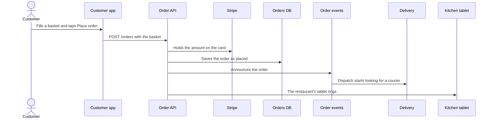

<h1 align="center">Flowy Docs</h1>

<p align="center">Architecture docs you zoom through instead of scrolling through.</p>
<p align="center">Desktop app for Windows &nbsp; · &nbsp; Browser version for Windows, macOS and Linux (Node 22.18+) &nbsp; · &nbsp; MIT</p>
<p align="center">Your architecture lives as YAML in your repo. Open it in the app, let Claude write it, or draw it on the canvas.</p>

<p align="center">
  <a href="#get-it"><strong>Get it</strong></a>
  &nbsp; · &nbsp;
  <a href="docs/guide.md">Guide</a>
  &nbsp; · &nbsp;
  <a href="https://github.com/feluminais/flowy-docs/issues">Report an issue</a>
  &nbsp; · &nbsp;
  <a href="CONTRIBUTING.md">Build &amp; contribute</a>
</p>


Readers start at the big picture and open only the shape they care about. The model is plain YAML in a `flowy/` folder:
people, systems, apps, stores and components, the connections between them, and step-by-step flows. It sits in git next
to the code it describes.

The screenshots show Plum, a made-up delivery service, in the desktop app. Its model is in [docs/demo/flowy](docs/demo/flowy).

What to write in it, shape by shape, is in [Writing good Flowy docs](docs/writing.md).

## Get it

**The desktop app** is the way to read a model. Download the installer for your system from
[Releases](https://github.com/feluminais/flowy-docs/releases), start it, and open a repo with **File › Open Folder**
(Ctrl+O). It finds the repo's `flowy/` folder, draws it, and redraws it whenever a file changes. No repo handy? **Help ›
Open the Demo** shows Plum.

**The browser version** does the same on any system that has Node, and it is where `export` and Claude's MCP server live.
From the root of the repo:

```bash
npx flowy-docs
```

Both read, and both edit. Press **E** to change a model by hand ([below](#edit-it)), or ask Claude
([below](#let-claude-build-it)). Whichever one has the folder open shows every save as it happens, so the app and a browser can
be open on the same model at once.

## Zoom in


Shapes show an icon in a colour, and a shape that holds others says how many ("7 inside"). Double-click it, or
select it and press Enter, to zoom in. A frame named after the shape wraps what's inside, and the faded dashed shapes
around it are what something inside connects to. Esc, Backspace, **Z** or the breadcrumb zoom back out. A faded shape that
opens sits beside you rather than inside, so opening it slides across instead.

| Type | What it is | Lives |
| --- | --- | --- |
| Actor | A person or role | At the top |
| System | Something you build or use | At the top, and holds apps and stores |
| App | A service, a mobile app, a website | Inside a system, and holds components |
| Store | A database, a cache, a queue | Inside a system, and holds components |
| Component | A part of an app or store | Inside an app or a store |

The type sets what a shape may sit inside. How it looks is separate: each type has a shape, a colour and an icon, and any shape can
choose its own from 13 shapes (a diamond for a decision, a queue, a document, a cloud), any colour with an opacity for its
background, and about 150 icons or ones you define. [The guide](docs/guide.md#shapes-colour-and-icons) says which shape fits what.

Outside services you don't own (a payment provider, an SMS gateway) are marked `external: true` and show grey with a cloud.

## Details on demand


Hover a shape for its short description. Click it for the full text, the files it lives in, and every connection out and
in. A line that stands for several connections opens to list them, and pointing at a row lights its line on the canvas.
Lines show their labels when you point at one, or when you select a shape.

A shape can list the files and folders it lives in. When the repo's `origin` is on GitHub or GitLab they link there, and a
path that doesn't exist shows up as a problem, so the model can't quietly point at code that's gone.

A shape can also link to its long documents, such as a runbook or a decision record, so Flowy stays the map and the
documents stay documents.

## Flows


Open the Flows tab (the icons on the left edge, or **L**) to see every flow and pick one to play it step by step; the Explorer (**O**) shows the whole documentation as a tree. A step is one shape handing something to another, or one shape doing
something on its own, and a step with more to say has a **More**. In the browser the address follows what's on screen, so
`#ordering/place-order` plays Customer places an order; send it to someone and they land on the same step.

A step can also say how it travels. Tag it `animation: call` and its line turns into a pipe with something running
through it and back while the sender waits; `send` and `event` go one way, and `callback` shows what set it off. **R** plays the
step again, and **Autoplay** (**P**) steps through the flow on its own. Nothing moves when the system asks for less motion, and
the step's text still says the same thing. The app and the browser play them alike.

## Performance


Flowy can also play back how a system behaved under load. Put a load test's results in `flowy/perf/<name>.yaml`, and a Performance
tab joins the icons on the right edge (or press **T**). The diagram then shows the load: dots run along the lines as often, and as
slowly, as the calls were, a line gets thicker with traffic, a shape's outline goes from green to red as it fills up, and a number
on it says how many are waiting. Move the slider (← →) to another tested load, or press **Ramp** (**P**) to sweep up through them.
The tab says where things first struggle ("First struggles at 200 req/s: Fulfilment worker at 100% of capacity"), plots latency
against load, and reads out the numbers of the shape or line you click.

It plays back what was measured and nothing more: between two tested loads it blends the two, past the highest there is nothing
to show, and a shape nobody measured stays plain. The file format is in [the guide](docs/guide.md#performance). To see it work, open the demo (Help › Open the Demo) and press **T**:
Plum has two made-up runs of a dinner rush, one where Delivery gives way and one after a fix. `perf-lab/` is a
small shop that really runs, with a load generator that writes these files (`npm run lab:run`, then
`node src/cli.ts --dir perf-lab/flowy` to look at it). The browser and the desktop app both show runs.

## Find anything


**Ctrl+K** or **/** finds a shape anywhere in the model by name. Pick one and the canvas opens the level it's on, with its
panel open.

## Let Claude build it

From the root of the repo you want to document:

```bash
claude mcp add flowy -- npx flowy-docs mcp
```

Then ask Claude something like "map this repo into Flowy". It writes `flowy/model.yaml` and `flowy/flows/*.yaml`, points
each shape at the code it lives in, marks outside services, and refuses any change that would break the model. Keep the
model open in the app, and it updates by itself as Claude saves.

You can write the files by hand too. This is Checkout from the demo:

```yaml
objects:
  checkout:
    type: component
    in: order-api
    name: Checkout
    code: [services/order-api/src/checkout.ts]
    description: Prices the basket, authorises the card and places the order.
connections:
  - { from: checkout, to: stripe, label: holds the card }
```

Saving rewrites a file, so YAML comments aren't kept. Put notes in a shape's `description` instead.

## Edit it


Press **E**, or the Edit button, in the app or in the browser. They edit the same files, through the same checks, and write them
the same way, so git sees no difference between a change made in one and a change made in the other.

- Drag shapes to arrange a view. Positions go to `flowy/layout.yaml`.
- Drag from the dot under a shape onto another shape to connect them, then type a label.
- **Add** offers only the types that fit where you are: actors and systems at the top, apps and stores inside a system, components
  inside an app or store.
- Click a shape to change its name, type, tech, look (shape, colour, opacity, icon), description and code. A field saves when you leave it.
- **Tidy** forgets where shapes were dragged and lays the view out again with as few crossing lines as it finds.
- **New flow** records a walkthrough: click the shape where a step starts and the shape it goes to, type what happens, press
  Enter, repeat.

Every save goes through the same checks as Claude's edits: a change that would add a problem is refused, and nothing is
written. **Ctrl+Z** takes back your last change, **Ctrl+Y** puts it back. Git keeps the history.
[The guide](docs/guide.md#edit-it) has the rest.

## Share it

People without the repo can read the model too:

```bash
npx flowy-docs export
```

It writes a read-only copy of the canvas to `./flowy-site`. Put the folder on any static host, such as GitHub Pages, and
send the link. Embed the link to show it in Notion or Confluence. The export carries any load-test runs too.

For a README or a pull request, the app's **View › Copy as Mermaid** (the browser's **Mermaid** button) copies the view on
screen, or the flow playing, as a Mermaid diagram that GitHub and GitLab draw. **View › Save Picture** saves the diagram as a
PNG. This is Customer places an order, from `npx flowy-docs mermaid --flow place-order`:



## Shortcuts

| Shortcut | Action |
| --- | --- |
| Ctrl+K, / | Find a shape |
| Enter | Open the selected shape |
| Esc | Close what's open, then go up a level |
| Backspace, Z | Zoom out: go up a level |
| F | Fit the view |
| ← → | Previous and next step of the flow playing, or previous and next tested load |
| Home, End | First and last step, or lowest and highest load |
| P | Autoplay: step through the flow on its own, or pause. In Performance, ramp the load up on its own |
| R | Replay the step's animation |
| T | The Performance tab, where a folder has load-test runs |
| Ctrl+O, F5 | Open a folder, reload it (app) |
| E | Edit mode on and off |
| N | Add a shape |
| Delete | Delete the open shape or line |
| Ctrl+Z, Ctrl+Y | Undo and redo |
| Esc, Backspace | Right after dragging a shape (editing): take the drag back |
| ? | List every shortcut |

## The desktop app

It is a native app, not a browser in a window: it reads a repo's `flowy/` folder itself and draws it with its own renderer
(Avalonia, on .NET), so there is no server behind it. It shows what the canvas shows, from zooming through the levels to the
side panel, flows, search and problems, in light or dark, and it reloads when the files change. A file that breaks keeps the
last good model on screen, with the file and line in a banner, and stays read-only until it is fixed. It edits too: **E** turns on
the same forms, dragging, connecting and flow recording as the browser, with Undo and Redo.

- **File › Open Folder** (Ctrl+O), a folder dropped on the window, or **Open Recent**. Give it a repo and it opens the repo's
  `flowy/` folder. A folder with no model is refused with a message. Opening never creates a file; only an edit does, and only `model.yaml`,
  `layout.yaml` and `flows/*.yaml` in the model folder.
- One window per model, and the window opens at the size you left it. Opening a model that's already open brings it forward, and
  `FlowyDocs.exe path\to\repo` from a terminal opens the folder in the app that's already running.
- On Windows, right-click a folder (under *Show more options* on Windows 11) and choose **Open with Flowy Docs**.
- A shape's links open on your computer: a web address in the browser, a folder in the file explorer, a document (Markdown,
  text, PDF, a common image) in its default app. A script or a program is shown in its folder and never run. **File › Open
  Files With** picks an app of your own for them, and that choice stays on your computer, not in the repo.
- **View › Copy as Mermaid** and **Save Picture…** for READMEs and pull requests. **File › Reload** (F5) reads the folder again,
  and **Show in Explorer** opens it.

Windows is where it has been built and tried. The macOS and Linux packages are built by the same workflow but haven't been run.
None of them is signed yet, so Windows shows SmartScreen the first time, and the macOS app needs right-click, then Open, and
doesn't update itself.

## The browser version

From the root of the repo you want to document:

```bash
npx flowy-docs
```

It prints a local address (port 4321, or the next free one) and opens it in your browser. The model lives in `./flowy`,
which Flowy creates if it's missing. `--dir <folder>` uses another folder, `--port <number>` picks the port, and
`--no-open` skips the browser. Needs Node 22.18 or later. It does everything the app does, plus `export`.

<details>
<summary>Not on npm? Run it from a clone</summary>

`flowy.sh` (macOS, Linux, Git Bash) or `flowy.cmd` (Windows) does the same with the same flags. Run it from the repo
you want to document. The first run installs and builds, which takes a moment. After a `git pull`, delete `dist/` to
rebuild.

```bash
/path/to/flowy-docs/flowy.sh
```

</details>

<details>
<summary>Is it safe to run?</summary>

Flowy runs on your machine and touches only its model folder.

- The browser version listens on 127.0.0.1, so other computers can't reach it. It refuses a request whose Host isn't
  `127.0.0.1` or `localhost` on its own port, and it saves only when a request carries a header that a web page open in
  another tab can't send. A website can't change your files through it.
- Saving, from the canvas or from Claude, writes `model.yaml`, `layout.yaml` and `flows/*.yaml` in the model folder and
  nothing else; the load-test runs in `perf/` are only ever read. `export` writes only to its output folder. The desktop app writes only when you edit, and only those same files, each
  through a temporary file and only if the file is still as it was read, so it can't overwrite a change made elsewhere.
- It never opens your code. For `code:` paths it checks that they exist, and it runs `git` with fixed arguments to read
  the `origin` URL and the branch for the links.
- It makes no network requests of its own: no telemetry, no CDN, no fonts. The page talks only to its local server.
  The desktop app adds one: a few seconds after it starts, an installed copy asks GitHub's Releases whether a newer version
  exists, and **Help › Check for updates automatically** turns that off. It fetches no remote images from descriptions (they show
  as their description in brackets) and shows where a link goes when you point at it. A web link opens only if it is an `http`
  or `https` address. A repo path opens only if it is a real file or folder inside the repo: a folder in the explorer, a
  document in its default app, anything else shown in its folder and not run (an app you pick under **File › Open Files
  With** may open any file in the repo). It keeps its recent folders, window size, line-style pick and that app in
  `state.json` in its own folder under your application data.
- Through `npx flowy-docs mcp`, Claude gets eleven tools: three read the model and eight change its objects, icons,
  connections and flows. None runs a command or reads a file outside the model folder.

Treat a `flowy/` folder you didn't write like any other text from that repo. In the browser, descriptions are Markdown and
can embed images, which your browser then fetches from wherever they point, and Claude reads the descriptions back through MCP.

</details>

## Contributing

See [CONTRIBUTING.md](CONTRIBUTING.md) for the build, the conventions and the checklist to run through before changing
the canvas or the app. This repo documents itself: open its own `flowy/` folder in the app, or run `node src/cli.ts`. Bug
reports and feature requests go to [Issues](https://github.com/feluminais/flowy-docs/issues).

## License

[MIT](LICENSE). The shape icons are from [Tabler Icons](https://tabler.io/icons), also MIT; their notice ships with the
canvas and the app.

Plum is made up. Stripe, Twilio and Mapbox appear in it as examples of outside services, and have no tie to Flowy Docs.
