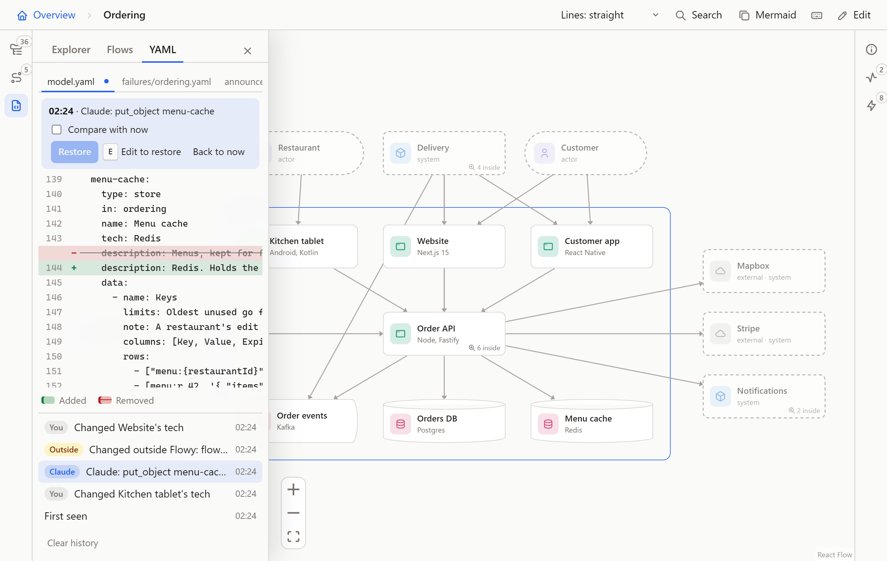
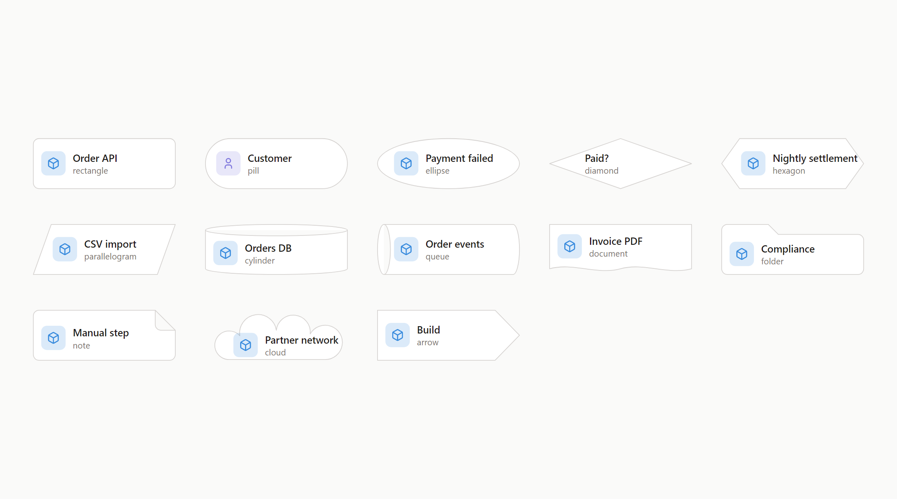
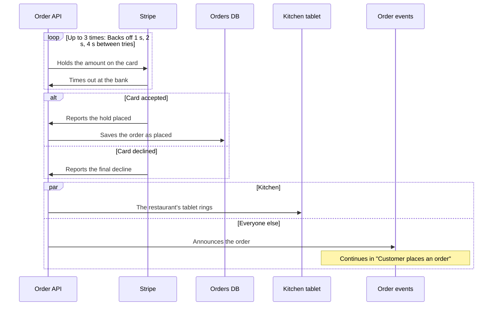
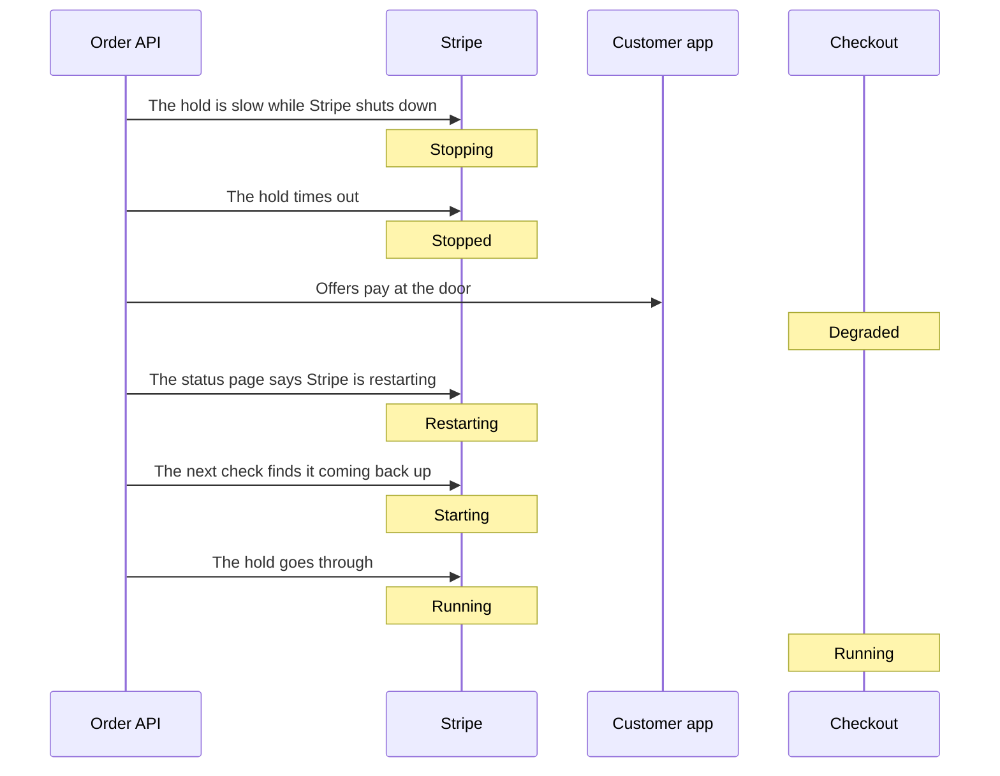
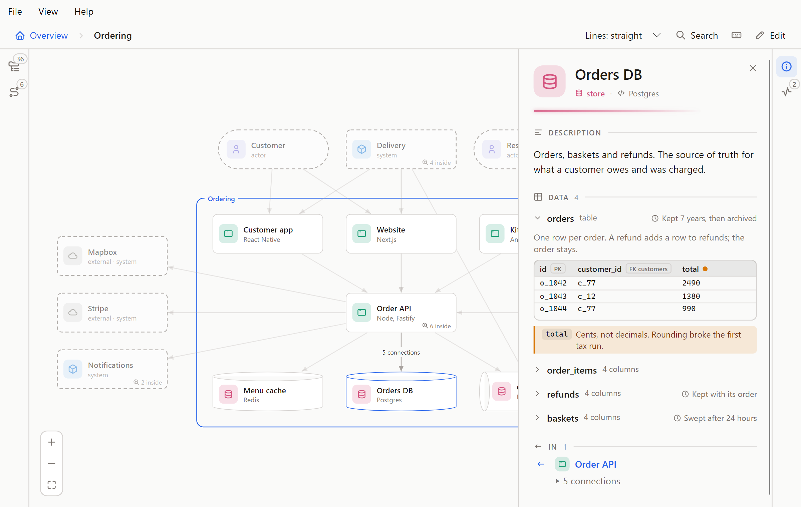
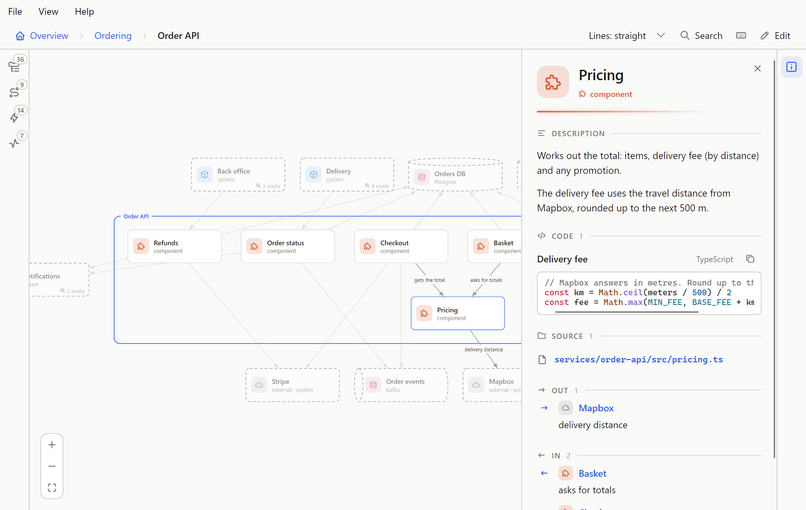

# Flowy Docs guide

The full detail behind the [README](../README.md): what every part of the canvas does, how editing and undo work, what Claude can change, and how sharing behaves. The examples come from Plum, a made-up delivery service whose model is in [`docs/demo/flowy`](demo/flowy).

What to write in it, shape by shape, is in [Writing good Flowy docs](writing.md).

## Read it

- Each shape shows an icon in a colour, which by default are its type's: person, system, app, store, component. Outside
  services you don't own are grey with a cloud. A shape can choose its own shape, colour, opacity and icon
  ([below](#shapes-colour-and-icons)). "3 inside" means a shape opens: double-click it, or
  select it and press Enter, to zoom in. Esc zooms back out, one level per press, once it has
  closed whatever is open (a flow, the side panel; the navigator only if your last click was in it). Backspace, Z and the breadcrumb zoom out too.
  Inside a shape, a frame named after it wraps what's in it, and a click on the frame opens that shape's panel. A faded shape that opens sits beside the
  one you're in, not inside it, so opening it slides across instead of zooming in.
- Hover a shape for its short description. Click it for the full text and its connections: every
  line out and in, with its label. A line that stands for several connections opens to list them.
  Pointing at a row lights its line on the canvas, and the shape's name opens that shape. Click a line
  to see the connections it stands for.
- Lines have no labels until you point at one. Click a shape and its lines show theirs while the
  others fade.
- Lines (top bar) switches between straight, curved and right-angled lines for your own screen.
  Pick the project's own style and your screen follows the project again.
- Faded, dashed shapes live elsewhere in the model. They show up because something here connects to
  them, and they wait around the edges (people above, the rest beside, below or above, wherever
  fewer lines cross) while what's inside sits in the middle.
- A shape can hold a few lines of code, such as a formula, a query or the request it takes, in a Code section under its description.
  The code is coloured, and Flowy works out the language unless you pick one ([below](#code)).
- A shape can list the files and folders it lives in, in a Source section. When the repo's
  `origin` is on GitHub or GitLab, they link there.
- A store can show what it holds: its panel has a Data section with its tables as tables, a few sample rows, how long things are kept
  and short notes ([below](#data)).
- A shape can list links to its long documents (a runbook, a decision record, a wiki page) in a Links
  section under its description. A web address opens in a new tab. A path in the repo links to the
  file when the repo's `origin` is on GitHub or GitLab, and a path that doesn't exist shows up as a
  problem.
- Ctrl+K or / (or Search) finds a shape anywhere in the model by name. Pick one and the canvas
  opens the level it's on, with its panel open.
- The icons on the left edge open a panel with two tabs. Explorer (O) shows everything as a tree, with
  how many shapes and flows are inside each, a dot where something is wrong, and a filter. It sorts as
  VS Code's Explorer does: shapes that hold others first, then the rest, each by name in any case, and
  with numbers read as numbers ("step 2" before "step 10"). A click shows a shape where it's drawn; Enter
  or a double-click zooms into it, and the tree follows you as you zoom. Flows (L) lists every flow, each
  level's by name: first those in the level you're in, then all the others under the level they play in,
  and a click goes there and plays it. In the browser version a YAML tab (Y) beside them shows the files
  as text, with every change to them ([YAML and history](#yaml-and-history)). The numbers on the icons are how many shapes and flows there are
  in all. Details, on the right (its own icon, or a click on a shape or a line), is what the
  click picked. Where the folder has load-test runs, a Performance icon below it (T) puts a run's panel
  in Details' place: see [Performance](#performance). Where it has failure analyses, a Failures icon (M) does the same: see
  [Failure modes](#failure-modes). Drag the inner edge of either panel to resize it,
  and double-click it to put the width back.
- Pick a flow in the Flows tab to play it step by step: ← and → move, Home and End jump to the first
  and last step, Esc stops. A step can be one shape doing something on its own, and a step with more
  to say has a More you can open. When a step lands on a shape that stands for a part inside it, the
  player names the part too ("Scheduler in Core"), so two steps on two parts of one shape don't read
  as a round trip.
- A step can carry an `animation:`. When you arrive at it, something runs
  along its line: `call` goes and comes back while the sender waits, `send` and `event` go one
  way, and `callback` shows what set it off (`trigger: outside` when it was the step before).
  A step that really ends another way adds an `outcome`: `fail` on a `send` or `call` runs red and flashes the receiver, `timeout` on a `call` leaves the sender waiting with no reply and dims the line, and five more show a request that is lost, turned away, taken by someone else, delivered twice or held up (see [How a request ends](#how-a-request-ends)). The step's text still says what happened.
  In the browser the step plays again two and a half seconds after it ends, until you move on (the Repeat button on the card turns that off),
  R plays it again from the start, and Autoplay (P) steps through the flow on its own after the first play. Nothing moves when
  the system asks for less motion, and a step's text always says the same thing. The desktop app
  plays each step once.
- A flow whose steps are grouped (see [Repeats, branches and parallel steps](#repeats-branches-and-parallel-steps)) is played in
  stops: a chip names the group, a branch shows its lanes as tabs, the bar has a bracket under each group, and the lanes of a parallel
  group are one stop, lit and moving together. A step that says `flow:` has an Open flow button, and a bar to come back.
- F fits the whole view back on screen, and ? (or the ? button) lists every shortcut.
- "N problems" in the top bar lists what's wrong in the files. Pick one to jump to it. Shapes with
  a problem carry a "!".

The page follows the files: when Claude or your editor changes them, it updates by itself.

### How a request ends

A step's `animation` can say how its request ends. With no `outcome` the request arrives, and a `call` is answered.

```yaml
- { from: app, to: api, text: The gateway turns the call away, animation: { kind: call, outcome: rejected, reason: Rate limit } }
```

| Outcome | What you see | Valid on |
| --- | --- | --- |
| `fail` | The request runs red and the receiver flashes red | `send`, `call` |
| `timeout` | The sender keeps waiting, nothing comes back, and the line dims | `call` |
| `lost` | The request pops partway along the line and leaves a cross. Nothing arrives, and a caller keeps waiting | `send`, `call`, `event` |
| `rejected` | The request stops at a bar by the receiver and comes back red | `send`, `call`, `event` |
| `intercepted` | The request leaves the line for a third shape, or a dashed marker with a name, which lights | `send`, `call`, `event` |
| `duplicated` | A second copy leaves the first and the receiver takes both in | `send`, `call`, `event` |
| `delayed` | The request waits partway beside a turning dashed clock, then goes on | `send`, `call`, `event` |

A `callback` takes no outcome. The step card says the outcome in a few words, and so does the Mermaid export: "Lost", "Rejected: Rate limit",
"Taken by Café wifi proxy", "Sent twice", "Delayed: Cold start", "30% lost". With reduced motion nothing moves, and the cross, the bar, the clock,
the marker and the reason stay.

These keys go inside `animation`, next to `outcome`:

| Key | What it does |
| --- | --- |
| `reason` | A few words on why: 40 characters at most, on one line. It is drawn where the outcome happens (by the puff, the bar, the clock, or the one who takes the request) and the card says it after the outcome |
| `share` | A whole percent from 1 to 100. Only that share of the requests meet the outcome and the rest arrive. Without it the step plays one request |
| `by` | Needed for `intercepted`, and only there. A shape id that is not an end of the step, or `{ name: Café wifi proxy }` (24 characters at most) for a party that is not in the model. A shape gets a dashed outline, a name gets a dashed marker beside the line |
| `at` | For `lost` only: how far along the line the request vanishes, from 0.1 to 0.9. Without it, 0.55 |

```yaml
- { from: gateway, to: orders, text: A third of the calls are lost, animation: { kind: send, outcome: lost, share: 30, reason: Packet dropped } }
- { from: app, to: api, text: A proxy on the café wifi reads the call, animation: { kind: call, outcome: intercepted, by: { name: Café wifi proxy } } }
```

With `share` the step plays a burst, one request after another: 10 when the share is a multiple of 10, 20 for a multiple of 5,
otherwise 100. Which of them meet the outcome is worked out from the share and spread evenly through the burst, never chosen at random, so the
browser, the desktop app and the tests play the same burst. Those requests are named `r1`, `r2` and so on (or by the step's `carries` word), wear a ring and a colour of their own, and the
others are ordinary deliveries with no name. A duplicated request is one request sent twice, so both copies carry the same name and colour.

The checker names the step and the key. It refuses an outcome on a `callback`, a `share` outside 1 to 100 or with no outcome, a `reason` or a name that is blank,
too long or has a line break, `by` on any other outcome, `intercepted` with no `by`, a `by` that names a shape that does not exist or one of the step's own ends, and an `at` outside 0.1 to 0.9
or on any other outcome.

Claude's `put_flow` takes the same keys, and is told to give a step an outcome only where it really ends that way.

## Edit it

Press E, or the Edit button. The browser canvas and the [desktop app](#the-desktop-app) both do everything below, through the same
checks, and write the same text, so a change made in one looks the same in git as one made in the other.

- Drag shapes to arrange the view. Positions go to `flowy/layout.yaml`.
- Drag from the dot under a shape onto another shape to connect them, then type a label in the panel.
- Add (or N) puts a shape in the current view. It offers only the types that fit there: actors and
  systems at the top, apps and stores inside a system, components inside an app or store.
  Double-click an empty system, app or store to open it and add what goes inside.
- Click a shape to change its name, type, tech, look (shape, colour, opacity, icon), description, code and source. A field saves when you leave
  it. Source takes one file or folder per line, relative to the folder that holds `flowy/`. A path that
  doesn't exist shows up as a problem.
- Code has a card for each snippet: a title, a language and the code. Add code starts a card, which is only saved once it has code.
  The language is Auto until you pick one, and Auto names what it worked out. A shape holds at most six snippets of 40 lines each.
- A store's **Data** box holds its data as the lines the file holds ([Data](#data)).
- Links takes one per line, as `title | address`, or an address alone. An address is a web address
  (http or https) or a path in the repo, relative to the folder that holds `flowy/`. Anything else
  is refused.
- "Outside service" in a shape's panel marks it `external: true`, for things you use but don't own.
- Delete (the key, or the button in the panel) removes the selected shape or line. A shape that still
  contains others, or that a flow uses, stays, and a notice says why.
- To work on several shapes at once, Ctrl+click (or Shift+click) adds a shape to the selection and takes it out again, Shift and drag on
  the empty canvas draws a box round the shapes to select, and Ctrl+A selects every shape in the view. Dragging any selected shape moves
  them all, and Esc straight after takes the whole move back. Delete removes them all as one edit: if one of them can't go (it has shapes
  inside, or a flow uses it), none do. Ctrl+Z puts back everything at once. The desktop app does all of this too.
- Lines, in edit mode, sets the project's style for everyone: a `lines:` key at the top of
  `model.yaml`, which takes `straight` (the default, so it's left out), `curved` or `angled`.
- Esc or Backspace, straight after dragging a shape, take the drag back: whoever has just moved a shape and got it wrong reaches for them.
  Once anything else is done (a click, another edit, a move to another level) they close the panel and go up again, as in reading.
  **Z** zooms out whatever you have just done, and Ctrl+Z undoes the last change of any kind.
- Tidy forgets where shapes in this view were dragged, so Flowy lays it out again, picking the
  layout with the fewest crossing lines it finds. Ctrl+Z brings your positions back.
- New flow records a walkthrough: name it, click the shape where a step starts and the shape it goes
  to (or the same shape again, for a step it does on its own), type what happens and press Enter.
  Repeat. Each step's More holds longer detail for readers who want it. ↑, ↓ and × reorder and
  delete steps. To change a flow you already have, pick it in the Flows tab: in edit mode its rows carry a pencil, and a click opens
  the flow for editing instead of playing it.
- Each step's **Animation** is a form of drawn choices: the way it travels (None, Send, Call, Callback, Event) and the way its request ends (Arrives, Fail,
  Timeout, Lost, Rejected, Intercepted, Duplicated, Delayed), then a share of the requests, a reason, and for an interception the shape that takes it or a name. A choice
  the step cannot have is dimmed with the reason in its tooltip: an outcome needs a way to travel, Timeout needs a call, and a callback or a step on one shape has
  none. Picking Intercepted names a placeholder ("Third party") until you pick a shape or type a name. Each pick is one edit, and a value the checks refuse (a share of 150) says why and saves nothing.
- Each step's **Group and flow** holds the group it is in, its lane (for a branch or parallel group) and the flow it opens. Under the
  steps, **Groups** lists each group with its kind, its times or until (for a repeat) and its text, and a form puts a stretch of steps
  in a new group: a repeat is written with `times: 3`, and in a branch or parallel group every step starts a lane of its own
  ("Lane 1", "Lane 2"…), which you then rename or empty to join the lane before. Each choice is one edit: a step that leaves a group
  hands its lane's label to the next step, a group whose last step goes is removed, a group given another kind keeps what still
  applies (a repeat becomes a branch or parallel group with its first step starting "Lane 1", and for parallel every step starts a lane),
  and a change the checks refuse (a `times` outside 2 to 99, a step moved out of its group's stretch) says why and saves nothing.

Every save goes through the same checks as Claude's edits: a change that would add a problem is
refused, and nothing is written. If a file changed on disk in the meantime, the save is dropped
and the page reloads. Git keeps the history, and the browser version's [YAML tab](#yaml-and-history) keeps every step.

Ctrl+Z, or Undo, takes back your last change on this page, then the one before. It goes back as
far as the page has been open. Ctrl+Y or Ctrl+Shift+Z, or Redo, puts back what you undid, until
you make a new change. If the file changed since (Claude, your editor, another tab), undo and redo
leave it alone and say so. Undo brings back what the file said, not how it was written: like any
save, it drops YAML comments and writes the file in Flowy's own layout.

## YAML and history

In the browser version, the **YAML** tab of the left-hand panel (beside Explorer and Flows, or **Y**) shows the model's files as text
and keeps every change to them. It stays open beside Details, so a change can be watched while you edit. It is read only: change a
model on the canvas, or in your editor.



**The files.** There is a tab for each file: `model.yaml`, `layout.yaml` when there is one, every `flows/<id>.yaml` and every
`failures/<id>.yaml`. The text is the file as it is on disk, comments included, so you can see that saving drops them. Load-test runs in
`perf/` are left out, because Flowy only reads them. The panel opens on the file that fits where you are, and picking a shape on the
canvas takes it to that shape's block in `model.yaml`.

**What the last change did.** When the files change, the panel marks the change in the file it shows: an added line in green, a removed
line in red with a strike. A dot on a file's tab means the change touched that file. The marks follow the newest step, whoever made it,
until you pick an older one.

**Steps.** Under the text, newest first, each change is a step with a label, a time and a badge for where it came from:

| Badge | Where it came from | Looks like |
| --- | --- | --- |
| You | An edit in Flowy | Moved Checkout, Renamed Cart to Basket, Connected Checkout to Stripe, Tidied Ordering |
| Claude | A write through the MCP server | Claude: put_object menu-cache |
| Outside | Files changed some other way | Changed outside Flowy: flows/capture-payment.yaml |
| Restored | A restore (below) | Restored the version from 14:02 |

The first step, **First seen**, is the folder as Flowy found it, and a change made while Flowy was closed shows up as a step the next
time it opens the folder. One edit is one step, even when it writes several files.

**Looking back.** Pick a step to see its files as they were. A mark says how that version differs from the step before it. **Compare
with now** marks it against the files today instead: red is what a restore would take away, green is what it would bring back. **Back
to now** returns to the newest step. The canvas keeps showing the current model.

**Restore** puts every file of the step back. A file that didn't exist then is removed, and one that has gone since comes back. It is
a step of its own ("Restored the version from 14:02"), and the files as they were just before are recorded first, so a restore can't
lose work that nobody saved to git. Ctrl+Z takes it back. Restore writes into the repo, so it needs edit mode (E), like every other
change.

**Where it is kept.** In your application data folder, never in the repo: `%APPDATA%\Flowy Docs` on Windows, `~/.config/Flowy Docs` (or
`$XDG_CONFIG_HOME`) elsewhere, and `FLOWY_STATE_DIR` moves it. `git status` doesn't change and Flowy makes no commits. Opening a folder
for the first time stores a copy of its YAML there as the First seen step. Each project path has its own trail, so a folder that is
moved or renamed starts a new one, and nothing follows the folder to another computer. The newest 300 steps are kept; **Clear history**
at the foot of the panel asks first, then empties them. If the history can't be written, an edit still saves, the tab says "History isn't being saved", and Restore is refused.

It is in the browser version only. An exported page has no files to show, the VS Code panel has no history, and the desktop app
doesn't have the tab yet.

## Shapes, colour and icons

Every shape starts with the look its type gives it: a person is a pill, a store is a cylinder, anything else is a rectangle, each
in its type's colour with its type's icon. Four optional fields change that, in the **Look** part of a shape's panel (in the app and
in the browser) or in the file. The type still decides what a shape may sit inside; these only decide how it is drawn.

```yaml
objects:
  paid:
    type: component
    in: checkout-api
    name: Payment taken?
    shape: diamond        # what it is drawn as
    color: amber          # a name, or #rgb / #rrggbb
    opacity: 30           # how much of the colour fills it, 0 to 100
    icon: coin            # a built-in icon, or one of your own
```

| Field | Takes | When you leave it out |
| --- | --- | --- |
| `shape` | One of the 13 shapes below | The type's: pill for an actor, cylinder for a store, rectangle for the rest |
| `color` | A name (`gray red orange amber green teal blue indigo purple pink`) or a hex colour | The type's colour, and grey for an outside service |
| `opacity` | A whole number, 0 to 100 | 15 once you set a colour, and 0 (the plain surface) until then |
| `icon` | A built-in icon name, or one defined under `icons:` | A cloud for an outside service, else the type's icon |

All four are optional, and a blank value (`shape:`) counts as left out. A value Flowy doesn't know is a problem, and the problem list
says which.



### Which shape for what

Keep the type's own shape unless another says something the type can't. A model where every shape is different says nothing; one
where a diamond always means a decision, and a queue always means a queue, can be read at a glance.

| Shape | Use it for | For example |
| --- | --- | --- |
| `rectangle` | Things that run or do work: systems, apps, services, components. The default, and right most of the time | Order API, Billing |
| `pill` | People and roles, and the start or end of a flow | Customer, Support agent, "Order placed" |
| `ellipse` | A state or an event: something that is true or happens, rather than a thing that runs | "Payment failed", "Idle" |
| `diamond` | A decision: a question with more than one way out | "Paid?", "Within the limit?" |
| `hexagon` | Background work that runs without being asked: a worker, a job, a scheduled task | Nightly settlement, Image resizer |
| `parallelogram` | Data going in or out: an import, an export, a feed | CSV import, Invoice export |
| `cylinder` | A place data is kept: a database, a cache, a bucket, a warehouse. A store is one by default | Orders DB |
| `queue` | Things waiting their turn: a message queue, a topic, a job queue, a backlog | Order events |
| `document` | A file or paper someone reads, fills in or signs: a report, a form, a contract | Invoice PDF, Terms of service |
| `folder` | A group that holds others: a team, a package, a shared drive | Compliance, Billing team |
| `note` | A remark that is not part of the system: a caveat, an assumption, a to-do | "Manual step until Q3" |
| `cloud` | The wider world you reach over a network, when the shape itself should say "out there" | The public internet, A partner's network |
| `arrow` | One stage of a process that hands over to the next | Build, Test, Ship |

Some of these suit more than software. A hiring process is pills, arrows and diamonds; a warehouse is documents, queues and
folders; an organisation is folders and pills. Two cautions. A diamond, an ellipse and a cloud have less room for text, so keep their
names short. And an outside service already shows grey with a cloud icon from `external: true`, so reach for the cloud shape only when
the shape alone has to say it.

### Colour and opacity

A colour is a name, which has a version for the light theme and one for the dark so it reads on both, or any hex colour, which is
the same in both. It colours the icon, the outline and the fill. The fill is the colour at the opacity you give it over the
plain surface, 15 by default, which is a tint. Raise it for a stronger background, up to 100 for a solid one. Text and icon change
to near-black or near-white to stay readable on a strong fill, and the Mermaid copy keeps the colour as a `style` line.

Colour is a way to say something, so decide what first and say it once:

- **Use it for one thing across the model:** red for what is deprecated or risky, green for what is new, grey for what you don't own,
  blue for the part a team is responsible for. A colour that means three things means nothing.
- **Say what it means** in the descriptions that use it, or in the description of the shape that holds them. A reader can't
  look a colour up.
- **Keep the tint for grouping** and a strong fill for the one or two shapes the reader must not miss.
- **Don't use colour alone.** Someone who can't tell the colours apart still needs the name, the shape or the icon to say it.

### Icons

An icon says what a shape is at a glance, in a small space. There are about 150 built in (from [Tabler Icons](https://tabler.io/icons)),
picked for what people document. Pick one from the grid under Icon, which filters as you type, or write `icon: name`.

**People.** `user`, `users`, `user-circle`, `user-check`, `user-cog`, `user-shield`, `users-group`, `headset`, `robot`, `id-badge-2`, `heart-handshake`

**Places and organisations.** `building`, `building-bank`, `building-store`, `building-factory-2`, `building-warehouse`, `building-skyscraper`, `building-hospital`, `home`, `school`, `map-pin`, `world`, `flag`

**Computing.** `server`, `server-2`, `database`, `cloud`, `cloud-upload`, `cloud-computing`, `api`, `app-window`, `apps`, `cpu`, `device-desktop`, `device-laptop`, `device-mobile`, `device-tablet`, `terminal-2`, `code`, `git-branch`, `git-merge`, `git-pull-request`, `bug`, `settings`, `tool`, `rocket`, `bolt`

**Data and flow.** `arrows-exchange`, `refresh`, `repeat`, `filter`, `table`, `chart-bar`, `chart-line`, `chart-pie`, `list-check`, `hierarchy-2`, `binary-tree`, `schema`, `timeline`, `webhook`, `layers-intersect`, `stack-2`, `puzzle`, `cube`, `package`, `packages`, `box`, `container`

**Network and devices.** `network`, `router`, `wifi`, `antenna`, `satellite`, `plug-connected`, `battery-2`, `printer`, `camera`, `video`, `microphone`, `qrcode`, `barcode`, `scan`, `radar`

**Documents and messages.** `file`, `file-text`, `file-invoice`, `file-certificate`, `files`, `folder`, `notebook`, `book`, `books`, `article`, `clipboard-check`, `signature`, `certificate`, `receipt`, `mail`, `message`, `messages`, `bell`, `phone`, `calendar`, `clock`, `hourglass`, `alarm`

**Money and trade.** `coin`, `credit-card`, `wallet`, `cash`, `calculator`, `shopping-cart`, `basket`, `tag`, `receipt-2`, `gift`

**Transport.** `truck`, `truck-delivery`, `plane`, `ship`, `train`, `car`

**Security and rules.** `lock`, `key`, `shield`, `shield-check`, `fingerprint`, `eye`, `gavel`, `scale`

**Status and ideas.** `check`, `circle-check`, `alert-triangle`, `alert-circle`, `star`, `heart`, `bookmark`, `target`, `bulb`, `brain`, `sparkles`, `flame`, `droplet`, `leaf`, `tree`, `sun`, `moon`, `trophy`, `award`

**Science and health.** `flask`, `microscope`, `stethoscope`, `heartbeat`, `medical-cross`, `pill`

Choose an icon when it names the thing better than its type does: a `truck` for the courier, a `mail` for the notification service, a
`lock` for the login. Leave it out when the type's icon already says it.

**Your own icons** go in an `icons:` section at the top of `model.yaml`: a name, and the SVG path data of a line icon on a 24 by 24
grid, drawn two units thick with round ends like the built-in ones. Name a shape's `icon:` after it.

```yaml
icons:
  stripe: M4 6h16v12h-16zM4 10h16M8 15h3   # a card
objects:
  stripe:
    type: system
    name: Stripe
    external: true
    icon: stripe
```

To take one from an SVG file, copy the `d` of each `<path>` and join them one after another, as the built-in ones are. A name is
lowercase letters, digits and dashes, and can't be one of the built-in names. Claude adds and removes them with the `put_icon` and
`delete_icon` tools, and `get_model` lists the ones a model has. An icon that is still in use can't be deleted. There are no
colour or image icons: an icon takes the colour of the shape that shows it.

## Repeats, branches and parallel steps

A flow is a flat list of steps, but real systems aren't flat: a call is retried, a result decides what happens next, one shape tells
several others at once, one flow hands the story to another. A flow file can say so, with two optional additions. A `groups:` section
declares each group once, and a step joins a group by its id.

```yaml
name: Customer pays for an order
view: ordering
groups:
  charge:
    kind: repeat
    times: 3
    text: Backs off 1 s, 2 s, 4 s between tries
  outcome:
    kind: branch
  tell:
    kind: parallel
steps:
  - { from: order-api, to: stripe, text: Holds the amount on the card, group: charge }
  - { from: stripe, to: order-api, text: Times out at the bank, group: charge }
  - { from: stripe, to: order-api, text: Reports the hold placed, group: outcome, lane: Card accepted }
  - { from: order-api, to: orders-db, text: Saves the order as placed, group: outcome }
  - { from: stripe, to: order-api, text: Reports the final decline, group: outcome, lane: Card declined }
  - { from: order-api, to: kitchen-tablet, text: The restaurant's tablet rings, group: tell, lane: Kitchen }
  - { from: order-api, to: events, text: Announces the order, group: tell, lane: Everyone else, flow: place-order }
```

This is a flow Plum doesn't have, written with Plum's shapes. A group is one of three kinds:

| Kind | It means | It takes |
| --- | --- | --- |
| `repeat` | The same steps run again | `times` or `until`, and optionally `text` |
| `branch` | Alternatives: one lane happens | Lanes, and optionally `text` |
| `parallel` | Lanes that all happen at once | At least two lanes, and optionally `text` |

- `times` is how many times the stretch runs in all, the first run included, a whole number from 2 to 99. It is a claim about a real
  limit ("the client gives up after 3 tries"), not a number for illustration. `until` says in words what stops a repeat. A repeat
  needs one of the two. Backoff, delays and timeouts aren't data: say them in the group's `text` or in the steps.
- A step's `group` is the group it belongs to, and it is in at most one. The steps of a group have to sit next to each other.
- A step's `lane` starts a lane of a branch or a parallel group, and the steps after it in the same group, up to the next `lane`, belong
  to it. The first step of a branch or parallel group must have one. A lane is a label in plain words ("Card declined"), unique inside
  its group, and a repeat has none. A branch may have a single lane, for "if the coupon is valid, this happens".
- A step's `flow` is the flow its story continues in, for a step whose story is long enough to deserve a flow of its own. A flow can
  point at one that points back, and that is not a problem.
- A group id follows the rule for a flow's id: lowercase letters, digits and dashes.
- There is one level of groups. A group can't sit inside another.

Flowy checks them as it checks everything else, and lists what is wrong in the problem list: a `group` that isn't declared under
`groups`, or a declared one that no step uses, a repeat with neither `times` nor `until`, `times` outside 2 to 99, `times` or `until`
on a branch, a lane on a step with no group or in a repeat, a first step with no lane, two lanes with one label, a parallel group with
fewer than two lanes, a step that sits between two members of a group without belonging to it, and a `flow` that isn't a flow in the
folder. The last means a change that deletes a flow another one points at is refused, as any change that adds a problem is.

**Elsewhere in Flowy.** The checks, and Mermaid. A repeat becomes a `loop` block labelled with every fact it has, a branch an `alt` with
an `else` for each further lane (`opt` when it has one), a parallel group a `par` with an `and` for each further lane, and a step with
`flow:` is followed by a note over its end that names the flow it continues in. The sample above comes out as:



**In the player.** The player steps through *stops*, the things that are on screen at once. Every step is a stop of its own except in
a parallel group, where stop *k* is the *k*-th step of every lane: five one-step lanes are one stop with five lines lit and moving
together, and a lane that has run out simply drops out. The card says where you are: a chip names the group (`Repeats up to 3 times`,
`One of 2`, `At the same time, 2 lanes`), a branch lists its lanes as tabs with yours marked, the group's own `text` follows, and the
progress bar has a cell for each stop, a branch's lanes on rows of their own and a bracket under each group. Point at a cell or a
bracket to read what it means, or press the **?** on the card for a key to all of it. A parallel stop shows a block for each lane. On
the canvas a small label on each lit line says how often it repeats or which lane it is, and the lanes of a branch you are not in
are dashed and faint. A step with `flow:` has an **Open flow** button. It plays that flow on its own level and puts a bar at the top
of the card, *Back to "…", step N*, that returns you to where you were (in the browser, the Back button does the same). The way back
isn't in the address, so a reload drops it. Nothing moves when the system asks for less motion, and the chips, tabs, brackets and labels
stay. A flow with none of these keys reads, plays and exports exactly as it did.

Claude's `put_flow` takes `groups` and a step's `group`, `lane` and `flow` (a `times` may be a number there), and its instructions say when
to reach for each. Edit mode has fields for all of them (see above).

## Shape states

A shape is Running unless a flow says otherwise. A step can say that a shape is coming up, shutting down, off, restarting or not well, and the shape shows it from that step until another step changes it.


| State | Means | On the canvas |
| --- | --- | --- |
| Running | Up and serving | Nothing is drawn |
| Starting | Coming up, not ready | Dimmed, with a dotted outline that circles |
| Stopping | Draining or shutting down | The outline drains and the shape dims |
| Stopped | Off | Dimmed and grey, with a dashed outline and a power symbol |
| Restarting | Down and coming back | Dimmed, with a short arc circling the outline |
| Degraded | Up but not well | A slow pulse in the warning colour, with a warning triangle |

The file holds the lowercase word. A step's `states` maps shape ids to states. Plum's
[stripe-outage](demo/flowy/flows/stripe-outage.yaml) uses all six:

```yaml
name: Stripe goes down and comes back
view: ordering
steps:
  - { from: order-api, to: stripe, text: The hold is slow while Stripe shuts down, animation: call, states: { stripe: stopping } }
  - { from: checkout, to: stripe, text: The hold times out, animation: { kind: call, outcome: timeout }, states: { stripe: stopped } }
  - { from: checkout, to: customer-app, text: Offers pay at the door, states: { checkout: degraded } }
  - { from: order-api, to: stripe, text: The status page says Stripe is restarting, animation: call, states: { stripe: restarting } }
  - { from: order-api, to: stripe, text: The next check finds it coming back up, animation: call, states: { stripe: starting } }
  - { from: checkout, to: stripe, text: The hold goes through, animation: call, states: { stripe: running, checkout: running } }
```

- A flow's own `states` say where shapes stand before step 1: `states: { stripe: starting }`. Left out, every shape starts Running.
- A step's change holds from that stop until another step changes it, so set a shape back to `running` when it recovers. The state at any stop is worked out from the start and the steps before it, which means stepping back needs no undo and no timer.
- In a parallel stop every lane's change applies, and two lanes that set one shape to different states are a problem. In a branch each lane starts from the state before the branch, and the last lane's changes carry on after it. If a shape's state after a branch matters, set it again in the next step.
- A flow that another flow opens starts from its own `states`, not from where the first one left off.
- At the overview, a shape with no state of its own shows the worst state of what is inside it (Stopped, then Restarting, Degraded, Stopping, Starting) on a dashed ring that reads "Stopped inside". A state of its own shows instead.
- The player card has a key for the states on the canvas now, and Details names the state of the shape it shows. A change takes about 0.6 seconds. Starting and Restarting keep moving, and Degraded pulses, for as long as they are on screen. Nothing moves when the system asks for less motion; the dimming, outline and symbol stay.

Flowy checks it as it checks everything else: an id that isn't a shape, a word that isn't one of the six, `states` that isn't a mapping of ids to words, and two lanes of one parallel stop that disagree. A change that deletes a shape that only a `states` names is refused, as it is for a step's shape.

**Elsewhere in Flowy.** In edit mode a step's form has a **State** section with a row of drawn tiles (None, then the six) for each end of the step, and a pick is one edit; a flow's starting states are written in the file or by Claude. Claude's `put_flow` takes `states` on the flow and on each step, and its instructions say to use them where the story really takes a shape down, brings it up or hurts it. Mermaid writes a note over the shape with the state's name:



A flow with no `states` reads, plays and exports exactly as it did.

## Performance

A run is a load test, summarised: for each load that was tested, what each shape and each connection measured. It lives in
`flowy/perf/<name>.yaml` (the name follows the same rule as a flow's file name), and a folder can hold several: a ramp, a spike,
the same test before and after a fix.

```yaml
name: Ramp, 20 s per level
about: Node 22, 4 cores, the load generator on the same machine
unit: req/s
levels:
  - load: 100
    overall: { rate: 98, p50: 60, p95: 140, errors: 0 }
    objects:
      web-api: { util: 0.35, queue: 0, errors: 0 }
    connections:
      - { from: web-api, to: payments, rate: 40, p50: 90, p95: 180, errors: 0 }
  - load: 200
    overall: { rate: 190, p50: 70, p95: 150, errors: 0.01 }
    objects:
      web-api: { util: 0.7, queue: 2, errors: 0 }
    connections:
      - { from: web-api, to: payments, rate: 80, p50: 95, p95: 260, errors: 0.01 }
```

Every number is optional except a level's `load`. On a shape, `util` is how much of what it can do is in use (0 to 1), `queue` how many are waiting, and
`errors` the share that fail (0 to 1). On a connection, and in `overall` (what the entry point measured), `rate` is calls a
second, `bytes` is how many bytes a call carries (the tab calls it the size of a call), `p50` and `p95` are milliseconds (the tab calls them the expected call and the slowest 5%) and `errors` is the share that fail.
Levels go up in load, and a run needs at least two. A number that isn't there isn't drawn as zero: that shape or line stays
plain. `unit` says what a load counts, and `entry` can name the shape the load comes in at.

Flowy checks a run the way it checks `code:` paths: a shape or connection it names that isn't in the model, or a number that
isn't one, is a problem. A run it can't read at all is a problem too, listed in the Performance tab, and it never stops the model
from loading. Flowy only reads runs. Tools write them, and nothing in Flowy changes a run file.

**Reading it.** Open the Performance tab on the right edge, or press **T**. Pick a run if there are several. The slider has a stop
for each tested load; ← and → move between them, and **Ramp** (**P**) sweeps up to the highest, at a pace that would cover the whole run in half a minute. Between two
tested loads the numbers are blended from the two, and the tab says so. Click a shape or a line to read its numbers at this load,
with a small curve of each across all of them. A shape that holds others takes the worst of what is inside it, so at the overview
you see which system is struggling and zoom in to find where. The tab opens on the load where things first struggle, if anything
does, and **Go there** gets back to it.

**Colour and scale.** A run can say what its dots look like and how many there are, so the picture reads as a ratio. Add a `source` at the top
of the file:

```yaml
source:
  color: blue          # a colour name or a hex, like a shape's colour
  dot: rate / 50       # how many dots are on a line at once
  size: bytes / 400    # how big each dot is
```

Every key is optional. `color` takes the names a shape's colour does (a named colour is a lighter one in the dark theme) or a hex such as `"#1d9e75"`, which is the
same in both themes. `dot` and `size` are small formulas: numbers, the names `rate` (calls a second), `bytes` (the size of a call) and `p50` (the
expected call, in milliseconds), the signs `+ - * /`, brackets and a minus in front, at most 80 characters. There are no functions, and nothing is run: Flowy reads
the text itself. A formula it can't read is a problem, and the source then keeps the usual dots, with its colour still applied.

`dot` is the number of dots on a line at once. `rate / 50` is 2 dots at 100 calls a second and 20 at 1,000, so ten times the calls is ten times the dots.
How fast they cross still follows `p50`, so two lines with the same calls and a different `p50` have the same number of dots, moving at different speeds.
`size` is the area of a dot: a call with twice the bytes draws a dot with twice the area, 1 is the usual dot, and the radius stays between half and two and a half
times the usual one. A line the formula gives no value for (it needs a `bytes` the line doesn't have, say) keeps the usual dots.

The screen holds at most 24 dots on a line. Past that the line is scaled down to 24 and says so: **Scaled down** in the key, and under the numbers of the line when you click it.
The key also says what one dot stands for ("1 dot = 50 calls/s") when `dot` is the rate times a number and nothing else, and draws **Bigger call** when `size` is set.

`bytes` on a line that several connections land on is their mean, weighted by their `rate`. A connection can also say how its failing share fails, with
`failure: lost` (a failing call pops where it dies) or `failure: rejected` (it runs to the end of the line, stops at a bar and comes back red). Without
`failure` a failing call fades away, as before.

**What to remember.** This is a replay. Flowy never predicts a load nobody tested, so the slider stops at the highest one. How
strained a shape looks is its `util`, or its failure rate counted twenty times (5% failing is as bad as full), whichever is
worse. A line can pass behind a shape that isn't one of its ends, or under a label, and its dots keep going there as faint, smaller
ghosts. Nothing moves when the system asks for less motion; the colours, thickness, badges and numbers stay. An exported page
carries the runs, so its Performance tab works too. The desktop app reads runs too, with the same panel and keys. In edit mode the
tab is greyed out and **T** does nothing.

**Making one.** Any tool that can write this file works. `perf-lab/` in the Flowy repo is a small shop that really runs, with a
load generator that measures it and writes runs of this shape: `npm run lab:run` makes one, and
`node src/cli.ts --dir perf-lab/flowy` opens it.

## Data

A store can say what it holds. Click it and its panel has a **Data** section that draws the data the way a developer pictures it: a
table is column headings over a few sample rows, and a document is its fields, indented. The first entry is open. The others are one
line each, with how many columns they have and how long they are kept, and a click opens or closes one.



Flowy never connects to a database. You write the entries, or Claude writes them from the code, and the sample rows are made up. A
store's `data:` is a list, and each entry is one table, one set of keys, one topic or one collection:

```yaml
objects:
  orders-db:
    type: store
    in: ordering
    name: Orders DB
    tech: Postgres
    data:
      - name: orders
        kind: table
        limits: Kept 7 years, then archived
        note: One row per order. A refund adds a row to refunds; the order stays.
        columns:
          - {name: id, key: primary}
          - {name: customer_id, to: customers}
          - status
          - {name: total, note: "Cents, not decimals. Rounding broke the first tax run."}
        rows:
          - [o_1042, c_77, placed, 2490]
          - [o_1043, c_12, accepted, 1380]
```

| Key | Takes | Shown as |
| --- | --- | --- |
| `name` | The table, key set, topic or collection, as a developer names it | The heading of the entry |
| `kind` | A word for what it is: `table`, `collection`, `topic` | Small, beside the name |
| `limits` | One line on how long it is kept or how much fits | A clock and the line, on the right |
| `note` | One line on why it is this way | Under the heading |
| `columns` | The column headings. A bare name, or a mapping with `name` and any of `key: primary`, `to` and `note` | The headings of the grid |
| `rows` | Sample rows, with one cell for each column | The rows of the grid |
| `sample` | One sample document, in place of `columns` | Its fields, one to a line, nesting shown by indent |
| `notes` | With a `sample`: a field to its note. A nested field is its keys joined with dots (`hours.mon`) | Under the data |

In a grid, a column with `key: primary` shows a small **PK**, a column with `to: customers` shows **FK customers**, and a column with a
`note` shows a dot. The note is under the data, headed by the column's name. Notes are always shown. Point at a mark for its full name.

A key set is a grid with `Key`, `Value` and `Expires` columns, and a topic is a grid with `Key` and `Value` whose rows are messages. A
document store has a `sample` in place of `columns`, and its notes name fields:

```yaml
objects:
  menu-cache:
    type: store
    in: ordering
    name: Menu cache
    tech: Redis
    data:
      - name: Keys
        limits: Oldest unused go first at 256 MB
        columns: [Key, Value, Expires]
        rows:
          - ["menu:{restaurantId}", "{ items, prices, hours }", 5 min]
  profiles:
    type: store
    in: ordering
    name: Restaurant profiles
    tech: MongoDB
    data:
      - name: restaurants
        kind: collection
        sample:
          _id: r_42
          name: Noodle Bar
          tags: [ramen, vegan]
          hours:
            mon: 11-22
        notes:
          hours: Hours live inside the profile. They are only ever read with it.
```

Every value is text, like the rest of the files. In a row a comma ends a cell, so a cell with a comma in it is quoted
(`["Noodle Bar, Inc.", c_77, 2490]`), and so is text that starts with a bracket, a brace, a quote or one of `- # & * ! | > % @`, or that
holds a colon followed by a space. Saving writes the quotes where they are needed. A field under a list item and a key that itself holds
a dot cannot carry a note. What to put in it, and how to word a note, is in [Writing good Flowy docs](writing.md#data).

The checks keep the section small. They refuse:

- `data` on anything but a store, an entry with no name or the name of another, and an entry with both `columns` and `sample` or with neither.
- A row with a different number of cells than there are columns, more than 12 columns or 8 rows, and a `key` other than `primary`.
- A sample nested more than 3 levels deep or showing more than 20 fields, a list directly inside a list, and a note on a field that is not there.
- Text with a line break, anywhere in `data` (the separator characters U+0085, U+2028 and U+2029 count), so that a row stays on one line.

In edit mode a store's form has a **Data** box that holds the same lines as the file. Leave the box and the change is checked like any
other: a refusal says why and keeps what you typed, and clearing the box removes the data. Saving writes each row on one line, so a table of
eight rows stays eight lines in git, and an empty cell is written `""`.

## Code

A shape can hold a few lines of code: the formula a component applies, the query a store answers, the request an app takes. Its panel has a
**Code** section that draws each snippet with its title, the language it is shown in and a Copy button, with the code in colour. The code
is only text, and nothing in it is run.



```yaml
objects:
  pricing:
    type: component
    in: order-api
    name: Pricing
    snippets:
      - title: Delivery fee
        text: |-
          // Mapbox answers in metres. Round up to the next 500 m.
          const km = Math.ceil(meters / 500) / 2
          const fee = Math.max(MIN_FEE, BASE_FEE + km * PER_KM)
```

`title` and `language` are optional. Without a `language`, Flowy works out the language from the code, and the panel names what it found.
A short snippet can be too little to tell. The form's Language choice (Auto, TypeScript, SQL and the rest) sets one when the guess is wrong.
A language is written as its id: `typescript`, `javascript`, `json`, `yaml`, `csharp`, `java`, `kotlin`, `python`, `go`, `rust`, `sql`,
`bash`, `powershell`, `html`, `xml`, `css`, `dockerfile`, `markdown`, `c`, `cpp`, `php`, `ruby`, `swift` or `text` (no colours). The short
names people write (`ts`, `py`, `sh`, `c#`) are read too, and saving writes the id.

A fenced block in a description is coloured the same way when it names one of those languages (`` ```ts ``) and stays plain when it names none.

The checks keep the section small. They refuse:

- A snippet with no text, and one with a language Flowy doesn't know.
- A snippet of more than 40 lines or 8000 characters, and more than six snippets on one shape. Long code belongs in a file, listed under Source.

Saving writes the code as a block of lines (`text: |-`), so a change to one line is one line in git. What to put in a snippet is in
[Writing good Flowy docs](writing.md#show-a-few-lines-of-code).

## Failure modes

A failure analysis holds how a system breaks as data: for a part, how it fails, what that causes, how bad, how likely and how hard to
spot it is, what exists to deal with it and what to do next. It lives in `flowy/failures/<name>.yaml` (the name follows the same rule
as a flow's file name), one file for each scope you would review in one meeting, such as Ordering or Delivery, and a folder can hold
several.

```yaml
name: Plum fail scenario
about: Made-up ratings for the demo, not a review of anything real.
scale:
  severity: { low: Nobody notices, high: A customer loses money or the kitchen stops }
  occurrence: { low: Never seen, high: Most days }
  detection: { low: An alert fires within a minute, high: We hear from a customer }
modes:
  stripe-timeout:
    from: checkout
    to: stripe
    mode: Stripe doesn't answer within five seconds
    effect: The order waits on a hold that may or may not exist.
    cause: Stripe is slow, or the network between Plum and Stripe drops.
    severity: 8
    occurrence: 4
    detection: 3
    controls: Three tries with backoff. The idempotency key stops a double hold.
    action: Page when more than 1% of holds time out for five minutes.
    owner: Payments
    status: planned
    after: { severity: 8, occurrence: 4, detection: 1 }
    affects: [customer-app, kitchen-tablet]
    flow: capture-payment
    step: 1
```

- A mode is keyed by its id: lowercase letters, digits and dashes, unique in the file. The key is what an address and an MCP write use.
- A mode names its part with `on: <shape id>` for a shape, or with `from` and `to` for a line. Exactly one of the two. A line must be a
  connection in the model, in that direction, so the badge has a line to sit on.
- Everything but `mode` and the part is optional. `about`, `scope` (`root`, the default, or the id of a shape that holds others: the
  parts that count towards coverage) and `scale` (what the ends of each rating mean, shown under it) belong to the analysis.
- A rating is a whole number from 1 to 10. A rating that is missing is **Not rated** on screen, never a zero. The file keeps the usual
  FMEA names so a row copied from a spreadsheet keeps its meaning, and the tab says it in plain words:

  | In the file | On screen | 10 means |
  | --- | --- | --- |
  | `severity` | Severity | The worst result |
  | `occurrence` | Likelihood | It keeps happening |
  | `detection` | Hard to spot | Nobody would notice |

- `controls` is what exists today, `action` what to do next, and `owner` who does it. `status` is `open` (the default), `planned`, `done`
  or `accepted` (known, and left alone). `after` holds the ratings once the action is done.
- `affects` lists the shapes the failure hurts. You write it: Flowy doesn't work it out from the lines, because a line's direction
  means different things (the order API calls Stripe, but the tracking service pushes to the customer app).
- `flow` names the flow that tells the failure, and `step` the step in it, numbered as the player numbers them. `run` names a run that
  shows it. `description` is More, in Markdown.
- Unknown keys are kept when Flowy writes the file back.

**How it ranks.** Risk is Severity times Likelihood times Hard to spot, from 1 to 1000, and there is none when a rating is missing.
The band follows: High when Severity is 9 or 10, even with the other ratings missing, since a severe failure never belongs in the quiet
group. Otherwise Not rated when a rating is missing, then High from a risk of 150, Medium from 60 and Low below that. The list runs
High, Medium, Low, then Not rated, and inside a band by risk, highest first, with ties in the order of the file. A mode that is `done`
counts by its `after` ratings, and the panel shows both ("96 to 32").

**Coverage.** "Analysed 15 of 26" counts the shapes that hold nothing, inside the analysis's scope, that have at least one mode, as the
part or as an end of a line. Actors are left out, because nothing of ours fails there. Outside services count, since a failing Stripe is
a failure you design for. Lines don't count. **Not analysed** lists the shapes left.

**Reading it.** Open the Failures tab on the right edge, or press **M**. Pick an analysis if there are several. A shape or a line that
has modes carries a badge: the colour of its worst band and how many. A shape that holds others adds up what is inside it, so at the
overview you see which system holds the risk and zoom in to find where, as in Performance. Four items count the modes by band, and a
click on one filters the list. The list has two groups: **This view**, the modes whose part is inside the level on screen, and **Other
views**, and picking one of those moves the canvas to the level that draws its part. Pick a mode to see all of it: Effect, Cause, the
three ratings drawn as ten small cells, Controls, Next action with the owner and status, and what it affects. On the canvas its part is
outlined in red, what it affects in a lighter outline, and the rest fades. ← and → move down the list and Esc closes the tab. A click on
a shape or a line shows the modes on it. **Show it** plays the flow that tells the failure. **Seen in a run** appears when `run` is set
and the part has errors in it, and opens Performance at the first load where it does. The address is
`#<view>/failures/<analysis>/<mode>`.

**Writing it.** In edit mode the tab stays open and gains **New analysis** (a name and a scope), **Add failure mode** and a form for
each mode: the part, the text, the three ratings, the status, what it affects, the flow and the run. Every save goes through the same
checks as the rest of the model. Claude does the same through the MCP server: `get_failures` answers with the ranked table, the
coverage and the problems, `put_failure` writes one mode, `delete_failure` removes one, and `put_failures` and `delete_failures`
write and remove a whole analysis. Every write is checked. How to word a mode is in [Writing good Flowy docs](writing.md#failure-modes).

**Getting it out.** **Copy as table** and **Copy as CSV** in the tab copy the ranked list with the words the screen uses. So does the
command line, which prints one table for each analysis:

```bash
node /path/to/flowy-docs/dist/cli.js failures --analysis ordering --format csv
```

`--format` is `markdown` (the default) or `csv`, and `--analysis` picks one. A problem in a file goes to stderr and the command exits
with 1, so a CI job can run it. A cell in the CSV that starts with `=`, `+`, `-` or `@` gets a leading quote mark, so a spreadsheet doesn't
run it.

**Checks.** Flowy checks an analysis the way it checks `code:` paths, so it can't quietly point at parts that are gone: a part that
isn't in the model, both forms of part or neither, an `affects` entry that isn't a shape, a missing `mode`, a rating outside 1 to 10, an
unknown `status`, a `flow`, `step` or `run` that doesn't exist, an id that breaks the rule or appears twice, and a `scope` that isn't
`root` or a shape that holds others. A change that would add a problem is refused. So is deleting a shape or a connection that a mode
names. A file that can't be read at all is a problem too, and it never stops the model from loading: the file is skipped and left as it
is. Renaming a shape by hand in `model.yaml` leaves its modes pointing at nothing, and the checks say so.

**Where it works.** The browser version and an exported page show failure modes. The desktop app doesn't draw them yet, and it doesn't
know a mode names a shape, so deleting that shape there goes through and the browser then lists the mode as a problem. Plum has an
analysis, [Order to door](demo/flowy/failures/ordering.yaml), and `node dist/cli.js --dir docs/demo/flowy` from a clone opens it.

## Let Claude build it

From the root of the repo you want to document, once the clone is built as the
[README](../README.md#the-browser-version) says:

```bash
claude mcp add flowy -- node /path/to/flowy-docs/dist/cli.js mcp
```

Then ask Claude something like "map this repo into Flowy". It writes `flowy/model.yaml` and
`flowy/flows/*.yaml`, and refuses any change that would break the model. Ask how the system fails and it can write a
[failure analysis](#failure-modes) in `flowy/failures/` too, leaving a rating out rather than guessing it. Add `--dir <folder>`
after `mcp` to keep the files somewhere other than `./flowy`.

Claude can also note where each shape lives in the code (`code: [src/api/]`). A path that doesn't
exist is refused, so the model can't quietly point at code that's gone. When code moves later,
the shape gets a "!" until someone fixes the path.

Claude can also link a shape to its long documents (`links: [{ title: Runbook, url: docs/runbook.md }]`).
A repo path must exist, and a web address is taken as given.

Claude can also add a few lines of code that explain a shape (`snippets:`, see [Code](#code)). It copies them from the repo as they are,
leaves out secrets and real data, and keeps to the limits. `put_object` replaces the whole list, so Claude reads the shape first and
sends the snippets to keep.

Claude can write what a store holds (`data:`, see [Data](#data)) from a migration, a schema file or the code that builds the keys. It
is told to show only the few tables a reader needs to follow the flows, to invent the sample rows and never copy them from a real
database or a log, and to keep a note to one line that says why. `put_object` replaces a store's whole list of entries, so Claude reads
the store first and sends the ones to keep.

Claude marks outside services (a payment provider, a third-party API) with `external: true`, so
they show grey. It is told to leave `shape`, `color`, `opacity` and `icon` alone unless one says something the type
doesn't, and to keep a colour to one meaning across the model, so a model it builds looks like the type defaults until you choose otherwise.

When Claude saves a flow, Flowy answers with how each step will read on the flow's view, the
way the player shows it ("2. Alert channels → Text and speech in Core: …"). Its instructions ask
for steps that say what passes between the two shapes and whether the sender waits, so a flow
reads the way the code works.

Saving rewrites the file, so YAML comments in `model.yaml` and flow files aren't kept. Put
notes in an object's `description` instead.

If you or Claude write the YAML by hand, put double quotes around the text of a one-line step when it holds a comma:
`{ from: app, to: api, text: "Sets the time zone, if the request has one" }`. Unquoted, the comma ends the text and what follows
becomes a key with no value. The file still loads, with the step cut short, but it can't be saved again, so Flowy lists the key as a
problem (`step 3: "if the request has one" has no value`) instead of leaving it to fail on the next edit.
[Writing good Flowy docs](writing.md#write-flows) has the full list of characters to quote.

## Share it

People without the repo can read the model too:

```bash
node /path/to/flowy-docs/dist/cli.js export
```

It writes a read-only copy of the canvas to `./flowy-site`, with the model inside its `index.html`.
Put the folder on any static host, such as GitHub Pages, and send the link. Browsers won't run it
straight from disk. To show it in Notion or Confluence, embed the link. `--dir` picks the model
folder and `--out` the export folder. An export carries any load-test runs and failure analyses too, and has no YAML tab.

Export again after the model changes. Only what the export wrote is replaced, so a `.git` or a
`CNAME` you keep next to it stays. A folder with other files in it is left alone, and so is one
that holds the model. A file that can't be read stops the export. Problems don't: the page lists
them.

For a README or a pull request, the Mermaid button copies the view on screen (or the flow
playing) as a Mermaid diagram, fenced and ready to paste. GitHub and GitLab draw it. A diamond comes out as a
diamond, a cylinder as a cylinder, and so on, and a colour becomes a `style` line (a folder has no Mermaid shape and stays a
rectangle, and the queue, document, note and cloud shapes need Mermaid 11.3 or later). The same
from the command line, or for Claude through MCP (`get_mermaid`):

```bash
node /path/to/flowy-docs/dist/cli.js mermaid --view ordering
```

`--flow <id>` prints a flow as a sequence diagram instead. A flow's repeats, branches and parallel lanes come out as `loop`, `alt` and
`par` blocks ([above](#repeats-branches-and-parallel-steps)).

The address follows what's on screen. `#ordering` is the inside of Ordering, and `#ordering/place-order` plays
the flow `place-order` there. Copy it to send someone straight to a level or a flow. The local canvas
does this too.

## The desktop app

The desktop app is a native reader for the same folders: it reads the YAML itself and draws it with its own renderer, so there is
no server and no browser behind it. It reads and it edits: [Edit it](#edit-it) above is as true of the app as of the browser, and
what it saves, the browser and Claude see, and the other way round. A file that can't be read leaves the last good model on screen
with the reason in a banner, and while it is there editing is off.

Editing in the app: **E** (or the Edit button) turns it on, and the bar gains New flow, Add, Undo, Redo and Tidy. A shape's panel becomes
a form (name, type, outside service, tech, look, description, code, links, source), and a line's panel has a label field and a delete for each connection it
stands for. Drag a shape to move it; the dot under a shape starts a connection, which you drop on another shape. Each edit is checked first:
one that would add a problem is refused and a notice says why. A file changed elsewhere since the app read it is never overwritten: the
edit is dropped, and the view reloads. **Ctrl+Z** and **Ctrl+Y** undo and redo, but only where the files are still as that edit left
them. The sample model that ships with the app can't be edited.

What it has, as the canvas does: zoom into a shape (double-click it, or select it and press Enter; Esc and Backspace go back up, and
the breadcrumb works too), a frame around the shape you're inside, shapes that belong to another level faded and dashed, wheel to
zoom and drag to pan, **F** to fit, the side panel with the description, its code, its links, the files a shape lives in (as links when the repo's
origin is on GitHub or GitLab), and every connection out and in, the rail of icons on the left edge (**O** shows the whole documentation as a tree, **L** lists every flow and plays one) and the one on the right (**T** for load-test runs), flows that play with ← and → (Home and End go to the first and last
step) with a step's animation, **R** to play it again and **P** to let the flow run on its own, **Ctrl+K** or **/** to find a shape, **?** for the shortcut list, the problem list in the top bar, straight, curved or
right-angled lines, light or dark with the system, and no animation when the system asks for less. **Opening a shape that sits
beside the one you're in slides across instead of zooming in.** It doesn't have the browser's YAML tab (**Y**) or Failures tab (**M**) yet.

The links in a shape's panel open on your computer. A web address opens in the browser, a folder in the file explorer, and a file in your
default app if it is a document (Markdown, text, PDF, a common image). Any other file, such as a script or a program, is shown in its
folder and not run. A small folder button beside each file shows it in its folder. **File › Open Files With** picks an app of your own to
open files with (any file inside the repo), and that choice stays on your computer, never in the repo.

What it adds is a way to choose the model:

- **File › Open Folder** (Ctrl+O) takes a repo or its `flowy/` folder. A folder called `flowy` is
  used as it is; otherwise the `flowy/` inside it, and with none of those, the folder itself if it holds `model.yaml`. If there is
  none, the app says so. Opening never creates files; only an edit does.
- Drop a folder on a window, pick one from **File › Open Recent**, or start the app with a path: `FlowyDocs.exe path\to\repo`. If
  the app is already running, the folder opens there.
- On Windows the installer adds **Open with Flowy Docs** to the right-click menu of a folder and of a folder's empty space (under
  *Show more options* on Windows 11), and removes it again when you uninstall.
- Each model gets its own window. Opening one that is already open brings its window forward. A window opens at the size, and
  maximized or not, that the last one was closed at.
- **Help › Open the Demo (Plum)**, or the welcome window's button, opens the sample model that ships with the app, so there is
  something to look at before you point it at a repo. It has three made-up load-test runs, so its Performance tab (**T**) works too.

For sharing, **View › Copy as Mermaid** puts the view on screen, or the flow playing, on the clipboard as a fenced Mermaid
diagram, the same text the browser's Mermaid button copies. **View › Save Picture…** saves the diagram, without the top bar and
the panel, as a PNG at twice the size on screen. **File › Reload** (F5) reads the folder again, which is also how to carry on
after the folder was deleted and came back, and **Show in Explorer** (Finder on macOS) opens the model's folder. A model with no
shapes says so instead of showing a blank canvas.

The shapes you haven't dragged are placed by the app's own layout, not by the browser's, so they can sit a little differently
there. Shapes you did drag are where `layout.yaml` says in both. The address that follows the canvas in the browser has no
counterpart in the app.

A few seconds after it starts, an installed copy asks GitHub's Releases whether a newer version exists: **Help › Check for updates
automatically** turns that off and **Help › Check for Updates…** asks once. The macOS build isn't signed, so there the item opens
the download page. Images in descriptions are not fetched; they show as their description in brackets.
