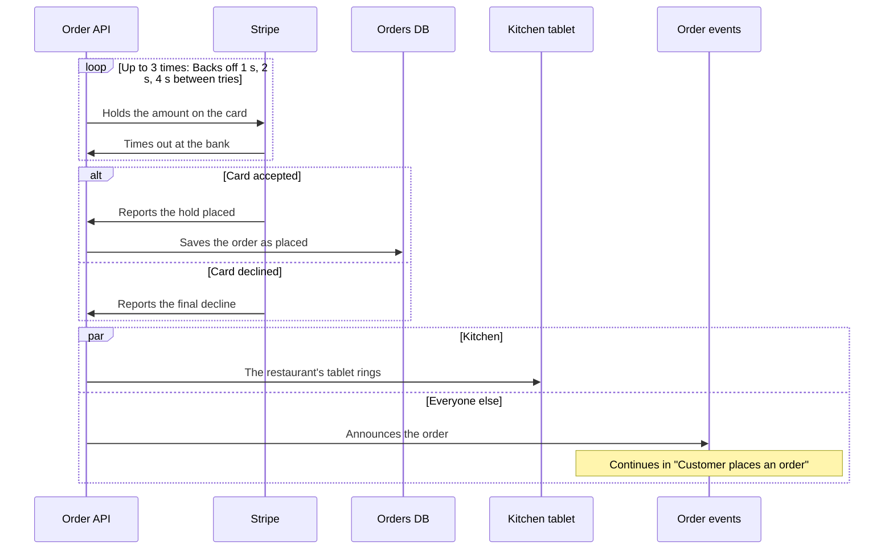

# Flowy Docs guide

The full detail behind the [README](../README.md): what every part of the canvas does, how editing and undo work, what Claude can change, and how sharing behaves. The examples come from Plum, a made-up delivery service whose model is in [`docs/demo/flowy`](demo/flowy).

What to write in it, shape by shape, is in [Writing good Flowy docs](writing.md).

## Read it

- Each shape shows an icon in a colour, which by default are its type's: person, system, app, store, component. Outside
  services you don't own are grey with a cloud. A shape can choose its own shape, colour, opacity and icon
  ([below](#shapes-colour-and-icons)). "3 inside" means a shape opens: double-click it, or
  select it and press Enter, to zoom in. Esc zooms back out, one level per press, once it has
  closed whatever is open (a flow, the side panel; the navigator only if your last click was in it). Backspace, Z and the breadcrumb zoom out too.
  Inside a shape, a frame named after it wraps what's in it, and a click on the frame opens that shape's panel. A faded shape that opens sits beside the
  one you're in, not inside it, so opening it slides across instead of zooming in.
- Hover a shape for its short description. Click it for the full text and its connections: every
  line out and in, with its label. A line that stands for several connections opens to list them.
  Pointing at a row lights its line on the canvas, and the shape's name opens that shape. Click a line
  to see the connections it stands for.
- Lines have no labels until you point at one. Click a shape and its lines show theirs while the
  others fade.
- Lines (top bar) switches between straight, curved and right-angled lines for your own screen.
  "Project default" goes back to the project's choice.
- Faded, dashed shapes live elsewhere in the model. They show up because something here connects to
  them, and they wait around the edges (people above, the rest beside, below or above, wherever
  fewer lines cross) while what's inside sits in the middle.
- A shape can list the files and folders it lives in, under its description. When the repo's
  `origin` is on GitHub or GitLab, they link there.
- A shape can list links to its long documents (a runbook, a decision record, a wiki page) in a Links
  section under its description. A web address opens in a new tab. A path in the repo links to the
  file when the repo's `origin` is on GitHub or GitLab, and a path that doesn't exist shows up as a
  problem.
- Ctrl+K or / (or Search) finds a shape anywhere in the model by name. Pick one and the canvas
  opens the level it's on, with its panel open.
- The icons on the left edge open a panel with two tabs. Explorer (O) shows everything as a tree, with
  how many shapes and flows are inside each, a dot where something is wrong, and a filter. It sorts as
  VS Code's Explorer does: shapes that hold others first, then the rest, each by name in any case, and
  with numbers read as numbers ("step 2" before "step 10"). A click shows a shape where it's drawn; Enter
  or a double-click zooms into it, and the tree follows you as you zoom. Flows (L) lists every flow, each
  level's by name: first those in the level you're in, then all the others under the level they play in,
  and a click goes there and plays it. The numbers on the icons are how many shapes and flows there are
  in all. Details, on the right (its own icon, or a click on a shape or a line), is what the
  click picked. Where the folder has load-test runs, a Performance icon below it (T) puts a run's panel
  in Details' place: see [Performance](#performance). Drag the inner edge of either panel to resize it,
  and double-click it to put the width back.
- Pick a flow in the Flows tab to play it step by step: ← and → move, Home and End jump to the first
  and last step, Esc stops. A step can be one shape doing something on its own, and a step with more
  to say has a More you can open. When a step lands on a shape that stands for a part inside it, the
  player names the part too ("Scheduler in Core"), so two steps on two parts of one shape don't read
  as a round trip.
- A step can carry an `animation:`. When you arrive at it, something runs
  along its line: `call` goes and comes back while the sender waits, `send` and `event` go one
  way, and `callback` shows what set it off (`trigger: outside` when it was the step before).
  In the browser the step plays again two and a half seconds after it ends, until you move on (the Repeat button on the card turns that off),
  R plays it again from the start, and Autoplay (P) steps through the flow on its own after the first play. Nothing moves when
  the system asks for less motion, and a step's text always says the same thing. The desktop app
  plays each step once.
- A flow whose steps are grouped (see [Repeats, branches and parallel steps](#repeats-branches-and-parallel-steps)) is played in
  stops: a chip names the group, a branch shows its lanes as tabs, the bar has a bracket under each group, and the lanes of a parallel
  group are one stop, lit and moving together. A step that says `flow:` has an Open flow button, and a bar to come back.
- F fits the whole view back on screen, and ? (or the ? button) lists every shortcut.
- "N problems" in the top bar lists what's wrong in the files. Pick one to jump to it. Shapes with
  a problem carry a "!".

The page follows the files: when Claude or your editor changes them, it updates by itself.

## Edit it

Press E, or the Edit button. The browser canvas and the [desktop app](#the-desktop-app) both do everything below, through the same
checks, and write the same text, so a change made in one looks the same in git as one made in the other.

- Drag shapes to arrange the view. Positions go to `flowy/layout.yaml`.
- Drag from the dot under a shape onto another shape to connect them, then type a label in the panel.
- Add (or N) puts a shape in the current view. It offers only the types that fit there: actors and
  systems at the top, apps and stores inside a system, components inside an app or store.
  Double-click an empty system, app or store to open it and add what goes inside.
- Click a shape to change its name, type, tech, look (shape, colour, opacity, icon), description and code. A field saves when you leave
  it. Code takes one path per line, relative to the folder that holds `flowy/`. A path that
  doesn't exist shows up as a problem.
- Links takes one per line, as `title | address`, or an address alone. An address is a web address
  (http or https) or a path in the repo, relative to the folder that holds `flowy/`. Anything else
  is refused.
- "Outside service" in a shape's panel marks it `external: true`, for things you use but don't own.
- Delete (the key, or the button in the panel) removes the selected shape or line. A shape that still
  contains others, or that a flow uses, stays, and a notice says why.
- To work on several shapes at once, Ctrl+click (or Shift+click) adds a shape to the selection and takes it out again, Shift and drag on
  the empty canvas draws a box round the shapes to select, and Ctrl+A selects every shape in the view. Dragging any selected shape moves
  them all, and Esc straight after takes the whole move back. Delete removes them all as one edit: if one of them can't go (it has shapes
  inside, or a flow uses it), none do. Ctrl+Z puts back everything at once. The desktop app does all of this too.
- Lines, in edit mode, sets the project's style for everyone: a `lines:` key at the top of
  `model.yaml`, which takes `straight` (the default, so it's left out), `curved` or `angled`.
- Esc or Backspace, straight after dragging a shape, take the drag back: whoever has just moved a shape and got it wrong reaches for them.
  Once anything else is done (a click, another edit, a move to another level) they close the panel and go up again, as in reading.
  **Z** zooms out whatever you have just done, and Ctrl+Z undoes the last change of any kind.
- Tidy forgets where shapes in this view were dragged, so Flowy lays it out again, picking the
  layout with the fewest crossing lines it finds. Ctrl+Z brings your positions back.
- New flow records a walkthrough: name it, click the shape where a step starts and the shape it goes
  to (or the same shape again, for a step it does on its own), type what happens and press Enter.
  Repeat. Each step's More holds longer detail for readers who want it. ↑, ↓ and × reorder and
  delete steps. To change a flow you already have, pick it in the Flows tab: in edit mode its rows carry a pencil, and a click opens
  the flow for editing instead of playing it.
- Each step's **Group and flow** holds the group it is in, its lane (for a branch or parallel group) and the flow it opens. Under the
  steps, **Groups** lists each group with its kind, its times or until (for a repeat) and its text, and a form puts a stretch of steps
  in a new group: a repeat is written with `times: 3`, and in a branch or parallel group every step starts a lane of its own
  ("Lane 1", "Lane 2"…), which you then rename or empty to join the lane before. Each choice is one edit: a step that leaves a group
  hands its lane's label to the next step, a group whose last step goes is removed, a group given another kind keeps what still
  applies (a repeat becomes a branch or parallel group with its first step starting "Lane 1", and for parallel every step starts a lane),
  and a change the checks refuse (a `times` outside 2 to 99, a step moved out of its group's stretch) says why and saves nothing.

Every save goes through the same checks as Claude's edits: a change that would add a problem is
refused, and nothing is written. If a file changed on disk in the meantime, the save is dropped
and the page reloads. Git keeps the history.

Ctrl+Z, or Undo, takes back your last change on this page, then the one before. It goes back as
far as the page has been open. Ctrl+Y or Ctrl+Shift+Z, or Redo, puts back what you undid, until
you make a new change. If the file changed since (Claude, your editor, another tab), undo and redo
leave it alone and say so. Undo brings back what the file said, not how it was written: like any
save, it drops YAML comments and writes the file in Flowy's own layout.

## Shapes, colour and icons

Every shape starts with the look its type gives it: a person is a pill, a store is a cylinder, anything else is a rectangle, each
in its type's colour with its type's icon. Four optional fields change that, in the **Look** part of a shape's panel (in the app and
in the browser) or in the file. The type still decides what a shape may sit inside; these only decide how it is drawn.

```yaml
objects:
  paid:
    type: component
    in: checkout-api
    name: Payment taken?
    shape: diamond        # what it is drawn as
    color: amber          # a name, or #rgb / #rrggbb
    opacity: 30           # how much of the colour fills it, 0 to 100
    icon: coin            # a built-in icon, or one of your own
```

| Field | Takes | When you leave it out |
| --- | --- | --- |
| `shape` | One of the 13 shapes below | The type's: pill for an actor, cylinder for a store, rectangle for the rest |
| `color` | A name (`gray red orange amber green teal blue indigo purple pink`) or a hex colour | The type's colour, and grey for an outside service |
| `opacity` | A whole number, 0 to 100 | 15 once you set a colour, and 0 (the plain surface) until then |
| `icon` | A built-in icon name, or one defined under `icons:` | A cloud for an outside service, else the type's icon |

All four are optional, and a blank value (`shape:`) counts as left out. A value Flowy doesn't know is a problem, and the problem list
says which.


### Which shape for what

Keep the type's own shape unless another says something the type can't. A model where every shape is different says nothing; one
where a diamond always means a decision, and a queue always means a queue, can be read at a glance.

| Shape | Use it for | For example |
| --- | --- | --- |
| `rectangle` | Things that run or do work: systems, apps, services, components. The default, and right most of the time | Order API, Billing |
| `pill` | People and roles, and the start or end of a flow | Customer, Support agent, "Order placed" |
| `ellipse` | A state or an event: something that is true or happens, rather than a thing that runs | "Payment failed", "Idle" |
| `diamond` | A decision: a question with more than one way out | "Paid?", "Within the limit?" |
| `hexagon` | Background work that runs without being asked: a worker, a job, a scheduled task | Nightly settlement, Image resizer |
| `parallelogram` | Data going in or out: an import, an export, a feed | CSV import, Invoice export |
| `cylinder` | A place data is kept: a database, a cache, a bucket, a warehouse. A store is one by default | Orders DB |
| `queue` | Things waiting their turn: a message queue, a topic, a job queue, a backlog | Order events |
| `document` | A file or paper someone reads, fills in or signs: a report, a form, a contract | Invoice PDF, Terms of service |
| `folder` | A group that holds others: a team, a package, a shared drive | Compliance, Billing team |
| `note` | A remark that is not part of the system: a caveat, an assumption, a to-do | "Manual step until Q3" |
| `cloud` | The wider world you reach over a network, when the shape itself should say "out there" | The public internet, A partner's network |
| `arrow` | One stage of a process that hands over to the next | Build, Test, Ship |

Some of these suit more than software. A hiring process is pills, arrows and diamonds; a warehouse is documents, queues and
folders; an organisation is folders and pills. Two cautions. A diamond, an ellipse and a cloud have less room for text, so keep their
names short. And an outside service already shows grey with a cloud icon from `external: true`, so reach for the cloud shape only when
the shape alone has to say it.

### Colour and opacity

A colour is a name, which has a version for the light theme and one for the dark so it reads on both, or any hex colour, which is
the same in both. It colours the icon, the outline and the fill. The fill is the colour at the opacity you give it over the
plain surface, 15 by default, which is a tint. Raise it for a stronger background, up to 100 for a solid one. Text and icon change
to near-black or near-white to stay readable on a strong fill, and the Mermaid copy keeps the colour as a `style` line.

Colour is a way to say something, so decide what first and say it once:

- **Use it for one thing across the model:** red for what is deprecated or risky, green for what is new, grey for what you don't own,
  blue for the part a team is responsible for. A colour that means three things means nothing.
- **Say what it means** in the descriptions that use it, or in the description of the shape that holds them. A reader can't
  look a colour up.
- **Keep the tint for grouping** and a strong fill for the one or two shapes the reader must not miss.
- **Don't use colour alone.** Someone who can't tell the colours apart still needs the name, the shape or the icon to say it.

### Icons

An icon says what a shape is at a glance, in a small space. There are about 150 built in (from [Tabler Icons](https://tabler.io/icons)),
picked for what people document. Type a name into the Icon field, which suggests as you type, or write `icon: name`.

**People.** `user`, `users`, `user-circle`, `user-check`, `user-cog`, `user-shield`, `users-group`, `headset`, `robot`, `id-badge-2`, `heart-handshake`

**Places and organisations.** `building`, `building-bank`, `building-store`, `building-factory-2`, `building-warehouse`, `building-skyscraper`, `building-hospital`, `home`, `school`, `map-pin`, `world`, `flag`

**Computing.** `server`, `server-2`, `database`, `cloud`, `cloud-upload`, `cloud-computing`, `api`, `app-window`, `apps`, `cpu`, `device-desktop`, `device-laptop`, `device-mobile`, `device-tablet`, `terminal-2`, `code`, `git-branch`, `git-merge`, `git-pull-request`, `bug`, `settings`, `tool`, `rocket`, `bolt`

**Data and flow.** `arrows-exchange`, `refresh`, `repeat`, `filter`, `table`, `chart-bar`, `chart-line`, `chart-pie`, `list-check`, `hierarchy-2`, `binary-tree`, `schema`, `timeline`, `webhook`, `layers-intersect`, `stack-2`, `puzzle`, `cube`, `package`, `packages`, `box`, `container`

**Network and devices.** `network`, `router`, `wifi`, `antenna`, `satellite`, `plug-connected`, `battery-2`, `printer`, `camera`, `video`, `microphone`, `qrcode`, `barcode`, `scan`, `radar`

**Documents and messages.** `file`, `file-text`, `file-invoice`, `file-certificate`, `files`, `folder`, `notebook`, `book`, `books`, `article`, `clipboard-check`, `signature`, `certificate`, `receipt`, `mail`, `message`, `messages`, `bell`, `phone`, `calendar`, `clock`, `hourglass`, `alarm`

**Money and trade.** `coin`, `credit-card`, `wallet`, `cash`, `calculator`, `shopping-cart`, `basket`, `tag`, `receipt-2`, `gift`

**Transport.** `truck`, `truck-delivery`, `plane`, `ship`, `train`, `car`

**Security and rules.** `lock`, `key`, `shield`, `shield-check`, `fingerprint`, `eye`, `gavel`, `scale`

**Status and ideas.** `check`, `circle-check`, `alert-triangle`, `alert-circle`, `star`, `heart`, `bookmark`, `target`, `bulb`, `brain`, `sparkles`, `flame`, `droplet`, `leaf`, `tree`, `sun`, `moon`, `trophy`, `award`

**Science and health.** `flask`, `microscope`, `stethoscope`, `heartbeat`, `medical-cross`, `pill`

Choose an icon when it names the thing better than its type does: a `truck` for the courier, a `mail` for the notification service, a
`lock` for the login. Leave it out when the type's icon already says it.

**Your own icons** go in an `icons:` section at the top of `model.yaml`: a name, and the SVG path data of a line icon on a 24 by 24
grid, drawn two units thick with round ends like the built-in ones. Name a shape's `icon:` after it.

```yaml
icons:
  stripe: M4 6h16v12h-16zM4 10h16M8 15h3   # a card
objects:
  stripe:
    type: system
    name: Stripe
    external: true
    icon: stripe
```

To take one from an SVG file, copy the `d` of each `<path>` and join them one after another, as the built-in ones are. A name is
lowercase letters, digits and dashes, and can't be one of the built-in names. Claude adds and removes them with the `put_icon` and
`delete_icon` tools, and `get_model` lists the ones a model has. An icon that is still in use can't be deleted. There are no
colour or image icons: an icon takes the colour of the shape that shows it.

## Repeats, branches and parallel steps

A flow is a flat list of steps, but real systems aren't flat: a call is retried, a result decides what happens next, one shape tells
several others at once, one flow hands the story to another. A flow file can say so, with two optional additions. A `groups:` section
declares each group once, and a step joins a group by its id.

```yaml
name: Customer pays for an order
view: ordering
groups:
  charge:
    kind: repeat
    times: 3
    text: Backs off 1 s, 2 s, 4 s between tries
  outcome:
    kind: branch
  tell:
    kind: parallel
steps:
  - { from: order-api, to: stripe, text: Holds the amount on the card, group: charge }
  - { from: stripe, to: order-api, text: Times out at the bank, group: charge }
  - { from: stripe, to: order-api, text: Reports the hold placed, group: outcome, lane: Card accepted }
  - { from: order-api, to: orders-db, text: Saves the order as placed, group: outcome }
  - { from: stripe, to: order-api, text: Reports the final decline, group: outcome, lane: Card declined }
  - { from: order-api, to: kitchen-tablet, text: The restaurant's tablet rings, group: tell, lane: Kitchen }
  - { from: order-api, to: events, text: Announces the order, group: tell, lane: Everyone else, flow: place-order }
```

This is a flow Plum doesn't have, written with Plum's shapes. A group is one of three kinds:

| Kind | It means | It takes |
| --- | --- | --- |
| `repeat` | The same steps run again | `times` or `until`, and optionally `text` |
| `branch` | Alternatives: one lane happens | Lanes, and optionally `text` |
| `parallel` | Lanes that all happen at once | At least two lanes, and optionally `text` |

- `times` is how many times the stretch runs in all, the first run included, a whole number from 2 to 99. It is a claim about a real
  limit ("the client gives up after 3 tries"), not a number for illustration. `until` says in words what stops a repeat. A repeat
  needs one of the two. Backoff, delays and timeouts aren't data: say them in the group's `text` or in the steps.
- A step's `group` is the group it belongs to, and it is in at most one. The steps of a group have to sit next to each other.
- A step's `lane` starts a lane of a branch or a parallel group, and the steps after it in the same group, up to the next `lane`, belong
  to it. The first step of a branch or parallel group must have one. A lane is a label in plain words ("Card declined"), unique inside
  its group, and a repeat has none. A branch may have a single lane, for "if the coupon is valid, this happens".
- A step's `flow` is the flow its story continues in, for a step whose story is long enough to deserve a flow of its own. A flow can
  point at one that points back, and that is not a problem.
- A group id follows the rule for a flow's id: lowercase letters, digits and dashes.
- There is one level of groups. A group can't sit inside another.

Flowy checks them as it checks everything else, and lists what is wrong in the problem list: a `group` that isn't declared under
`groups`, or a declared one that no step uses, a repeat with neither `times` nor `until`, `times` outside 2 to 99, `times` or `until`
on a branch, a lane on a step with no group or in a repeat, a first step with no lane, two lanes with one label, a parallel group with
fewer than two lanes, a step that sits between two members of a group without belonging to it, and a `flow` that isn't a flow in the
folder. The last means a change that deletes a flow another one points at is refused, as any change that adds a problem is.

**Elsewhere in Flowy.** The checks, and Mermaid. A repeat becomes a `loop` block labelled with every fact it has, a branch an `alt` with
an `else` for each further lane (`opt` when it has one), a parallel group a `par` with an `and` for each further lane, and a step with
`flow:` is followed by a note over its end that names the flow it continues in. The sample above comes out as:



**In the player.** The player steps through *stops*, the things that are on screen at once. Every step is a stop of its own except in
a parallel group, where stop *k* is the *k*-th step of every lane: five one-step lanes are one stop with five lines lit and moving
together, and a lane that has run out simply drops out. The card says where you are: a chip names the group (`Repeats up to 3 times`,
`One of 2`, `At the same time, 2 lanes`), a branch lists its lanes as tabs with yours marked, the group's own `text` follows, and the
progress bar has a cell for each stop, a branch's lanes on rows of their own and a bracket under each group. Point at a cell or a
bracket to read what it means, or press the **?** on the card for a key to all of it. A parallel stop shows a block for each lane. On
the canvas a small label on each lit line says how often it repeats or which lane it is, and the lanes of a branch you are not in
are dashed and faint. A step with `flow:` has an **Open flow** button. It plays that flow on its own level and puts a bar at the top
of the card, *Back to "…", step N*, that returns you to where you were (in the browser, the Back button does the same). The way back
isn't in the address, so a reload drops it. Nothing moves when the system asks for less motion, and the chips, tabs, brackets and labels
stay. A flow with none of these keys reads, plays and exports exactly as it did.

Claude's `put_flow` takes `groups` and a step's `group`, `lane` and `flow` (a `times` may be a number there), and its instructions say when
to reach for each. Edit mode has fields for all of them (see above).

## Performance

A run is a load test, summarised: for each load that was tested, what each shape and each connection measured. It lives in
`flowy/perf/<name>.yaml` (the name follows the same rule as a flow's file name), and a folder can hold several: a ramp, a spike,
the same test before and after a fix.

```yaml
name: Ramp, 20 s per level
about: Node 22, 4 cores, the load generator on the same machine
unit: req/s
levels:
  - load: 100
    overall: { rate: 98, p50: 60, p95: 140, errors: 0 }
    objects:
      web-api: { util: 0.35, queue: 0, errors: 0 }
    connections:
      - { from: web-api, to: payments, rate: 40, p50: 90, p95: 180, errors: 0 }
  - load: 200
    overall: { rate: 190, p50: 70, p95: 150, errors: 0.01 }
    objects:
      web-api: { util: 0.7, queue: 2, errors: 0 }
    connections:
      - { from: web-api, to: payments, rate: 80, p50: 95, p95: 260, errors: 0.01 }
```

Every number is optional except a level's `load`. On a shape, `util` is how much of what it can do is in use (0 to 1), `queue` how many are waiting, and
`errors` the share that fail (0 to 1). On a connection, and in `overall` (what the entry point measured), `rate` is calls a
second, `p50` and `p95` are milliseconds (the tab calls them the expected call and the slowest 5%) and `errors` is the share that fail.
Levels go up in load, and a run needs at least two. A number that isn't there isn't drawn as zero: that shape or line stays
plain. `unit` says what a load counts, and `entry` can name the shape the load comes in at.

Flowy checks a run the way it checks `code:` paths: a shape or connection it names that isn't in the model, or a number that
isn't one, is a problem. A run it can't read at all is a problem too, listed in the Performance tab, and it never stops the model
from loading. Flowy only reads runs. Tools write them, and nothing in Flowy changes a run file.

**Reading it.** Open the Performance tab on the right edge, or press **T**. Pick a run if there are several. The slider has a stop
for each tested load; ← and → move between them, and **Ramp** (**P**) sweeps up to the highest, at a pace that would cover the whole run in half a minute. Between two
tested loads the numbers are blended from the two, and the tab says so. Click a shape or a line to read its numbers at this load,
with a small curve of each across all of them. A shape that holds others takes the worst of what is inside it, so at the overview
you see which system is struggling and zoom in to find where. The tab opens on the load where things first struggle, if anything
does, and **Go there** gets back to it.

**What to remember.** This is a replay. Flowy never predicts a load nobody tested, so the slider stops at the highest one. How
strained a shape looks is its `util`, or its failure rate counted twenty times (5% failing is as bad as full), whichever is
worse. Nothing moves when the system asks for less motion; the colours, thickness, badges and numbers stay. An exported page
carries the runs, so its Performance tab works too. The desktop app reads runs too, with the same panel and keys.

**Making one.** Any tool that can write this file works. `perf-lab/` in the Flowy repo is a small shop that really runs, with a
load generator that measures it and writes runs of this shape: `npm run lab:run` makes one, and
`node src/cli.ts --dir perf-lab/flowy` opens it.

## Let Claude build it

From the root of the repo you want to document, once the clone is built as the
[README](../README.md#the-browser-version) says:

```bash
claude mcp add flowy -- node /path/to/flowy-docs/dist/cli.js mcp
```

Then ask Claude something like "map this repo into Flowy". It writes `flowy/model.yaml` and
`flowy/flows/*.yaml`, and refuses any change that would break the model. Add `--dir <folder>`
after `mcp` to keep the files somewhere other than `./flowy`.

Claude can also note where each shape lives in the code (`code: [src/api/]`). A path that doesn't
exist is refused, so the model can't quietly point at code that's gone. When code moves later,
the shape gets a "!" until someone fixes the path.

Claude can also link a shape to its long documents (`links: [{ title: Runbook, url: docs/runbook.md }]`).
A repo path must exist, and a web address is taken as given.

Claude marks outside services (a payment provider, a third-party API) with `external: true`, so
they show grey. It is told to leave `shape`, `color`, `opacity` and `icon` alone unless one says something the type
doesn't, and to keep a colour to one meaning across the model, so a model it builds looks like the type defaults until you choose otherwise.

When Claude saves a flow, Flowy answers with how each step will read on the flow's view, the
way the player shows it ("2. Alert channels → Text and speech in Core: …"). Its instructions ask
for steps that say what passes between the two shapes and whether the sender waits, so a flow
reads the way the code works.

Saving rewrites the file, so YAML comments in `model.yaml` and flow files aren't kept. Put
notes in an object's `description` instead.

## Share it

People without the repo can read the model too:

```bash
node /path/to/flowy-docs/dist/cli.js export
```

It writes a read-only copy of the canvas to `./flowy-site`, with the model inside its `index.html`.
Put the folder on any static host, such as GitHub Pages, and send the link. Browsers won't run it
straight from disk. To show it in Notion or Confluence, embed the link. `--dir` picks the model
folder and `--out` the export folder. An export carries any load-test runs too.

Export again after the model changes. Only what the export wrote is replaced, so a `.git` or a
`CNAME` you keep next to it stays. A folder with other files in it is left alone, and so is one
that holds the model. A file that can't be read stops the export. Problems don't: the page lists
them.

For a README or a pull request, the Mermaid button copies the view on screen (or the flow
playing) as a Mermaid diagram, fenced and ready to paste. GitHub and GitLab draw it. A diamond comes out as a
diamond, a cylinder as a cylinder, and so on, and a colour becomes a `style` line (a folder has no Mermaid shape and stays a
rectangle, and the queue, document, note and cloud shapes need Mermaid 11.3 or later). The same
from the command line, or for Claude through MCP (`get_mermaid`):

```bash
node /path/to/flowy-docs/dist/cli.js mermaid --view ordering
```

`--flow <id>` prints a flow as a sequence diagram instead. A flow's repeats, branches and parallel lanes come out as `loop`, `alt` and
`par` blocks ([above](#repeats-branches-and-parallel-steps)).

The address follows what's on screen. `#ordering` is the inside of Ordering, and `#ordering/place-order` plays
the flow `place-order` there. Copy it to send someone straight to a level or a flow. The local canvas
does this too.

## The desktop app

The desktop app is a native reader for the same folders: it reads the YAML itself and draws it with its own renderer, so there is
no server and no browser behind it. It reads and it edits: [Edit it](#edit-it) above is as true of the app as of the browser, and
what it saves, the browser and Claude see, and the other way round. A file that can't be read leaves the last good model on screen
with the reason in a banner, and while it is there editing is off.

Editing in the app: **E** (or the Edit button) turns it on, and the bar gains New flow, Add, Undo, Redo and Tidy. A shape's panel becomes
a form (name, type, outside service, tech, look, description, links, code), and a line's panel has a label field and a delete for each connection it
stands for. Drag a shape to move it; the dot under a shape starts a connection, which you drop on another shape. Each edit is checked first:
one that would add a problem is refused and a notice says why. A file changed elsewhere since the app read it is never overwritten: the
edit is dropped, and the view reloads. **Ctrl+Z** and **Ctrl+Y** undo and redo, but only where the files are still as that edit left
them. The sample model that ships with the app can't be edited.

What it has, as the canvas does: zoom into a shape (double-click it, or select it and press Enter; Esc and Backspace go back up, and
the breadcrumb works too), a frame around the shape you're inside, shapes that belong to another level faded and dashed, wheel to
zoom and drag to pan, **F** to fit, the side panel with the description, its links, the files a shape lives in (as links when the repo's
origin is on GitHub or GitLab), and every connection out and in, the rail of icons on the left edge (**O** shows the whole documentation as a tree, **L** lists every flow and plays one) and the one on the right (**T** for load-test runs), flows that play with ← and → (Home and End go to the first and last
step) with a step's animation, **R** to play it again and **P** to let the flow run on its own, **Ctrl+K** or **/** to find a shape, **?** for the shortcut list, the problem list in the top bar, straight, curved or
right-angled lines, light or dark with the system, and no animation when the system asks for less. **Opening a shape that sits
beside the one you're in slides across instead of zooming in.**

The links in a shape's panel open on your computer. A web address opens in the browser, a folder in the file explorer, and a file in your
default app if it is a document (Markdown, text, PDF, a common image). Any other file, such as a script or a program, is shown in its
folder and not run. A small folder button beside each file shows it in its folder. **File › Open Files With** picks an app of your own to
open files with (any file inside the repo), and that choice stays on your computer, never in the repo.

What it adds is a way to choose the model:

- **File › Open Folder** (Ctrl+O) takes a repo or its `flowy/` folder. A folder called `flowy` is
  used as it is; otherwise the `flowy/` inside it, and with none of those, the folder itself if it holds `model.yaml`. If there is
  none, the app says so. Opening never creates files; only an edit does.
- Drop a folder on a window, pick one from **File › Open Recent**, or start the app with a path: `FlowyDocs.exe path\to\repo`. If
  the app is already running, the folder opens there.
- On Windows the installer adds **Open with Flowy Docs** to the right-click menu of a folder and of a folder's empty space (under
  *Show more options* on Windows 11), and removes it again when you uninstall.
- Each model gets its own window. Opening one that is already open brings its window forward. A window opens at the size, and
  maximized or not, that the last one was closed at.
- **Help › Open the Demo (Plum)**, or the welcome window's button, opens the sample model that ships with the app, so there is
  something to look at before you point it at a repo. It has two made-up load-test runs, so its Performance tab (**T**) works too.

For sharing, **View › Copy as Mermaid** puts the view on screen, or the flow playing, on the clipboard as a fenced Mermaid
diagram, the same text the browser's Mermaid button copies. **View › Save Picture…** saves the diagram, without the top bar and
the panel, as a PNG at twice the size on screen. **File › Reload** (F5) reads the folder again, which is also how to carry on
after the folder was deleted and came back, and **Show in Explorer** (Finder on macOS) opens the model's folder. A model with no
shapes says so instead of showing a blank canvas.

The shapes you haven't dragged are placed by the app's own layout, not by the browser's, so they can sit a little differently
there. Shapes you did drag are where `layout.yaml` says in both. The address that follows the canvas in the browser has no
counterpart in the app.

A few seconds after it starts, an installed copy asks GitHub's Releases whether a newer version exists: **Help › Check for updates
automatically** turns that off and **Help › Check for Updates…** asks once. The macOS build isn't signed, so there the item opens
the download page. Images in descriptions are not fetched; they show as their description in brackets.
