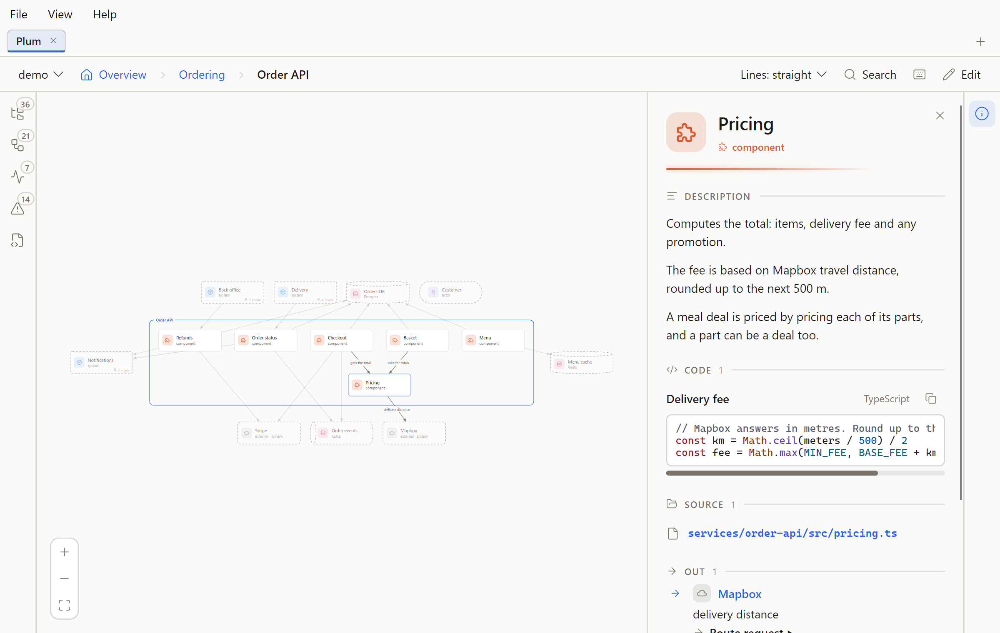
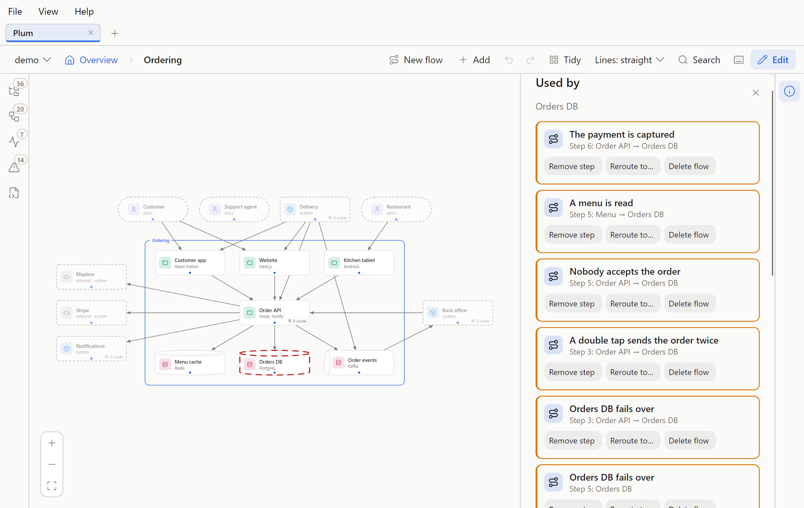
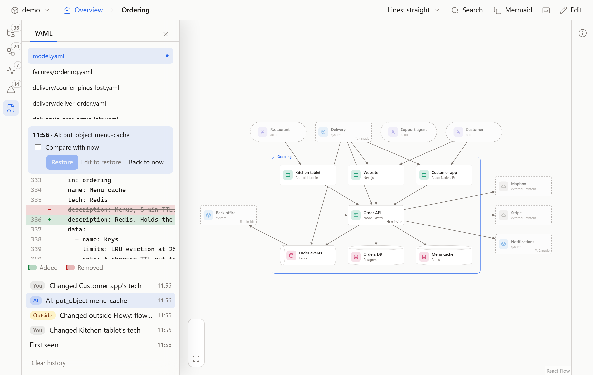

# The canvas

The keys are in [Shortcuts](../shortcuts.md).

## Read it

- Wheel: zooms. Drag on empty canvas: pans.
- Theme: the system's, or in the VS Code panel the editor's.
- Find a shape (search, top bar): anywhere in the model, by name or id, at most 8 results. Picking one opens its level with its panel open.
- "3 inside": a double-click opens the shape. A faded shape that opens slides across instead of zooming in.
- Frame round the view: the shape you are inside. A click opens its panel.
- Faded, dashed shape: it lives elsewhere, and something here connects to it, or it is a person a flow here names. People wait above, the rest where fewer lines cross.
- Arrowhead at both ends: connections run both ways, and the line's panel lists each way under its own heading.
- "!" on a shape: a problem. "N problems" in the top bar lists them.
- Key at the canvas foot: the [connection kinds](kinds.md) drawn, and any Plain line beside them.
- Line label: shows on hover, or while its shape is selected.
- Lines (top bar): straight, curved or angled for your screen, until you pick the project's own style. In edit mode it sets `lines`.
- Explorer: shapes that hold others first, then by name in any case, with numbers read as numbers. A row's number counts one level, its tooltip every level, and a dot says a problem is in there.
- Flows tab: the search matches names, file names, folders and tags.
- Rail: the numbers are shapes, flows, failure modes and runs in all. Performance and Failures are always there, and Create on an empty one copies a starter run, or for Failures turns edit mode on.
- Code section: each snippet's title, language and a Copy button, over the code in colour. Nothing in it runs.
- Details: with nothing picked, the Overview at the top level and the shape you are in elsewhere.
- A payload only a flow step sends sits under the line once, and its tooltip names the step.
- Links and Source: a web address opens in a new tab. A repo path links to the file when `origin` is on GitHub or GitLab, else it is plain text. In the VS Code panel it opens in the editor.
- Side panels: they stop at 640 px, wider only for a line of code or a table, and a double-click on the edge resets them. Changing one fits the view again, unless you have zoomed or panned.
- Screen readers (browser): names, never ids. The side panels are Navigator and Details, and a flow folder is a named group.

## The player

A flow opens with its first step moving, and each step waits at its end.

- Back: a moving step plays again, and a second press within 2 seconds goes to the step before. A still step goes there at once.
- Pause: holds everything where it is, the moving dot, a channel coming in and a shape's state included, and stays on through Back and Next.
- Play: carries on. A step that has played out runs again, and the last step with Autoplay on starts from step 1.
- Autoplay: a finished step goes on to the next, up to the last. It stays on through Back and Next, and a comparison pane opens with it off.
- Repeat (browser, on by default): a moving step plays again 2.5 seconds after it ends. Greyed out on a still step and during Autoplay.
- The bar goes to any moment of any step. The browser keeps Autoplay, Repeat and the speed for your next visit.
- The card keeps the size of its tallest step.
- A step on a part of a shape names it: "Scheduler in Core".
- Recursion: a card per level, a flag on the deepest, and a counter that stays at the end (`↻ 3 deep`).
- Reduced motion (system setting): nothing moves and every mark stays drawn, a recursion shows only its counter, and a step's text stays the same.

## Edit it

The browser and the [desktop app](desktop.md#the-desktop-app) do all of this and write the same text. A field saves when you leave it, and a dimmed choice says why in its tooltip.

- Connect: drag from the dot under a shape onto another, then type a label in the panel.
- Where a key is set: a line's card has Kind, a shape's panel Outside service (`external: true`), a step's form Payload, Reply and Group and flow.
- Add: offers only the types that fit the view. Double-click an empty system, app or store to open it.
- Overview form: clearing **Name** or **About** removes its key.
- Source: one path per line. Links: one per line, `title | address` or an address alone.
- Code: a card is saved once it has code. Language is Auto until you pick one, and Auto names what it worked out.
- Kind on a line: a drawn tile for each kind and one for Plain line.
- Payload and Reply in a step's form, Payloads on a line: a button for each payload.
- New payload: saved, and put on the line, once its About is. Delete payload takes it out of the model, and is refused while another line or a step names it.
- Intercepted: names "Third party" until you pick a shape or type a name.
- New flow: name it, click a step's start and end (the same shape twice for a step on its own), type what happens.
- Pencil on a flow row: opens it for editing. An empty **Folder** means the top of `flows/`. Browser only: drag a row onto a folder, or onto Top level.
- Tidy: lays this view out again and saves it, whatever was dragged in it, by the fewest crossing lines it finds, as an untidied view is, and with faded shapes on the side they have in the view above.

**Groups.** The **Groups** form groups a stretch of steps.

- A new repeat is written with `times: 3`.
- In a new branch or parallel group every step starts a lane ("Lane 1", "Lane 2"). Empty a lane's name to join the lane before.
- A step that leaves hands its lane's label to the next step, and a group whose last step goes is removed.
- A repeat made a branch starts "Lane 1" on its first step, and made a parallel group on every step.

**Delete.** With nothing depending on it, a shape or line goes at once, with Undo in the notice. Otherwise the Used by panel lists each dependent: shapes inside, flow steps, a flow's view, a failure mode. Delete stays grey until every row has a choice, and a click on a row outlines its shapes. A selection shares one panel, and all of it is one edit.

**Saving.** A change that would add a problem is refused with the reason. If a file changed on disk meanwhile, the save is dropped and the page reloads.

**Undo.** It reaches as far back as the page has been open, and a new change ends Redo. If the file changed since, both leave it alone and say so. Undo brings back what the file said, in Flowy's own layout.

## YAML and history

The YAML tab shows the files as text, read only, beside Details. The browser also keeps the last 300 changes. An exported page and the desktop app show the files marked Read only, with no steps, and the VS Code panel has no history.

- Files: `model.yaml`, `layout.yaml`, every flow and failure analysis, as on disk, comments included. `perf/` is left out because tools write it. Picking a shape goes to its block.
- Marks: an added line is green, a removed line red with a strike, and a dot on a file's tab means the change touched it. Marks follow the newest step, whoever made it, until you pick an older one.
- Steps: You (an edit in Flowy), AI (a write over MCP), Outside (anything else) and Restored. One edit is one step, even across files. **First seen** is a copy of the folder as first opened. A change made while Flowy was closed shows the next time it opens the folder.
- Looking back: a picked step shows its files, marked against the step before. **Compare with now** marks them against today: red is what a restore would take away, green what it would bring back. The canvas keeps the current model.
- Restore: needs edit mode. Every file of the step comes back, and one that didn't exist then is removed. It is a step of its own, the files just before are recorded first, and Undo takes it back.
- Where it is kept: `%APPDATA%\Flowy Docs` on Windows, `~/.config/Flowy Docs` (or `$XDG_CONFIG_HOME`) elsewhere, and `FLOWY_STATE_DIR` moves it. Nothing goes in the repo or git. Each project path has its own trail, so a moved folder starts a new one. **Clear history** asks first.
- If the history can't be written, an edit still saves, the tab says "History isn't being saved", and Restore is refused.
