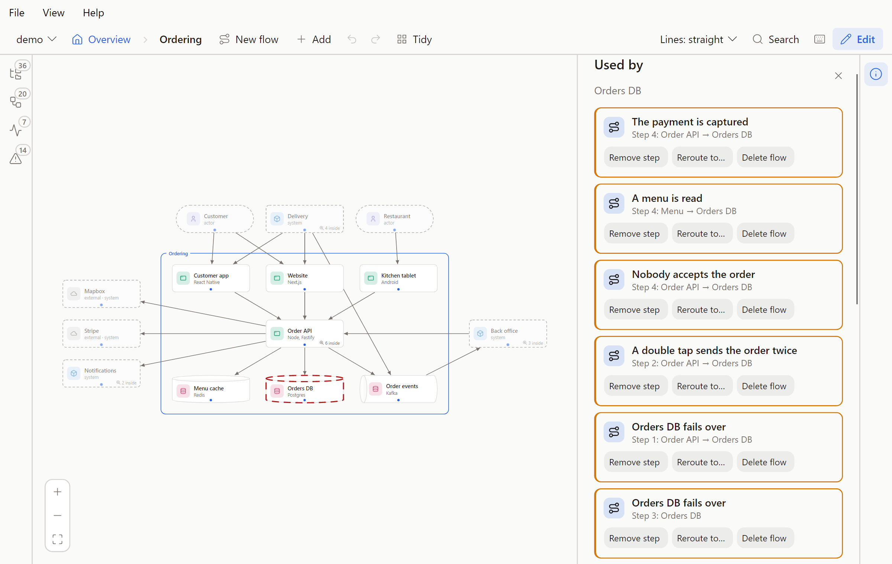

# The canvas

Reading the model on the canvas, editing it, and the YAML tab with its history. Part of the [Flowy Docs guide](../guide.md).

## Read it

- Each shape shows an icon in a colour, which by default are its type's: person, system, app, store, component. Outside
  services you don't own are grey with a cloud. A shape can choose its own shape, colour, opacity and icon
  ([below](shapes.md#shapes-colour-and-icons)). "3 inside" means a shape opens: double-click it, or
  select it and press Enter, to zoom in. Esc goes back to the level you came from, one per press, once it has
  closed whatever is open (a flow, the side panel; the navigator only if your last click was in it): open Ordering, then Back office beside it, and Esc returns to Ordering, then the overview.
  With nowhere to go back to, it goes up a level. Backspace, Z and the breadcrumb always zoom out to the level above.
  Inside a shape, a frame named after it wraps what's in it, and a click on the frame opens that shape's panel. A faded shape that opens sits beside the
  one you're in, not inside it, so opening it slides across instead of zooming in.
- Hover a shape for its short description. Click it for the full text and its connections: every
  line out and in, with its label. A line that stands for several connections opens to list them.
  Pointing at a row lights its line on the canvas, and the shape's name opens that shape. Click a line
  to see the connections it stands for.
- Lines have no labels until you point at one. Click a shape and its lines show theirs while the
  others fade.
- Lines (top bar) switches between straight, curved and right-angled lines for your own screen.
  Pick the project's own style and your screen follows the project again.
- Faded, dashed shapes live elsewhere in the model. They show up because something here connects to
  them, and they wait around the edges (people above, the rest beside, below or above, wherever
  fewer lines cross) while what's inside sits in the middle.
- A shape can hold a few lines of code, such as a formula, a query or the request it takes, in a Code section under its description.
  The code is coloured, and Flowy works out the language unless you pick one ([below](code.md#code)).
- A shape can list the files and folders it lives in, in a Source section. When the repo's
  `origin` is on GitHub or GitLab, they link there.
- A store can show what it holds: its panel has a Data section with its tables as tables, a few sample rows, how long things are kept
  and short notes ([below](data.md#data)).
- A shape can list links to its long documents (a runbook, a decision record, a wiki page) in a Links
  section under its description. A web address opens in a new tab. A path in the repo links to the
  file when the repo's `origin` is on GitHub or GitLab, and a path that doesn't exist shows up as a
  problem.
- Ctrl+K or / (or Search) finds a shape anywhere in the model by name. Pick one and the canvas
  opens the level it's on, with its panel open.
- The icons on the left edge open a panel with tabs. Explorer (O) shows everything as a tree, with
  how many shapes and flows are inside each, a dot where something is wrong, and a filter. It sorts as
  VS Code's Explorer does: shapes that hold others first, then the rest, each by name in any case, and
  with numbers read as numbers ("step 2" before "step 10"). A click shows a shape where it's drawn; Enter
  or a double-click zooms into it, and the tree follows you as you zoom. Flows (L) lists every flow as the
  folders they are filed in under `flows/`, a folder before the flows beside it and the flows by file name, so `01-place-order` comes before `02-pay`.
  A click goes to the level a flow plays in and plays it. The tags in use sit above the list: press one to keep the flows that have it, or press
  several to keep those with any of them. The search matches names, file names, folders and tags. In the browser version a YAML tab (Y) beside them shows the files
  as text, with every change to them ([YAML and history](#yaml-and-history)). The numbers on the icons are how many shapes, flows,
  failure modes and runs there are in all. A Performance icon (T) and a Failures icon (M) sit with them, whether or not the folder has a
  load-test run or a failure analysis: with none, their panels offer to **Create** one. See [Performance](performance.md#performance) and
  [Failure modes](failures.md#failure-modes). Details, on the right (its own icon, or a click on a shape or a line), is what the
  click picked, and it is all the right-hand side holds. With nothing picked at the top level it shows the Overview: the system's name and
  what it is (`name` and `about` in `model.yaml`), then how many shapes and flows there are. Inside a shape it shows that shape. Drag the inner edge of either panel to resize it,
  and double-click it to put the width back.
- Pick a flow in the Flows tab to play it step by step: ← and → move, Home and End jump to the first
  and last step, Esc stops. A step can be one shape doing something on its own, and a step with more
  to say has a More you can open. When a step lands on a shape that stands for a part inside it, the
  player names the part too ("Scheduler in Core"), so two steps on two parts of one shape don't read
  as a round trip.
- Every flow row in the Flows tab and the Explorer has a Compare button, and a flow that is half of a pair has a link mark. See [Compare](compare.md).
- A step can carry an `animation:`. When you arrive at it, something runs
  along its line: `call` goes and comes back while the sender waits, `send` and `event` go one
  way, and `callback` shows what set it off (`trigger: outside` when it was the step before).
  A step that really ends another way adds an `outcome`: `fail` on a `send` or `call` runs red and flashes the receiver, `timeout` on a `call` leaves the sender waiting with no reply and dims the line, and five more show a request that is lost, turned away, taken by someone else, delivered twice or held up (see [How a request ends](flows.md#how-a-request-ends)). The step's text still says what happened.
  In the browser the step plays again two and a half seconds after it ends, until you move on (the Repeat button on the card turns that off),
  R plays it again from the start, and Autoplay (P) steps through the flow on its own after the first play. Nothing moves when
  the system asks for less motion, and a step's text always says the same thing. The desktop app
  plays each step once.
- A flow whose steps are grouped (see [Repeats, branches and parallel steps](flows.md#repeats-branches-and-parallel-steps)) is played in
  stops: a chip names the group, a branch shows its lanes as tabs, the bar boxes each group, and the lanes of a parallel
  group are one stop, lit and moving together. A step that says `flow:` has an Open flow button, and a bar to come back.
- F fits the whole view back on screen, and ? (or the ? button) lists every shortcut.
- "N problems" in the top bar lists what's wrong in the files. Pick one to jump to it. Shapes with
  a problem carry a "!".

The page follows the files: when an AI or your editor changes them, it updates by itself.

## Edit it

Press E, or the Edit button. The browser canvas and the [desktop app](desktop.md#the-desktop-app) both do everything below, through the same
checks, and write the same text, so a change made in one looks the same in git as one made in the other. A save writes the whole
file again, so comments in it are not kept ([File format](../format.md#the-folder)).

- Drag shapes to arrange the view. Positions go to `flowy/layout.yaml`.
- Drag from the dot under a shape onto another shape to connect them, then type a label in the panel.
- Add (or N) puts a shape in the current view. It offers only the types that fit there: actors and
  systems at the top, apps and stores inside a system, components inside an app or store.
  Double-click an empty system, app or store to open it and add what goes inside.
- With nothing picked at the top level, Details holds a form for the system's **Name** and **About** (Markdown). Both are optional; clearing a
  field removes its key.
- Click a shape to change its name, type, tech, look (shape, colour, opacity, icon), description, code and source. A field saves when you leave
  it. Source takes one file or folder per line, relative to the folder that holds `flowy/`. A path that
  doesn't exist shows up as a problem.
- Code has a card for each snippet: a title, a language and the code. Add code starts a card, which is only saved once it has code.
  The language is Auto until you pick one, and Auto names what it worked out. A shape holds at most six snippets of 40 lines each.
- A store's **Data** box holds its data as the lines the file holds ([Data](data.md#data)).
- Links takes one per line, as `title | address`, or an address alone. An address is a web address
  (http or https) or a path in the repo, relative to the folder that holds `flowy/`. Anything else
  is refused.
- "Outside service" in a shape's panel marks it `external: true`, for things you use but don't own.
- Delete (the key, or the button in the panel) removes the selected shape or line, with its lines. When nothing else depends on it, it goes at
  once, and the notice says what went with it and has an Undo button. When something does (shapes inside it, flow steps, a flow's view, a failure
  mode), the Used by panel opens with a row for each. Pick what to do with a row: remove the step, reroute it to another shape, delete the flow,
  remove the mode, repoint it. Click a row to outline the shapes it names. Remove all (Enter) settles every row by removing, Reroute all (R)
  sends steps and modes to one shape, and Delete stays grey until each row has a choice. Esc closes the panel and changes nothing. All of it
  is one edit, so Ctrl+Z puts everything back.

  
- To work on several shapes at once, Ctrl+click (or Shift+click) adds a shape to the selection and takes it out again, Shift and drag on
  the empty canvas draws a box round the shapes to select, and Ctrl+A selects every shape in the view. Dragging any selected shape moves
  them all, and Esc straight after takes the whole move back. Delete removes them all as one edit, and what depends on any of them
  shows in one Used by panel. Ctrl+Z puts back everything at once. The desktop app does all of this too.
- Lines, in edit mode, sets the project's style for everyone: a `lines:` key at the top of
  `model.yaml`, which takes `straight` (the default, so it's left out), `curved` or `angled`.
- Esc or Backspace, straight after dragging a shape, take the drag back: whoever has just moved a shape and got it wrong reaches for them.
  Once anything else is done (a click, another edit, a move to another level) they close the panel and go up again, as in reading.
  **Z** zooms out whatever you have just done, and Ctrl+Z undoes the last change of any kind.
- Tidy lays this view out again and saves it, whatever was dragged in it, picking the layout with the fewest crossing lines it finds. The faded shapes
  from other levels go on the side they have in the view above: if Back office is right of Ordering at the top level, Ordering shows it on the right and
  Back office shows Ordering on the left, so zooming from one to the other never leads the same way twice. A view you never tidy is laid out by the same
  search without that rule. Ctrl+Z brings your positions back.
- New flow records a walkthrough: name it, click the shape where a step starts and the shape it goes
  to (or the same shape again, for a step it does on its own), type what happens and press Enter.
  Repeat. Each step's More holds longer detail for readers who want it. ↑, ↓ and × reorder and
  delete steps. To change a flow you already have, pick it in the Flows tab: in edit mode its rows carry a pencil, and a click opens
  the flow for editing instead of playing it. A flow's form has a **Folder** (type a new one, or pick one that is there; an empty field puts the flow at the top of `flows/`), its **Tags**, and **Compare with**, which links it to an older flow ([Compare](compare.md#making-a-pair)). A move changes only where the file is, and in the Flows tab you can also drag a flow onto a folder (a Top level row appears while you drag, for the way back). A tag is a button to press on or off, and a field adds a tag of your own.
- Each step's **Animation** is a form of drawn choices: the way it travels (None, Send, Call, Callback, Event) and the way its request ends (Arrives, Fail,
  Timeout, Lost, Rejected, Intercepted, Duplicated, Delayed), then a share of the requests, a reason, and for an interception the shape that takes it or a name. A choice
  the step cannot have is dimmed with the reason in its tooltip: an outcome needs a way to travel, Timeout needs a call, and a callback or a step on one shape has
  none. Picking Intercepted names a placeholder ("Third party") until you pick a shape or type a name. Each pick is one edit, and a value the checks refuse (a share of 150) says why and saves nothing.
- Each step's **Group and flow** holds the group it is in, its lane (for a branch or parallel group) and the flow it opens. Under the
  steps, **Groups** lists each group with its kind, its times or until (for a repeat) and its text, and a form puts a stretch of steps
  in a new group: a repeat is written with `times: 3`, and in a branch or parallel group every step starts a lane of its own
  ("Lane 1", "Lane 2"…), which you then rename or empty to join the lane before. Each choice is one edit: a step that leaves a group
  hands its lane's label to the next step, a group whose last step goes is removed, a group given another kind keeps what still
  applies (a repeat becomes a branch or parallel group with its first step starting "Lane 1", and for parallel every step starts a lane),
  and a change the checks refuse (a `times` outside 2 to 99, a step moved out of its group's stretch) says why and saves nothing.

Every save goes through the same checks as an AI's edits: a change that would add a problem is
refused, and nothing is written. If a file changed on disk in the meantime, the save is dropped
and the page reloads. Git keeps the history, and the browser version's [YAML tab](#yaml-and-history) keeps every step.

Ctrl+Z, or Undo, takes back your last change on this page, then the one before. It goes back as
far as the page has been open. Ctrl+Y or Ctrl+Shift+Z, or Redo, puts back what you undid, until
you make a new change. If the file changed since (an AI, your editor, another tab), undo and redo
leave it alone and say so. Undo brings back what the file said, not how it was written: like any
save, it drops YAML comments and writes the file in Flowy's own layout.

## YAML and history

In the browser version, the **YAML** tab of the left-hand panel (beside Explorer and Flows, or **Y**) shows the model's files as text
and keeps every change to them. It stays open beside Details, so a change can be watched while you edit. It is read only: change a
model on the canvas, or in your editor. A page made with `flowy export` shows the files too, marked **Read only**, with no steps.

**The files.** There is a tab for each file: `model.yaml`, `layout.yaml` when there is one, every `flows/<id>.yaml` and every
`failures/<id>.yaml`. The text is the file as it is on disk, comments included, so you can see that saving drops them. Load-test runs in
`perf/` are left out, because tools write them. The panel opens on the file that fits where you are, and picking a shape on the
canvas takes it to that shape's block in `model.yaml`.

**What the last change did.** When the files change, the panel marks the change in the file it shows: an added line in green, a removed
line in red with a strike. A dot on a file's tab means the change touched that file. The marks follow the newest step, whoever made it,
until you pick an older one.

**Steps.** Under the text, newest first, each change is a step with a label, a time and a badge for where it came from:

| Badge | Where it came from | Looks like |
| --- | --- | --- |
| You | An edit in Flowy | Moved Checkout, Renamed Cart to Basket, Connected Checkout to Stripe, Tidied Ordering |
| AI | A write through the MCP server | AI: put_object menu-cache |
| Outside | Files changed some other way | Changed outside Flowy: flows/payments/capture-payment.yaml |
| Restored | A restore (below) | Restored the version from 14:02 |

The first step, **First seen**, is the folder as Flowy found it, and a change made while Flowy was closed shows up as a step the next
time it opens the folder. One edit is one step, even when it writes several files.

**Looking back.** Pick a step to see its files as they were. A mark says how that version differs from the step before it. **Compare
with now** marks it against the files today instead: red is what a restore would take away, green is what it would bring back. **Back
to now** returns to the newest step. The canvas keeps showing the current model.

**Restore** puts every file of the step back. A file that didn't exist then is removed, and one that has gone since comes back. It is
a step of its own ("Restored the version from 14:02"), and the files as they were just before are recorded first, so a restore can't
lose work that nobody saved to git. Ctrl+Z takes it back. Restore writes into the repo, so it needs edit mode (E), like every other
change.

**Where it is kept.** In your application data folder, never in the repo: `%APPDATA%\Flowy Docs` on Windows, `~/.config/Flowy Docs` (or
`$XDG_CONFIG_HOME`) elsewhere, and `FLOWY_STATE_DIR` moves it. `git status` doesn't change and Flowy makes no commits. Opening a folder
for the first time stores a copy of its YAML there as the First seen step. Each project path has its own trail, so a folder that is
moved or renamed starts a new one, and nothing follows the folder to another computer. The newest 300 steps are kept; **Clear history**
at the foot of the panel asks first, then empties them. If the history can't be written, an edit still saves, the tab says "History isn't being saved", and Restore is refused.

It is in the browser version only. An exported page has no files to show, the VS Code panel has no history, and the desktop app
doesn't have the tab yet.
