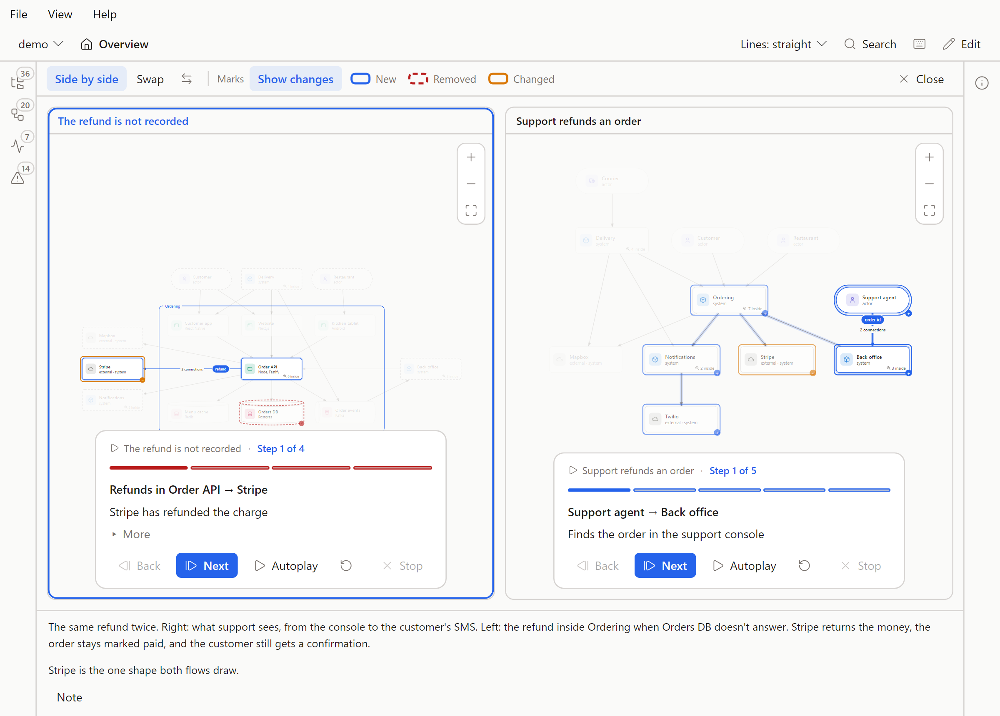
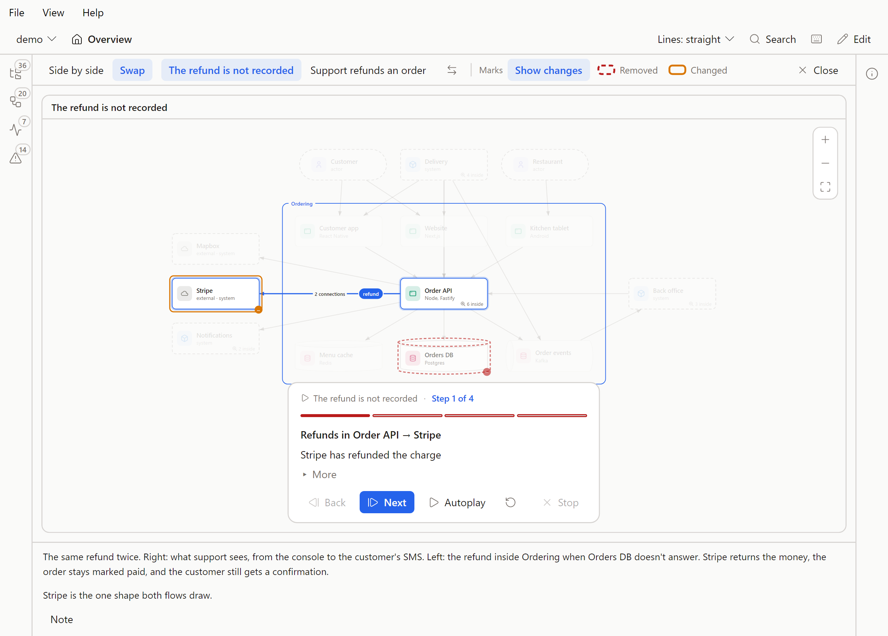

# Compare

Two flows or two load-test runs next to each other, with what changed marked. Part of the [Flowy Docs guide](../guide.md).

## Compare

Compare is for a pair where one replaced the other: a bug and the flow after the fix, an old flow and what took its place, a slow run and a faster one. It opens
two flows (or two runs) in one view, so the difference is something you look at instead of remember.

Plum has two pairs to try. The flow [Support refunds an order](../demo/flowy/flows/refund.yaml) is compared with
[The refund is not recorded](../demo/flowy/flows/refund-not-recorded.yaml), and the run [Orders and pings, tested together](../demo/flowy/perf/together-measured.yaml) with
[Orders and pings, added](../demo/flowy/perf/together.yaml). Press **C** while Support refunds an order plays, or while the Performance tab shows Orders and pings, tested together.

**Opening it.** Every flow row in the Flows tab and the Explorer has a Compare button. On a flow with a link it opens beside the first flow it is linked to; on a flow with none it
opens a picker. **C** does the same for the flow playing. The Compare button on the player card always opens the picker: the flows it is linked to come first, then every other flow
by name, with a field to find one, so any two flows can be put side by side. On the Performance tab, **Compare** (also **C**) does the same for the run on show. A flow that can't
play yet, and a link to something that isn't there (**Missing**), are greyed out in the picker, and Compare is greyed out in edit mode, with the reason in its tooltip.
**Esc** or **Close** gets back to where you were.

## Two ways to look

The bar over the panes picks the view.

**Side by side** puts the two in two panes. Each pane has its own zoom, pan and player, so one flow can be at step 2 while the other is at step 5, and each can
be at its own level (two flows on different views both draw). One Details panel serves both: it shows whatever you clicked last, in either pane. The pane you
clicked last has an outline, and the keys act on it: ← and → step, **Home** and **End** jump, **P** plays, **R** replays, **F** fits that pane. Panes keep their
zoom when the window changes size, so press **F** to fit again.

**Swap** draws one canvas and flips it between the two. **X** (or a click on the other name in the bar) swaps. A shape both flows draw glides to its new place, one only the
new flow draws fades in, and one only the old flow drew fades out. Each flow keeps its own step, so swapping back finds it where you left it. For two runs, which draw the same level, only
the traffic fades. When the system asks for less motion, the swap cuts instead of gliding.

The control with two arrows puts the two on each other's side. The newer flow, the one that holds the tag, reads on the right, and second in Swap.

## Marks

**Show changes** (in the bar, off until you turn it on, and remembered) outlines what differs between two flows. The key beside it draws the outlines that are on screen:

- **New**: only the newer flow has it.
- **Removed**: only the older flow has it.
- **Changed**: both have it, and something differs.

The marks are on shapes, on lines and on the steps in the progress bar. Steps are matched in order by who sends, who receives and the text. A matched step is
Changed when its animation or its description differs. A step with the same ends and different words is Changed too, and a step with no match is New or Removed. A shape or a line both flows draw is Changed
when any step on it is marked.

Two flows with no shape in common have no marks, and the key says **Nothing in common** instead of calling everything changed. Two that match step for step say **No step changes**.
Runs have no marks: **Show changes** is greyed out for them, with the reason in its tooltip.

## The note

A strip under the panes holds a note on the pair, in Markdown. **Note** opens the editor, **Save** writes it, **Cancel** drops what you typed, and **Ctrl+Enter** saves a note on a pair that has a tag. A saved note always shows.
Say what changed and why, in a sentence or two; [Writing good Flowy docs](../writing.md#write-a-comparison-note) has more.

A note is saved with the pair's tag, on the newer flow. Two flows with no tag between them have nowhere to put it, so what you type is a draft that stays until you save or
discard it. **Save as pair** names the flow that will hold the tag and writes the tag with the draft as its note. If that flow already links elsewhere, the confirm says so before it replaces the link. Closing the
comparison with a draft asks first. Each pair keeps its own draft, so a draft on one pair stays when you compare another. Closing the browser tab, or the desktop window, with a draft that was never saved asks too.

A page that can't save (an exported page, or a read-only one) shows the notes and greys the controls out, with "This page can't save" in the tooltip.

## The tag

A pair is one line on the newer flow or run, naming the older one:

```yaml
name: Support refunds an order
view: root
compare: refund-not-recorded
```

With a note, the long form:

```yaml
compare:
  with: refund-not-recorded
  note: |
    The same refund twice. On the right, what support sees.
    On the left, the day Orders DB doesn't answer.
```

A run's file takes the same key: `compare: together`, or `with` and `note`. The holder is the newer one. A tag can't name its own holder, and the id has to be a flow (a run, in a run's file). The check reports a tag that breaks either rule,
and the flow still opens. [The file format](../format.md) lists the key for flows and for runs.

The tag only helps you find things. It limits nothing: any two flows can be opened together, tagged or not, and a flow can be tagged by many. If A and B tag each other the pair is listed once.
A flow in a pair has a link mark in the Flows tab and the Explorer, with **Linked** in the key at the foot of the list. A tag that names a flow that isn't there is listed as **Missing**, greyed out.

## Making a pair

- **In the Flows tab or the Explorer.** Compare on a row of a flow with no link, pick the other flow, and write a note with **Save as pair**. This is the quickest way to tag a flow.
- **In edit mode.** A flow's form has **Compare with**: tiles of the other flows and a field to find one. Picking one writes the tag and keeps the note. **Remove** takes it away, and asks first when a note would go with it. Flows that tag this one are listed under **Compared by**. Deleting a flow takes the tag off the flows that tagged it. If one of those tags holds a note, the delete is refused until that link is removed.
- **In YAML.** Add the `compare` key above to the newer flow, in the YAML tab or in the file.
- **Over MCP.** The `set_compare` tool sets or removes the tag of a flow or a run, with a note. See [AI and MCP](ai.md#let-an-ai-build-it).
- **For runs.** While editing, the Performance tab lists the runs, each with **Link with** and **Unlink**. Looking at a run, the tab has **Compare** and the **Linked** mark, and no link buttons. They write only the `compare` field of the run file, in place, and a tool that writes the run again keeps it. A run called `null` can't be linked.

## In the desktop app

The app has the same bar, panes, marks, key and note, with the same words and the same keys, and it reads and writes the same tags. What differs:

- The picker for a row opens under the tabs of the panel instead of under the row, and a row's Compare button is always there, a little quieter until you point at it.
- The app has no address, so a comparison can't be linked to.
- A run's tag has no Undo, in the app or in the browser.





## Sharing an address

In the browser, a comparison has an address: `#ordering/compare/refund-not-recorded/refund` for two flows, and `#delivery/compare-runs/together/together-measured` for two runs. The first
name is the left pane. Add `/swap` for Swap. The part before it is the level the run panes draw. An address for a comparison that can't open (a flow that can't play, a run that isn't there)
shows a notice and leaves the page as it was.
