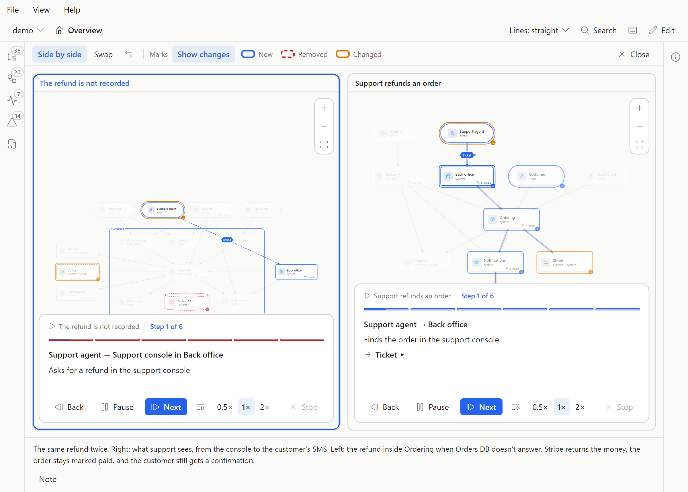
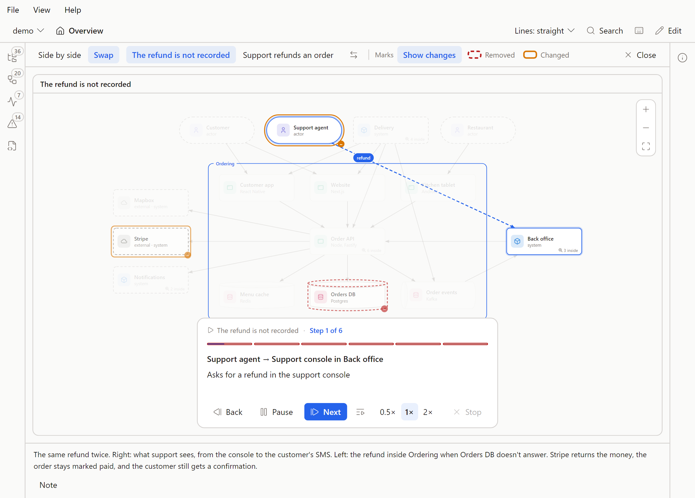

# Compare

The newer one reads on the right, and second in Swap.

## Open it

- Compare on a flow row: beside the first linked flow, else the picker. Its shortcut does this for the flow playing and the run on the Performance tab.
- Compare on the player card or the Performance tab: always the picker, linked ones first, then the rest by name.
- Greyed out: in the picker, a flow that can't play and a Missing tag. Compare itself, while editing or with nothing else to compare.

## Side by side and Swap

- Side by side: each pane has its own zoom, pan, player and level, and one Details panel shows the last click. The pane clicked last has an outline, and the keys act on it. Opening a shape zooms that pane only, the flow still playing, and it zooms back out before the comparison closes.
- Swap: one canvas flips between the two, each keeping its step or place. Shapes both flows draw glide to their new place and the others fade. Two runs draw the same level, so only their traffic fades.
- Swap sides (two arrows): puts the two on each other's side.

## Show changes

Off by default, remembered, flows only.

- New: only the newer flow. Removed: only the older. Changed: both, and it differs. On shapes, lines and progress bar steps.
- Steps match in order by sender, receiver and text. A match is Changed when its animation, description, payload, reply or `via` differs. Leftovers with the same ends pair up as Changed, and the rest are New or Removed.
- A shape or line both flows use is Changed when a step on it is marked.
- `states`, groups, lanes and a step's `flow` aren't compared.
- No shared shape: Nothing in common, no marks. A step-for-step match: No step changes.

## The note

Markdown under the panes, saved in the pair's tag on the newer flow or run.

- With no tag, a note is a draft, kept per pair. Closing the comparison or the window with one asks first.
- Save as pair writes tag and draft on the right-hand one. If that links elsewhere and the other doesn't, the tag goes on the other. If both do, the confirm says which link goes.
- A page that can't save shows notes and greys the controls out.

## Making a pair

A tag limits nothing: any two flows open together, a flow can be tagged by many, and two that tag each other list once.

- Link mark in the Flows tab and Explorer: Compare pair in the key, the partner on pointing. The Performance tab names it beside Compare. A tag to nothing is Missing.
- Compare with, in a flow's form: writes the tag and keeps the note. Remove asks first if a note would go. Compared by lists flows tagging this one.
- Deleting a flow drops the tags on it, and is refused while one holds a note.
- Link with and Unlink, on the Performance tab while editing: set a run's tag.
