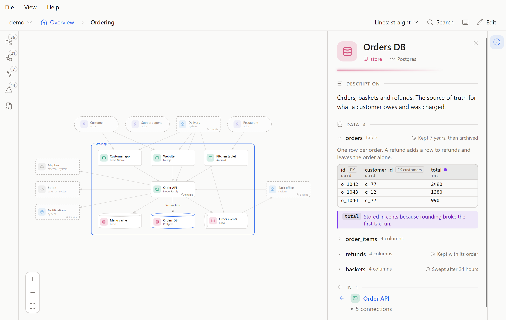

# Data

A store's panel has a **Data** section: a table is column headings over sample rows, a document is its fields, indented. The first entry is open. The others are one line each, with their column or field count and `limits`, and a click opens one. The keys are in [A data entry](../format.md#a-data-entry).



| Mark | Says |
| --- | --- |
| PK | Primary key |
| FK customers | Foreign key to customers |
| NULL | Can be empty |
| Small text under a column name | Its `type` |
| Purple dot | A note on that column or field, under the data on a purple strip, headed by its name |
| Clock | `limits` |

Point at a mark for its full name.

## A document

A `sample` with a note on a nested key:

```yaml
- name: restaurants
  kind: collection
  sample:
    _id: r_42
    name: Noodle Bar
    tags: [ramen, vegan]
    hours:
      mon: 11-22
  notes:
    hours: Hours live inside the profile. They are only ever read with it.
```

## The Data box

In edit mode a store's form has a **Data** box holding the same lines as the file. Leaving the box checks them: a refusal says why and keeps what you typed, and clearing the box removes the data. Saving adds the quotes a cell needs.
