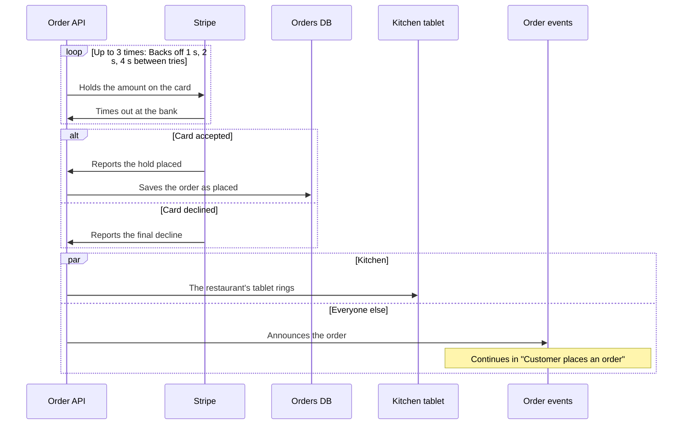
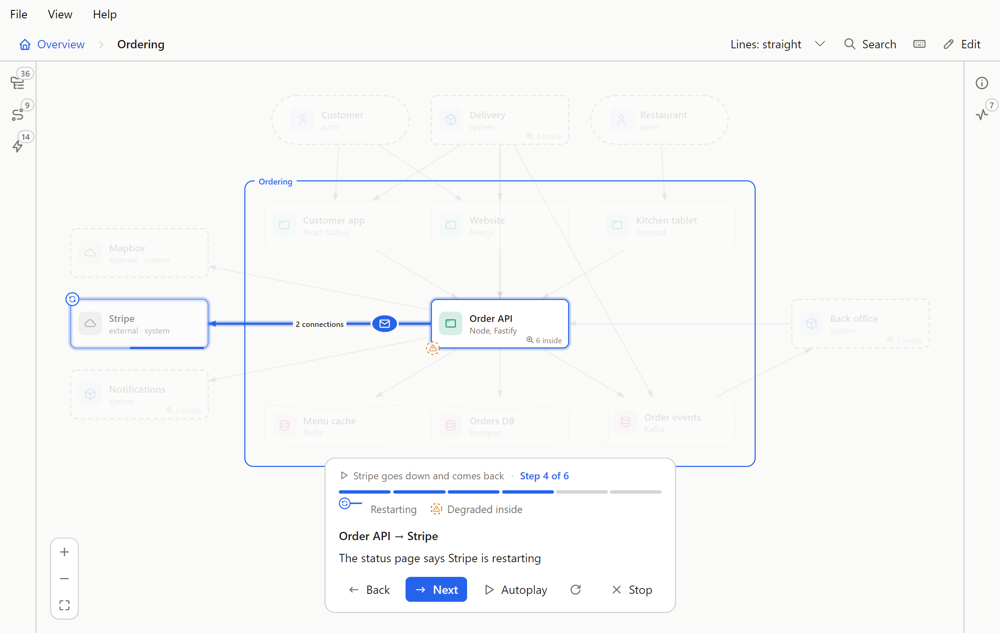
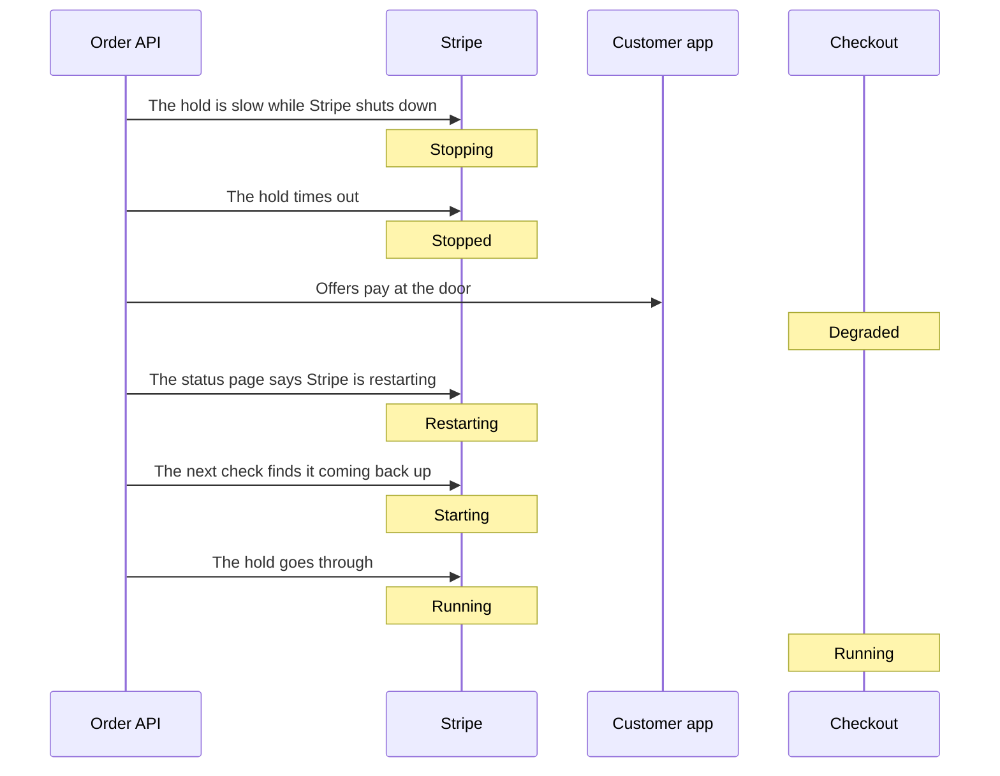

# Flows

How a request ends, repeats, branches and parallel steps, and shape states. Part of the [Flowy Docs guide](../guide.md).

## How a request ends

A step's `animation` can say how its request ends. With no `outcome` the request arrives, and a `call` is answered.

```yaml
- { from: app, to: api, text: The gateway turns the call away, animation: { kind: call, outcome: rejected, reason: Rate limit } }
```

| Outcome | What you see | Valid on |
| --- | --- | --- |
| `fail` | The request runs red and the receiver flashes red | `send`, `call` |
| `timeout` | The sender keeps waiting, nothing comes back, and the line dims | `call` |
| `lost` | The request pops partway along the line and leaves a cross. Nothing arrives, and a caller keeps waiting | `send`, `call`, `event` |
| `rejected` | The request stops at a bar by the receiver and comes back red | `send`, `call`, `event` |
| `intercepted` | The request leaves the line for a third shape, or a dashed marker with a name, which lights | `send`, `call`, `event` |
| `duplicated` | A second copy leaves the first and the receiver takes both in | `send`, `call`, `event` |
| `delayed` | The request waits partway beside a turning dashed clock, then goes on | `send`, `call`, `event` |

A `callback` takes no outcome. The step card says the outcome in a few words, and so does the Mermaid export: "Lost", "Rejected: Rate limit",
"Taken by Café wifi proxy", "Sent twice", "Delayed: Cold start", "30% lost". With reduced motion nothing moves, and the cross, the bar, the clock,
the marker and the reason stay.

These keys go inside `animation`, next to `outcome`:

| Key | What it does |
| --- | --- |
| `reason` | A few words on why: 40 characters at most, on one line. It is drawn where the outcome happens (by the puff, the bar, the clock, or the one who takes the request) and the card says it after the outcome |
| `share` | A whole percent from 1 to 100. Only that share of the requests meet the outcome and the rest arrive. Without it the step plays one request |
| `by` | Needed for `intercepted`, and only there. A shape id that is not an end of the step, or `{ name: Café wifi proxy }` (24 characters at most) for a party that is not in the model. A shape gets a dashed outline, a name gets a dashed marker beside the line |
| `at` | For `lost` only: how far along the line the request vanishes, from 0.1 to 0.9. Without it, 0.55 |

```yaml
- { from: gateway, to: orders, text: A third of the calls are lost, animation: { kind: send, outcome: lost, share: 30, reason: Packet dropped } }
- { from: app, to: api, text: A proxy on the café wifi reads the call, animation: { kind: call, outcome: intercepted, by: { name: Café wifi proxy } } }
```

With `share` the step plays a burst, one request after another: 10 when the share is a multiple of 10, 20 for a multiple of 5,
otherwise 100. Which of them meet the outcome is worked out from the share and spread evenly through the burst, never chosen at random, so the
browser, the desktop app and the tests play the same burst. Those requests are named `r1`, `r2` and so on (or by the step's `carries` word), wear a ring and a colour of their own, and the
others are ordinary deliveries with no name. A duplicated request is one request sent twice, so both copies carry the same name and colour.

The checker names the step and the key. It refuses an outcome on a `callback`, a `share` outside 1 to 100 or with no outcome, a `reason` or a name that is blank,
too long or has a line break, `by` on any other outcome, `intercepted` with no `by`, a `by` that names a shape that does not exist or one of the step's own ends, and an `at` outside 0.1 to 0.9
or on any other outcome.

Claude's `put_flow` takes the same keys, and is told to give a step an outcome only where it really ends that way.

## Repeats, branches and parallel steps

A flow is a flat list of steps, but real systems aren't flat: a call is retried, a result decides what happens next, one shape tells
several others at once, one flow hands the story to another. A flow file can say so, with two optional additions. A `groups:` section
declares each group once, and a step joins a group by its id.

```yaml
name: Customer pays for an order
view: ordering
groups:
  charge:
    kind: repeat
    times: 3
    text: Backs off 1 s, 2 s, 4 s between tries
  outcome:
    kind: branch
  tell:
    kind: parallel
steps:
  - { from: order-api, to: stripe, text: Holds the amount on the card, group: charge }
  - { from: stripe, to: order-api, text: Times out at the bank, group: charge }
  - { from: stripe, to: order-api, text: Reports the hold placed, group: outcome, lane: Card accepted }
  - { from: order-api, to: orders-db, text: Saves the order as placed, group: outcome }
  - { from: stripe, to: order-api, text: Reports the final decline, group: outcome, lane: Card declined }
  - { from: order-api, to: kitchen-tablet, text: The restaurant's tablet rings, group: tell, lane: Kitchen }
  - { from: order-api, to: events, text: Announces the order, group: tell, lane: Everyone else, flow: place-order }
```

This is a flow Plum doesn't have, written with Plum's shapes. A group is one of three kinds:

| Kind | It means | It takes |
| --- | --- | --- |
| `repeat` | The same steps run again | `times` or `until`, and optionally `text` |
| `branch` | Alternatives: one lane happens | Lanes, and optionally `text` |
| `parallel` | Lanes that all happen at once | At least two lanes, and optionally `text` |

- `times` is how many times the stretch runs in all, the first run included, a whole number from 2 to 99. It is a claim about a real
  limit ("the client gives up after 3 tries"), not a number for illustration. `until` says in words what stops a repeat. A repeat
  needs one of the two. Backoff, delays and timeouts aren't data: say them in the group's `text` or in the steps.
- A step's `group` is the group it belongs to, and it is in at most one. The steps of a group have to sit next to each other.
- A step's `lane` starts a lane of a branch or a parallel group, and the steps after it in the same group, up to the next `lane`, belong
  to it. The first step of a branch or parallel group must have one. A lane is a label in plain words ("Card declined"), unique inside
  its group, and a repeat has none. A branch may have a single lane, for "if the coupon is valid, this happens".
- A step's `flow` is the flow its story continues in, for a step whose story is long enough to deserve a flow of its own. A flow can
  point at one that points back, and that is not a problem.
- A group id follows the rule for a flow's id: lowercase letters, digits and dashes.
- There is one level of groups. A group can't sit inside another.

Flowy checks them as it checks everything else, and lists what is wrong in the problem list: a `group` that isn't declared under
`groups`, or a declared one that no step uses, a repeat with neither `times` nor `until`, `times` outside 2 to 99, `times` or `until`
on a branch, a lane on a step with no group or in a repeat, a first step with no lane, two lanes with one label, a parallel group with
fewer than two lanes, a step that sits between two members of a group without belonging to it, and a `flow` that isn't a flow in the
folder. The last means a change that deletes a flow another one points at is refused, as any change that adds a problem is.

**Elsewhere in Flowy.** The checks, and Mermaid. A repeat becomes a `loop` block labelled with every fact it has, a branch an `alt` with
an `else` for each further lane (`opt` when it has one), a parallel group a `par` with an `and` for each further lane, and a step with
`flow:` is followed by a note over its end that names the flow it continues in. The sample above comes out as:



**In the player.** The player steps through *stops*, the things that are on screen at once. Every step is a stop of its own except in
a parallel group, where stop *k* is the *k*-th step of every lane: five one-step lanes are one stop with five lines lit and moving
together, and a lane that has run out simply drops out. The card says where you are: a chip names the group (`Repeats up to 3 times`,
`One of 2`, `At the same time, 2 lanes`), a branch lists its lanes as tabs with yours marked, the group's own `text` follows, and the
progress bar has a cell for each stop, a branch's lanes on rows of their own and a bracket under each group. Point at a cell or a
bracket to read what it means, or press the **?** on the card for a key to all of it. A parallel stop shows a block for each lane. On
the canvas a small label on each lit line says how often it repeats or which lane it is, and the lanes of a branch you are not in
are dashed and faint. A step with `flow:` has an **Open flow** button. It plays that flow on its own level and puts a bar at the top
of the card, *Back to "…", step N*, that returns you to where you were (in the browser, the Back button does the same). The way back
isn't in the address, so a reload drops it. Nothing moves when the system asks for less motion, and the chips, tabs, brackets and labels
stay. A flow with none of these keys reads, plays and exports exactly as it did.

Claude's `put_flow` takes `groups` and a step's `group`, `lane` and `flow` (a `times` may be a number there), and its instructions say when
to reach for each. Edit mode has fields for all of them (see above).

## Shape states

A shape is Running unless a flow says otherwise. A step can say that a shape is coming up, shutting down, off, restarting or not well, and the shape shows it from that step until another step changes it.



| State | Means | On the canvas |
| --- | --- | --- |
| Running | Up and serving | Nothing is drawn |
| Starting | Coming up, not ready | Dimmed, with a dotted outline that circles |
| Stopping | Draining or shutting down | The outline drains and the shape dims |
| Stopped | Off | Dimmed and grey, with a dashed outline and a power symbol |
| Restarting | Down and coming back | Dimmed, with a short arc circling the outline |
| Degraded | Up but not well | A slow pulse in the warning colour, with a warning triangle |

The file holds the lowercase word. A step's `states` maps shape ids to states. Plum's
[stripe-outage](../demo/flowy/flows/stripe-outage.yaml) uses all six:

```yaml
name: Stripe goes down and comes back
view: ordering
steps:
  - { from: order-api, to: stripe, text: The hold is slow while Stripe shuts down, animation: call, states: { stripe: stopping } }
  - { from: checkout, to: stripe, text: The hold times out, animation: { kind: call, outcome: timeout }, states: { stripe: stopped } }
  - { from: checkout, to: customer-app, text: Offers pay at the door, states: { checkout: degraded } }
  - { from: order-api, to: stripe, text: The status page says Stripe is restarting, animation: call, states: { stripe: restarting } }
  - { from: order-api, to: stripe, text: The next check finds it coming back up, animation: call, states: { stripe: starting } }
  - { from: checkout, to: stripe, text: The hold goes through, animation: call, states: { stripe: running, checkout: running } }
```

- A flow's own `states` say where shapes stand before step 1: `states: { stripe: starting }`. Left out, every shape starts Running.
- A step's change holds from that stop until another step changes it, so set a shape back to `running` when it recovers. The state at any stop is worked out from the start and the steps before it, which means stepping back needs no undo and no timer.
- In a parallel stop every lane's change applies, and two lanes that set one shape to different states are a problem. In a branch each lane starts from the state before the branch, and the last lane's changes carry on after it. If a shape's state after a branch matters, set it again in the next step.
- A flow that another flow opens starts from its own `states`, not from where the first one left off.
- At the overview, a shape with no state of its own shows the worst state of what is inside it (Stopped, then Restarting, Degraded, Stopping, Starting) on a dashed ring that reads "Stopped inside". A state of its own shows instead.
- The player card has a key for the states on the canvas now, and Details names the state of the shape it shows. A change takes about 0.6 seconds. Starting and Restarting keep moving, and Degraded pulses, for as long as they are on screen. Nothing moves when the system asks for less motion; the dimming, outline and symbol stay.

Flowy checks it as it checks everything else: an id that isn't a shape, a word that isn't one of the six, `states` that isn't a mapping of ids to words, and two lanes of one parallel stop that disagree. A change that deletes a shape that only a `states` names is refused, as it is for a step's shape.

**Elsewhere in Flowy.** In edit mode a step's form has a **State** section with a row of drawn tiles (None, then the six) for each end of the step, and a pick is one edit; a flow's starting states are written in the file or by Claude. Claude's `put_flow` takes `states` on the flow and on each step, and its instructions say to use them where the story really takes a shape down, brings it up or hurts it. Mermaid writes a note over the shape with the state's name:



A flow with no `states` reads, plays and exports exactly as it did.
