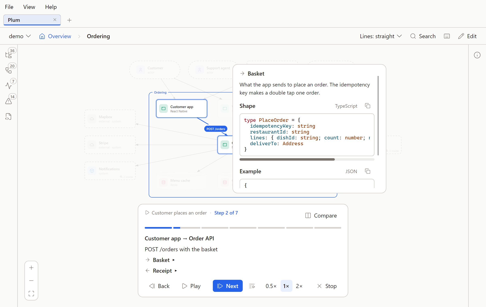
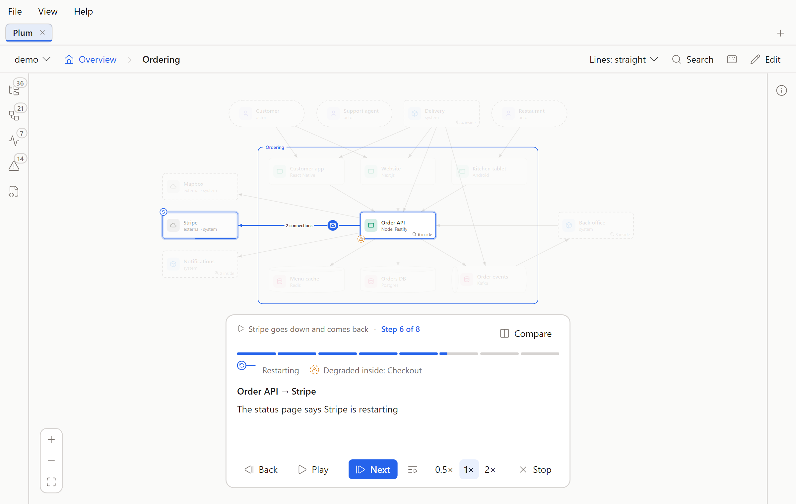

# Flows

## What a step sends

The moving dot shows the `carries` word, else the payload's name. The answer to a `recurse` shows the `returns` word, else the reply's name, and the answer to a `call` the reply's name. The player card lists both, each a row that opens.

Point at a dot while paused, in a pane of a comparison too: a card beside it shows the payload, or the reply on the way back, and stays while the pointer is on it.

## How a step moves

| Kind | What moves |
| --- | --- |
| `send` | An envelope goes one way |
| `call` | An envelope goes and comes back while the sender waits |
| `event` | A bolt goes one way and the receiver flashes |
| `callback` | A bell goes from a ringing shape to the receiver. With `trigger: outside`, what set it off flashes or drops on the sender first |
| `recurse` | A pipe loops out of the shape and back in |

## How a request ends

With no `outcome` the request arrives, and a `call` is answered.

| `outcome` | What happens |
| --- | --- |
| `fail` | Runs red and the receiver flashes red |
| `timeout` | The sender keeps waiting, nothing comes back, and the line dims |
| `lost` | Pops partway and leaves a cross. Nothing arrives, and a caller keeps waiting |
| `rejected` | Stops at a bar by the receiver and comes back red |
| `intercepted` | Leaves the line for `by`, which lights: a shape with a dashed outline, or a dashed marker with its name |
| `duplicated` | A second copy leaves the first, and the receiver takes both in |
| `delayed` | Waits partway beside a turning dashed clock, then goes on |

A `reason` is drawn where the outcome happens and on the player card.

With `share` the step plays a burst, one request after another: 10 when the share is a multiple of 10, 20 for a multiple of 5, otherwise 100. Those that meet the outcome are spread evenly, never at random. They are named `r1`, `r2` and so on, or by `carries`, each with a ring and a colour of its own, and both copies of a `duplicated` request share them. The others are plain deliveries.

## Streams, listeners and jobs

A step's `opens` leaves a mark on every later step until a step `closes` it. It comes and goes as the step's motion lands, with any `name` beside it.

| `opens` | Mark |
| --- | --- |
| `stream` | Dots keep running along the line |
| `listener` | A bell with rings on the shape that listens, and a dotted line to the shape it listens to |
| `job` | An arc keeps turning on the shape the work runs on |

## Which line a step rides

Where a pair has [a line for each connection](sketches.md#several-lines-between-two-shapes), the candidates are the lines of the pair that run the step's way, then the Request and reply and Request then stream lines that run against it, since an answer rides the line of its request. The first of these decides:

1. The `via`, when it matches a candidate
2. The step's `payload`, when a candidate lists it under `payloads`
3. The step's own `from` and `to`, when the step sits between components and the view shows their parents
4. The first candidate in the file

A step with no candidate plays on a dashed line of its own, and so does a step against a one-way line where a pair is one line, whatever its kind. A person a flow names is drawn on its view even where no line reaches them.

- Renaming a connection's label rewrites the `via` of the steps that name it
- A connection a `via` names can't be deleted until those steps change
- While recording a flow in edit mode, a click on a line sets the step's `via`
- In a view with one line for each pair, `via` doesn't change the line, and it must still match a connection

## Repeats, branches and parallel steps

The player moves through stops, one per step, and a branch plays every lane in turn. In a parallel group stop *k* is the *k*-th step of every lane, lit and moving together, and a lane that has run out drops out. A repeat plays once. The card's chip names the group (`Repeats 3 times`, `One of 2`, `At the same time, 2 lanes`), a branch lists its lanes as tabs, and the group's `text` follows.

Open channels and shape states at a stop are worked out from the flow's start and the stops before it. In a branch each lane starts from what stood before the branch, and what the last lane left carries on after it.

On the progress bar a box marks a repeat or a parallel group, dashed for a repeat with `until`, which may stop sooner. A branch forks into a row per lane, the way to your lane in the accent colour and the other lanes hollow. A one-lane branch has a bare line going round it: the lane happens only if its label holds. On the canvas, the lanes you are not in are dashed and faint.

A step with `flow` has an **Open flow** button, which plays that flow on its own level, from its own `states`. A bar on the card leads back to the step, and in the browser so does its Back button. The way back isn't in the address, so a reload drops it.

## Shape states

| State | On the canvas |
| --- | --- |
| Running | Nothing is drawn |
| Starting | Dimmed, a dotted outline circling |
| Stopping | The outline drains and the shape dims |
| Stopped | Dimmed and grey, dashed outline, power symbol |
| Restarting | Dimmed, a short arc circling the outline |
| Degraded | A slow pulse in the warning colour, warning triangle |

At the overview, a shape with no state of its own shows the worst state inside it (Stopped, then Restarting, Degraded, Stopping, Starting) on a dashed ring that reads "Stopped inside".

A step's form has a **State** row of drawn tiles for each end of the step. A flow's starting states have no form: they go in the file or come from an AI.

## Folders and tags

The Flows tab lists flows in their folders under `flows/`, whatever view they play on. A folder lists its folders first, by name, then its flows by file name with numbers read as numbers, so `2-pay` comes before `10-refund`. Of two files with one name, the second is left out.

The tags in use are buttons above the list. One keeps the flows that have it, and several keep the flows that have any of them.
