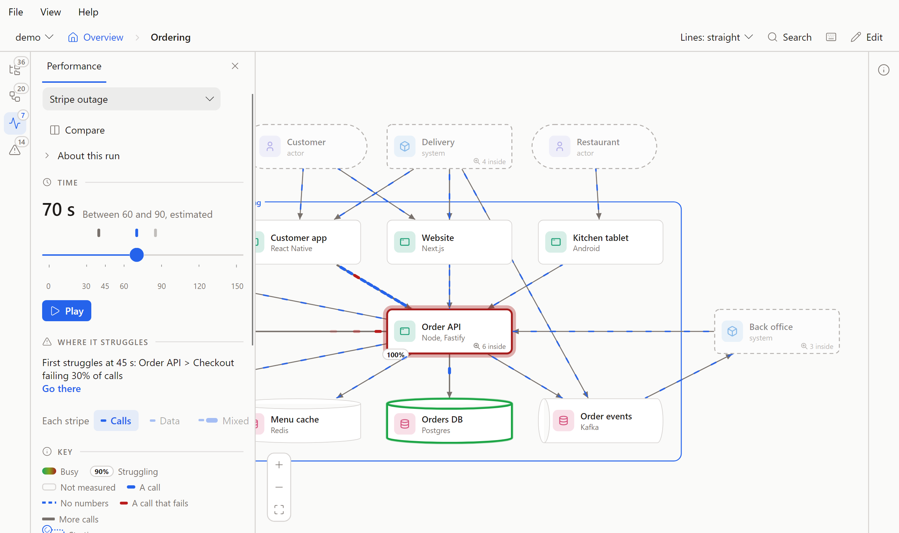
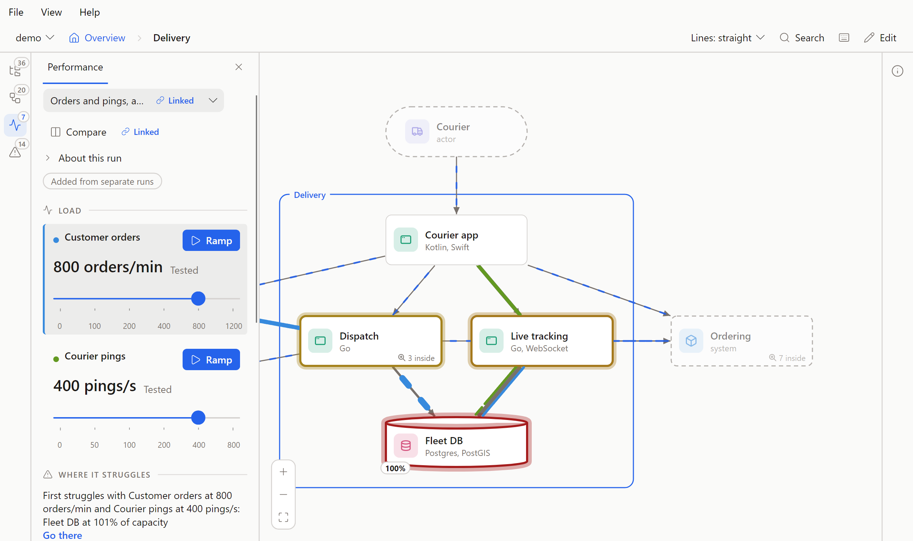

# Performance

Replaying a load test on the diagram. Part of the [Flowy Docs guide](../guide.md).

## Performance

A run is a load test, summarised: for each load that was tested, what each shape and each connection measured. It lives in
`flowy/perf/<name>.yaml` (the name follows the same rule as a flow's file name), and a folder can hold several: a ramp, a spike,
the same test before and after a fix.

```yaml
name: Ramp, 20 s per level
about: Node 22, 4 cores, the load generator on the same machine
unit: req/s
levels:
  - load: 100
    overall: { rate: 98, p50: 60, p95: 140, errors: 0 }
    objects:
      web-api: { util: 0.35, queue: 0, errors: 0 }
    connections:
      - { from: web-api, to: payments, rate: 40, p50: 90, p95: 180, errors: 0 }
  - load: 200
    overall: { rate: 190, p50: 70, p95: 150, errors: 0.01 }
    objects:
      web-api: { util: 0.7, queue: 2, errors: 0 }
    connections:
      - { from: web-api, to: payments, rate: 80, p50: 95, p95: 260, errors: 0.01 }
```

Every number is optional except a level's `load` (or `at`, in a run over time, below). On a shape, `util` is how much of what it can do is in use (0 to 1), `queue` how many are waiting, and
`errors` the share that fail (0 to 1). On a connection, and in `overall` (what the entry point measured), `rate` is calls a
second, `bytes` is how many bytes a call carries (the tab calls it the size of a call), `p50` and `p95` are milliseconds (the tab calls them the expected call and the slowest 5%) and `errors` is the share that fail.
Levels go up in load, and a run needs at least two. A number that isn't there isn't drawn as zero: that shape or line stays
plain. `unit` says what a load counts, and `entry` can name the shape the load comes in at.

Flowy checks a run the way it checks `code:` paths: a shape or connection it names that isn't in the model, or a number that
isn't one, is a problem. A run it can't read at all is a problem too, listed in the Performance tab, and it never stops the model
from loading. Flowy reads runs, and writes only their `compare` field. Tools write the rest of a run file.

**Reading it.** Open the Performance tab on the left edge, or press **T**. Pick a run if there are several. The slider runs from no load up to the highest tested load, and a
tick marks each tested one; drag it anywhere, and it pulls onto a tested load when it comes close to one. ← and → move between tested loads, and **Ramp** (**P**) sweeps up from no load to the
highest, at a pace that would cover the whole run in half a minute. Between two tested loads the numbers are blended from the two, and the tab says so ("Between 200 and 400,
estimated"). Below the first tested load they run down to no load, where nothing is used, queued or called and a call weighs and takes what it does at the first load; that is an
estimate too ("Between 0 and 100, estimated"). A drag draws once a frame at most, so a fast one costs no more than a slow one. Click a shape or a line to read its numbers at this load,
with a small curve of each across all of them. A shape that holds others takes the worst of what is inside it, so at the overview
you see which system is struggling and zoom in to find where. The tab opens on the load where things first struggle, if anything
does, and **Go there** gets back to it. The sentence names the shape the way the canvas draws it, so a part inside Dispatch reads "Dispatch > ETA", and the tooltip of **Go there** says which load it goes to.

**Marks on the canvas.** The tab runs from the controls down: the load, **Where it struggles** (the sentence and **Go there**), **Each stripe**, the **Key**, then the chart and the numbers of what is picked. The key draws only the marks on the canvas now. A run's About note folds under "About this run" once it is over 200 characters, so the load, the sentence and the key stay in view together. A shape's outline runs from green to red as it fills up (**Busy**).
Once a shape is past the point where a run counts as struggling (85% busy) it also wears its percentage, so the fact does not rest on colour alone (**Struggling**); shapes below that carry nothing. A square badge with a number is
**Waiting**: how many calls are queued. It is square so it is not taken for the round badge of a failure mode. A plain outline is **Not measured**.

**The chart.** Under the key, the chart says whose calls it shows (the shape the run's `entry` names, "Calls into Customer app", else "All calls"). Its left edge is time on a log scale ("Time (log)"), so 10 ms, 100 ms and 1 s are evenly
spaced. A blue line is the **Expected call**, an amber one the **Slowest 5%**, red dashes **First struggles**, and the solid grey line is **Now**, the load on the slider. For a screen reader the chart is a list: each tested load with its expected call and its slowest 5%.

**Calls, Data and Mixed.** A call is drawn as a small stripe that runs along its line and sticks out to either side of it. **Each stripe** sets what one stripe stands for, and the tab has three choices, each drawn with its stripe. **Calls** draws one
stripe for each call a second: the more calls, the more stripes and the thicker the line. **Data** draws one for each bit of data a second, the calls times the size of a call (`bytes`), so a line of a few
large calls has more of them than a line of a few small ones, and the size is already in the count, so every stripe is the usual size. **Mixed** counts the calls, as Calls does, and draws each stripe as big as
its call is: twice the bytes is twice the area, against the size of a typical call. Mixed is where a run opens when it gives both a `rate` and `bytes`, which is why a run is best measured with both: say the
calls a second and the size of a call on every connection. A run with `rate` only opens on Calls, and Data and Mixed are greyed out with "No call sizes in this run" in their tooltip. Only the size of a call makes a
stripe bigger: more calls give more stripes and a thicker line, never bigger stripes.

A line the run gives nothing to show, because it has no `rate` (or under Data no `bytes`), is not left plain. It gets a line highlight: blue stripes moving along the line itself, as they do on an animated edge,
and the key calls them **No numbers**. They follow how loaded the run is, the load over the highest tested load (for a run with several sources the mean of its sliders), so they are slow when nothing is asked
of it and quick at the top, even though the line itself has no numbers. A run over time has no load to follow, so its plain stripes keep one pace. At the overview of Plum most lines are plain, since the runs
measure what is inside Delivery, and the lines they do measure show calls.
Data counts against the mean size of a call over the whole run, rounded to 1, 2 or 5 times a power of ten, so a call of that size draws as many stripes under Data as under Calls.

**Colour and scale.** A run can say what its stripes look like and how many there are, so the picture reads as a ratio. Add a `source` at the top
of the file:

```yaml
source:
  color: blue          # a colour name or a hex, like a shape's colour
  dot: rate / 50       # how many stripes are on a line at once
  size: bytes / 400    # how big each stripe is
```

Every key is optional. `color` takes the names a shape's colour does (a named colour is a lighter one in the dark theme) or a hex such as `"#1d9e75"`, which is the
same in both themes. `dot` and `size` are small formulas: numbers, the names `rate` (calls a second), `bytes` (the size of a call) and `p50` (the
expected call, in milliseconds), the signs `+ - * /`, brackets and a minus in front, at most 80 characters. There are no functions, and nothing is run: Flowy reads
the text itself. A formula it can't read is a problem, and the source then keeps the usual stripes, with its colour still applied.

`dot` is the number of stripes on a line at once. `rate / 50` is 2 stripes at 100 calls a second and 20 at 1,000, so ten times the calls is ten times the stripes. Without `dot` they follow the curve
of what the line carries (the calls under Calls and Mixed, the data under Data).
How fast they cross still follows `p50`, so two lines with the same calls and a different `p50` have the same number of stripes, moving at different speeds.
`size` is the area of a stripe: a call with twice the bytes draws a stripe with twice the area, 1 is the usual stripe, and the radius stays between half and two and a half
times the usual one. A line the formula gives no value for (it needs a `bytes` the line doesn't have, say) keeps the usual stripes. Under Mixed with no `size`, the size of the call says it. Under Data
every stripe is the usual size.

The screen holds at most 24 stripes on a line. Past that the line is scaled down to 24 and says so: **Scaled down** in the key, and under the numbers of the line when you click it.
The key also says what one stripe stands for ("1 dot = 50 calls/s", or in KB/s under Data) when `dot` is the rate times a number and nothing else, and draws **Bigger call** when a stripe is bigger or smaller than usual.

`bytes` on a line that several connections land on is their mean, weighted by their `rate`. A connection can also say how its failing share fails, with
`failure: lost` (a failing call pops where it dies) or `failure: rejected` (it runs to the end of the line, stops at a bar and comes back red). Without
`failure` a failing call fades away, as before.

**Runs over time.** A run can be measured over time instead of over load, so an outage and its recovery can be replayed. Say `axis: time`, give each
level an `at` where a load run gives a `load`, and list `events`: things that happen at a time, such as a shape going down.



```yaml
name: Payments killed at 40 s
axis: time
unit: s
events:
  - { at: 40, on: stripe, state: stopped, text: Payments killed }
  - { at: 70, on: stripe, state: starting, text: Restart begins }
  - { at: 85, on: stripe, state: running, text: Answers again }
levels:
  - at: 0
    overall: { rate: 98, p50: 60, p95: 140, errors: 0 }
    objects:
      stripe: { util: 0.4 }
  - at: 45
    objects:
      stripe: { util: 0 }
      checkout: { util: 0.9, errors: 0.6 }
  - at: 120
```

Plum's [stripe-outage](../demo/flowy/perf/stripe-outage.yaml) is a run like this one, and
[every-state-over-time](../showcase/flowy/perf/every-state-over-time.yaml) in the showcase puts a shape in all six states.

- `axis` is `load` or `time`. Left out it is `load`, so a run without it reads, plays and exports exactly as before. A run is one or the other: a time run's levels say `at`
  and a load run's say `load`, and the wrong one is a problem (the run still plays, using the number). `at` is a time in the run's `unit` (seconds if there is none), 0 or more.
  Levels go up in time, and the numbers between two levels are blended as they are for a load.
- An event is `{ at, on, state, text }`: a time inside the run, a shape id, one of the six [states](flows.md#shape-states), and words for the list. Without `text` the row reads
  "Stripe: Stopped". The state of a shape at a time is the latest event at or before it. Of two events at one time the later in the file wins, and a shape with no event yet is Running.
- Events are only for a time run. An event with no time, a time outside the run's first and last time, no shape or an unknown state is a problem and is left out of the run;
  so is `events` on a load run. A shape an event names that the model doesn't have is a problem too, found at the next load, so deleting a shape never breaks a run.

**Playing it.** The tab says **Time** where it said Load, and the slider is linear in time: a level sits where its time is, and a mark above the slider sits where each event
is, in the colour of the state it leaves and with its words when you point at it. The **Events** list under the buttons has a row for each: a ring until the run has got there and a dot after,
with the latest lit. A click on a row or a mark goes there. **Play** (**P**) takes the whole run in half a minute, and ← and → still go from level to level. The shapes
take the state the events leave, a state beats the strain colour, and the key names only the states on screen now. Stepping, Play and a click on an event let a shape ease into its new
state in about 0.6 seconds; dragging the slider changes it at once, so the shapes keep up with the thumb. Nothing moves when the system asks for less motion: there is no Play, and
the states, marks and numbers stay. The address names a level, as it does for a load run: `#ordering/perf/stripe-outage/2`. A failure mode's `run` can name a time run too.

**Several sources.** A system can have more than one source of requests at once, such as customers placing orders while couriers send their position. A run can show several, in
two ways, and the top of the panel says which: **Added from separate runs** or **Tested together**. A run of one source has neither label.



**Added from separate runs.** One run lists the runs it adds, and each of them keeps its own colour and scale:

```yaml
name: Orders and pings, added
adds: [orders-only, pings-climbing]
```

The list takes two to four runs, and a run that adds has no levels of its own. Each run it lists must be a load run that stands alone: not a run over time, not another run that adds, not one tested
with several sources, and not itself. Anything else is a problem that names the run, and the others still play (with fewer than two left, the run is left out). Each added run is a source. Its name
is the run's `name`, its slider runs along the run's own loads, and its colour is the run's `source.color`. A run with no colour takes the first of blue, green, orange and indigo that no other
source draws in, and two sources that name one colour are a problem.

At a setting of the sliders the picture adds what each run says at its own load. A shape's `util` and `queue` add, so a shape can pass 1: its colour stops at full strain and its numbers say
"Added use is over 100%". A line's `rate` adds, `p50`, `p95` and `errors` take the worse, and `bytes` is the mean weighted by `rate`. This is an estimate. Queues grow faster than a sum, so near the
limit it looks calmer than a test with both sources at once would.

**Tested together.** One run with several sources, and a result for each combination that was tested:

```yaml
name: Orders and pings, tested together
sources:
  orders: { name: Customer orders, entry: customer-app, unit: orders/min, color: blue, dot: rate / 4 }
  pings:  { name: Courier pings, entry: courier-app, unit: pings/s, color: green, dot: rate / 20 }
levels:
  - load: { orders: 100, pings: 50 }
    objects:
      fleet-db: { util: 0.13 }
    connections:
      - { from: tracking, to: fleet-db, rate: 58, by: { orders: { rate: 8 }, pings: { rate: 50 } } }
```

A run has two or three sources. Each has a `name` and a `unit`, and may have an `entry` (a shape) and the `color`, `dot` and `size` of a `source`, above. A level's `load` gives a number for every
source. The levels must form a full grid: every load of one source with every load of the others, each once. A combination that is missing is a problem that names it, and the run is left out. Between tested
combinations the numbers are blended along each source in turn, so the middle of a square is the mean of its four corners. Outside the grid nothing is shown: the sliders stop at the highest tested load.

A connection can carry `by`, which splits what the line carries between the sources. Each source gives any of `rate`, `bytes`, `p50` and `errors`, and its dots take its own colour, scale and size. A
source that gives no `rate` carries the whole line when it is the only one named. A line with no `by` draws grey with the usual curve, and the key calls it **Other calls**.

**In the tab.** Each source has a block: its name beside its colour, its load, whether that load was tested ("Tested", or "Between 200 and 400, estimated"), a slider with the tested loads under it, and
its own **Ramp**. The block you moved or clicked last is the active one, marked at its edge. ← →, Home, End and **P** act on it, and the Strip and the small curves are drawn along it, with the others
held where they stand and named above the chart. The tab opens where things first struggle when every source rises from its lowest load to its highest together, each along its own loads, and the
sentence says where each stood: "First struggles with Customer orders at 800 orders/min and Courier pings at 400 pings/s: Fleet DB at 101% of capacity". **Go there** returns to it.

The key draws a swatch and the name of each source on screen, with its scale ("1 dot = 4 calls/s") and **Bigger call** where it has them. A line that sources share has a stream of dots for each, side
by side, in each colour. The limit of 24 dots applies to the busiest source on the line: when it is reached every source on that line is scaled down by the same factor, so a source that sends ten times
the calls still draws ten times the dots, and the key says **Scaled down**.

The address has one place for each source, in the order of the sliders and separated by commas: `#delivery/perf/together/3,2`. A list of the wrong length, or one with something in it that is not a
number, opens at the place the tab opens at. In the desktop app `--at 800,400` puts each source at a load, for a picture.

Plum's [together](../demo/flowy/perf/together.yaml) adds customer orders and courier pings, and [together-measured](../demo/flowy/perf/together-measured.yaml) tests them at once. The showcase has
[added](../showcase/flowy/perf/added.yaml) and [together-grid](../showcase/flowy/perf/together-grid.yaml).

**Comparing runs.** **Compare** (**C**) under the run's name opens it beside another run, side by side or swapped, and, while editing (the Performance tab then lists the runs), **Link with** records the pair in the run's file as a `compare` tag and **Unlink** takes it away.
Plum's [together-measured](../demo/flowy/perf/together-measured.yaml) is linked to [together](../demo/flowy/perf/together.yaml), and the note says what the difference is. See [Compare](compare.md).

**What to remember.** This is a replay. Flowy never predicts a load nobody tested past the highest one, so the slider stops there. (A run tested together has no load-free end: its sliders start at the lowest tested load.) How
strained a shape looks is its `util`, or its failure rate counted twenty times (5% failing is as bad as full), whichever is
worse. A line can pass behind a shape that isn't one of its ends, or under a label, and its dots keep going there as faint, smaller
ghosts. Nothing moves when the system asks for less motion; the colours, thickness, badges and numbers stay. An exported page
carries the runs, so its Performance tab works too. The desktop app reads runs too, with the same panel and keys. In edit mode the
tab is greyed out and **T** does nothing.

**Making one.** Any tool that can write this file works. `perf-lab/` in the Flowy repo is a small shop that really runs, with a
load generator that measures it and writes runs of this shape: `npm run lab:run` makes one, and
`node src/cli.ts --dir perf-lab/flowy` opens it.
