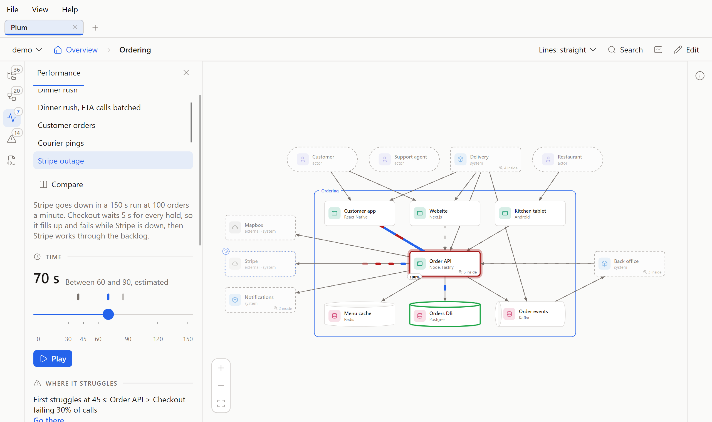
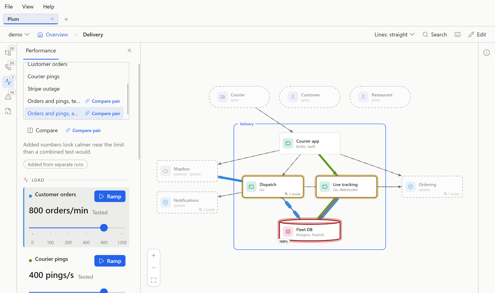

# Performance

A run is a load test summarised: what each shape and line measured at each tested load. Flowy replays it and never predicts past the highest. Any tool can write one, and `npm run lab:run` does from `perf-lab/`.

## Run file

```yaml
name: Ramp, 20 s per level
unit: req/s
levels:
  - load: 100
    overall: { rate: 98, p50: 60, p95: 140, errors: 0 }
    objects:
      web-api: { util: 0.35, queue: 0, errors: 0 }
    connections:
      - { from: web-api, to: payments, rate: 40, bytes: 900, p50: 90, p95: 180, errors: 0 }
  - load: 200
```

| Key | Takes |
| --- | --- |
| `name` | Text. Required |
| `about` | What was tested. Past 200 characters it folds under About this run |
| `unit` | What a load counts. Default `load`, or `s` over time |
| `axis` | `load` or `time`. Left out, `load`. Anything else is a problem |
| `entry` | The shape the load comes in at. The chart then reads "Calls into" it, else "All calls" |
| `levels` | At least two, going up. Each has `load` (0 or more), `overall` (at the entry point), `objects` (shape id to numbers), `connections` |
| `compare` | See [the file format](../format.md) |

| Number | On | Takes | Tab name |
| --- | --- | --- | --- |
| `util` | Shape | Share in use, 0 to 1 | Busy |
| `queue` | Shape | Calls waiting | Waiting |
| `errors` | All | Share failing, 0 to 1 | Failing |
| `rate` | Line, `overall` | Calls a second | Calls |
| `bytes` | Line, `overall` | Bytes in a call | Size of a call |
| `p50` | Line, `overall` | Milliseconds | Expected call |
| `p95` | Line, `overall` | Milliseconds, at least `p50` | Slowest 5% |

A connection also takes `from` and `to`, once per level, then `by` (below) and `failure`: `lost` or `rejected`, how its failing share fails. A merged line keeps it only if those naming one agree.

Numbers are optional, and a missing one stays plain, never zero. An unknown shape or line, a bad number or a line listed twice is a problem, and the rest plays. A file that can't play is listed in the tab and never stops the model loading.

## The tab

- Slider: no load to the highest tested load, with tested loads labelled under it, pulled onto one nearby. Ramp: first to highest tested load in 30 seconds, and from no load at that pace. Play over time: 30 seconds end to end.
- Between tested loads: blended, marked estimated. Below the first: down to no load, with nothing used, queued or called, and a call at its first size and time.
- Shape holding others: the highest Busy and Failing inside, queues added.
- Merged line: `rate` adds, `p50`, `p95` and `errors` take the worst, `bytes` is the mean weighted by `rate`. Both directions land on it.
- Strain: Busy, or Failing times 20, whichever is worse.
- First struggles, where the tab opens: the first tested load with a shape at 85% strain or the overall Slowest 5% at 3 times its first value. If both, the shape is named.
- Chart: time on a log scale. Blue line Expected call, amber line Slowest 5%, red dashes First struggles, solid grey line Now, the slider's load.
- Click a shape or line: its numbers at this load, with a small curve of each across all tested loads.
- While editing: the tab lists runs and shows no numbers.
- Reduced motion: no stripes, Ramp or Play. Colours, thickness, badges and numbers stay.

## Marks

The key draws only the marks on the canvas.

| Name | Mark |
| --- | --- |
| Busy | Outline from green to red: strain |
| Struggling | Percentage on a shape, from 85% strain |
| Waiting | Square badge: calls queued. A round badge is a failure mode |
| Not measured | Plain outline, or grey stripes quickening with the share of the highest load (mean of the sliders), one pace over time |
| A call | Stripe along a line, crossing at a speed set by `p50` |
| A call that fails | Red stripe that fades |
| Lost call | `lost`: red stripe that pops where it dies |
| Rejected call | `rejected`: stripe stopped by a bar, returning red |
| More calls, More data | Thicker line |
| Bigger call | Stripe bigger or smaller than usual |
| Scaled down | A `dot` count past 24 on a line, cut to 24 |
| "1 dot = 50 calls/s" | One stripe's worth, in KB/s under Data, when `dot` is only `rate` times a number |
| None | Faint stripes: a line behind a shape or label |

## Each stripe

| Choice | One stripe for | Size |
| --- | --- | --- |
| Calls | Each call a second | Usual, or `size` |
| Data | Each bit of data a second, calls times size, against the run's mean size rounded to 1, 2 or 5 times a power of ten | Usual |
| Mixed | Each call a second | `size`, else twice the bytes is twice the area against that mean |

A run with `bytes` on a line or in a `by` opens on Mixed, else on Calls with Data and Mixed greyed out. `bytes` on `overall` alone doesn't count. A line with no `rate`, or no `bytes` under Data, shows as Not measured.

## source

| Key | Takes |
| --- | --- |
| `color` | A shape's `color` values. A name lightens in the dark theme, a hex stays |
| `dot` | Formula: stripes on a line at once, `rate / 50`. Left out: a curve of what the line carries |
| `size` | Formula: stripe area, 1 is usual, `bytes / 400`. Radius 0.5 to 2.5 times usual |

A formula takes numbers, `rate`, `bytes`, `p50`, `+ - * /`, brackets and a leading minus, in at most 80 characters, and nothing is run. An unreadable one is a problem: usual stripes, colour kept. A line with no value from it keeps usual stripes.

## Over time

`axis: time`: levels say `at` (in `unit`) for `load`, and the wrong key is a problem but plays. Levels and events need not fall together.



```yaml
events:
  - { at: 40, on: stripe, state: stopped, text: Payments killed }
```

- `state` is one of the [states](flows.md#shape-states). With no `text` the row reads "Stripe: Stopped".
- A shape's state: the latest event so far, the later in the file at one time, Running before any. It beats the strain colour.
- An event with no `at`, no `on`, an `at` outside the run's first and last time or an unknown `state`, or `events` on a load run: a problem, left out. An unknown shape is a problem at the next load.
- Slider: linear, with a mark per event in the colour of the state it leaves. Events rows: a ring until reached, then a dot.

## Added from separate runs



`adds: [orders-only, pings-climbing]` lists two to four other load runs of one source, with no `levels`, `source` or `sources` of its own. A wrong one is a problem that names it, and the rest play. Under two left, the run is left out.

Each is a source with its `name`, loads and `source.color`, else the first of blue, green, orange and indigo unused. Two in one colour are a problem.

Each counts at its own load: `util` and `queue` add, `errors` takes the worst, lines as a merged line. A shape past 1 stops at full strain and reads "Added use is over 100%". The result is an estimate.

## Tested together

```yaml
sources:
  orders: { name: Customer orders, unit: orders/min }
  pings: { name: Courier pings, unit: pings/s }
levels:
  - load: { orders: 100, pings: 50 }
    connections:
      - { from: tracking, to: fleet-db, rate: 58, by: { orders: { rate: 8 }, pings: { rate: 50 } } }
```

- `sources`: two or three, each needing `name`, with `unit` (default `load`), `entry`, `color`, `dot`, `size` optional. The run has no `entry`, `source` or `axis: time`.
- Grid: two or more loads per source, every combination once, so three sources at five loads is 125 tests. A missing one is a problem that names it, and the run is left out.
- Between combinations: blended along each source in turn. Sliders stay between tested loads.
- `by`: any of `rate`, `bytes`, `p50`, `errors` per source. A source named alone falls back to the line's `rate` and `bytes`, any source to its `p50`, and to its `errors` when none gives one. A line with no `by` draws grey: Other calls.

## With several sources

- The source last moved or clicked is active, marked at its edge: keys act on it, the chart follows it, the others hold.
- First struggles: all sources rise together, each along its own loads.
- A shared line draws a stream per source. Past a `dot` count of 24 on the busiest, all on that line scale by one factor.
- The address gives one place per source, in slider order: `#delivery/perf/together/3,2`. A list of the wrong length, or with a non-number, opens where the tab opens.
