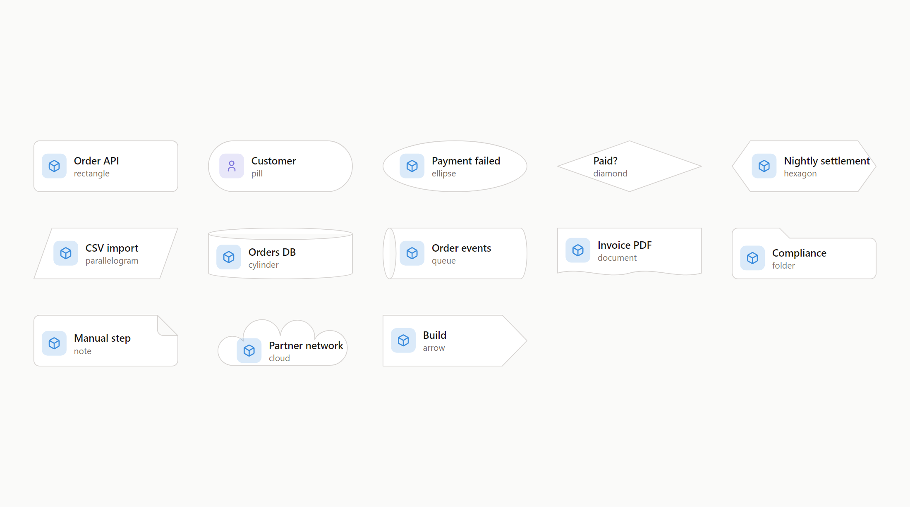

# Shapes, colour and icons

`shape`, `color`, `opacity` and `icon` only change how a shape is drawn, and sit in the **Look** part of its form.

## Which shape for what

| Shape | For |
| --- | --- |
| `rectangle` | What runs or does work |
| `pill` | A person or role, the start or end of a flow |
| `ellipse` | A state or an event |
| `diamond` | A decision with more than one way out |
| `hexagon` | Background work: a worker, a job, a scheduled task |
| `parallelogram` | Data going in or out: an import, an export, a feed |
| `cylinder` | Where data is kept |
| `queue` | Things waiting their turn: a queue, a topic, a backlog |
| `document` | A file or paper someone reads, fills in or signs |
| `folder` | A group that holds others: a team, a package, a shared drive |
| `note` | A remark outside the system: a caveat, an assumption, a to-do |
| `cloud` | The wider world over a network |
| `arrow` | A stage of a process that hands over to the next |

A diamond, an ellipse and a cloud have less room for text.

## Colour

- A colour name has a light and a dark version. A hex is the same in both themes.
- It paints the icon, the outline and the fill.
- On a strong fill, text and icon turn near-black or near-white.

## Icons

Built-in icons come from [Tabler Icons](https://tabler.io/icons). Their names are in the Icon grid of a shape's form, the `put_icon` description and `ICON_GROUPS` in [`src/core/icons.ts`](../../src/core/icons.ts).

There are no colour or image icons.
