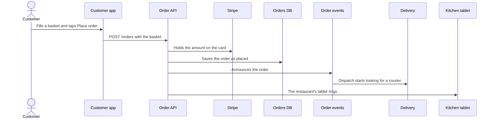

# Check it and share it

The check command, and exporting a read-only site. Part of the [Flowy Docs guide](../guide.md).

## Check it

```bash
node /path/to/flowy-docs/dist/cli.js check
```

`check` prints every problem in the folder, one line each (`flows/checkout.yaml: step 3: unknown object "stripe"`), and exits with 1 if there is any. With
none it says so and exits 0, so a build can gate on it:

```yaml
- run: node /path/to/flowy-docs/dist/cli.js check
```

It reads what the canvas reads: the model, the flows, the failure analyses and the load-test runs, a failure mode whose run doesn't exist, a path in `code:` that
doesn't exist, and a file Flowy skips (`.yml`). It also writes every file back in memory, which reports a file that loads but could not be saved again, such as a
key with no value that an unquoted comma leaves behind. `--dir` picks the model folder. A model or flow file that can't be read at all is the one line it prints.
`export` lists problems on the page and exits 0, and `failures` exits 1 only for the failure files, so `check` is the one to gate on.

## Share it

People without the repo can read the model too:

```bash
node /path/to/flowy-docs/dist/cli.js export
```

It writes a read-only copy of the canvas to `./flowy-site`, with the model inside its `index.html`.
Put the folder on any static host, such as GitHub Pages, and send the link. Browsers won't run it
straight from disk. To show it in Notion or Confluence, embed the link. `--dir` picks the model
folder and `--out` the export folder. An export carries any load-test runs and failure analyses too, and has no YAML tab.

Export again after the model changes. Only what the export wrote is replaced, so a `.git` or a
`CNAME` you keep next to it stays. A folder with other files in it is left alone, and so is one
that holds the model. A file that can't be read stops the export. Problems don't: the page lists
them.

For a README or a pull request, the Mermaid button copies the view on screen (or the flow
playing) as a Mermaid diagram, fenced and ready to paste. GitHub and GitLab draw it. A diamond comes out as a
diamond, a cylinder as a cylinder, and so on, and a colour becomes a `style` line (a folder has no Mermaid shape and stays a
rectangle, and the queue, document, note and cloud shapes need Mermaid 11.3 or later). The same
from the command line, or for an AI through MCP (`get_mermaid`):

```bash
node /path/to/flowy-docs/dist/cli.js mermaid --view ordering
```

`--flow <id>` prints a flow as a sequence diagram instead. A flow's repeats, branches and parallel lanes come out as `loop`, `alt` and
`par` blocks ([above](flows.md#repeats-branches-and-parallel-steps)). This is Customer places an order, from `mermaid --flow place-order`:



The desktop app does the same from **View › Copy as Mermaid**, and **View › Save Picture** saves the diagram as a PNG.

The address follows what's on screen. `#ordering` is the inside of Ordering, and `#ordering/place-order` plays
the flow `place-order` there. Copy it to send someone straight to a level or a flow. The local canvas
does this too.
