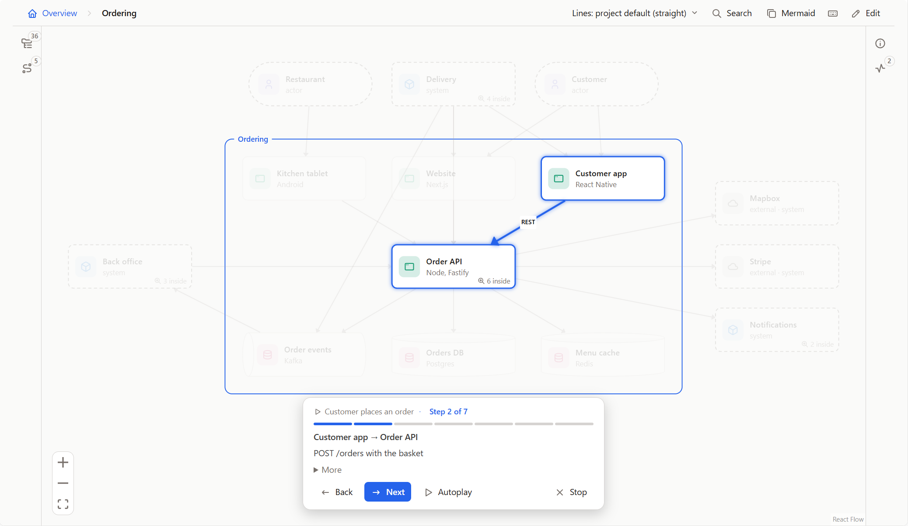

# Flowy Docs for VS Code

Architecture docs you zoom through instead of scrolling through. This extension opens a repo's `flowy/` folder as a
diagram inside VS Code: people, systems, apps, stores and components, how they connect, and step-by-step flows. The model
is plain YAML that sits in git next to the code it describes.



## What you can do

- **Read it.** Run **Flowy: Open Docs**. Double-click a shape to zoom in, point at a line to read its label, click a shape
  for its description, the files it lives in and everything it connects to. The **Flows** tab plays a flow one step at a
  time, with **Autoplay**.
- **Edit it.** Press **E** in the panel to add shapes, rename them, drag them, connect them, write flows, and undo or redo.
  Every edit is written to the YAML files, checked the same way Claude's edits are.
- **Jump to the code.** A path under **Code** opens in the editor beside the panel. A folder shows in the Explorer.
- **Jump from the code.** Right-click a file in the Explorer or the editor and choose **Show This File in the Docs**. The
  panel shows the shape whose `code` lists that file, or the folder it is in. If two shapes list it equally you pick one.
- **Find things from the palette.** **Flowy: Open Flow…** plays a flow you pick. **Flowy: Go to Shape…** shows a shape you
  pick where it is drawn.
- **Stay current.** The panel redraws when a file in `flowy/` changes, whether you saved it, Claude wrote it or the desktop
  app did. It follows your VS Code colour theme, and after VS Code restarts it opens where you left off.

| Command | What it does |
| --- | --- |
| Flowy: Open Docs | Opens the `flowy/` folder in a panel. |
| Flowy: Open Flow… | Plays a flow you pick from a list. |
| Flowy: Go to Shape… | Shows a shape you pick from a list. |
| Flowy: Show This File in the Docs | Shows the shape a file belongs to. Also on the Explorer and editor menus. |

## Getting a model

A model is a `flowy/` folder at the root of your repo: `model.yaml` for the shapes and connections, and `flows/*.yaml` for
walkthroughs. The quickest way to get one is to ask Claude. From the root of the repo, with the Flowy Docs clone built once
(the [README](https://github.com/feluminais/flowy-docs#let-claude-build-it) says how):

```bash
claude mcp add flowy -- node /path/to/flowy-docs/dist/cli.js mcp
```

Then ask it to "map this repo into Flowy". You can also write the files by hand. How, and what to put in them, is in the
[guide](https://github.com/feluminais/flowy-docs/blob/main/docs/guide.md) and
[Writing good Flowy docs](https://github.com/feluminais/flowy-docs/blob/main/docs/writing.md).

If a workspace has no `flowy/` folder at its top, the extension looks for one deeper in the tree, which suits a monorepo,
and asks which to open when it finds several.

## Good to know

- It needs a folder on disk that you trust. Restricted Mode and virtual workspaces (vscode.dev, github.dev) are not
  supported. In Remote-SSH, WSL and Dev Containers the extension runs next to your files, on the remote side.
- Saving rewrites a file, so YAML comments in `flowy/` don't survive. Put notes in a shape's `description`.
- If you have a `flowy/` file open with unsaved changes and edit the model in the panel, VS Code asks which version to keep
  when you save the file.
- The panel keeps no edit history beyond this session's undo and redo.

## Also in the Flowy Docs family

The same folders open in a [native desktop app](https://github.com/feluminais/flowy-docs/releases) and in any browser
(run from a clone of the repo), which can also export a read-only copy for a static host. Source, issues and the full guide:
[github.com/feluminais/flowy-docs](https://github.com/feluminais/flowy-docs).

## License

MIT. The licences of what the extension bundles are in the package: `dist/THIRD-PARTY-LICENSES.md` for its own code and
`media/THIRD-PARTY-LICENSES.md` for the canvas.
